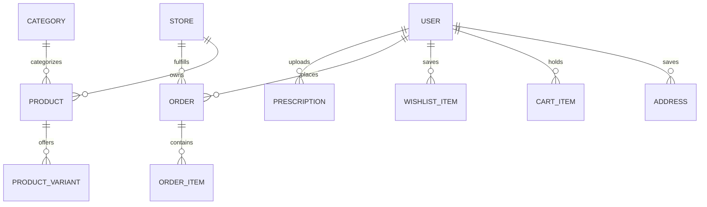

# Fillcart Customer Website — Backend APIs & Database Audit Report

> **Document Type:** Read-Only Engineering & Database Architecture Audit  
> **Target Scope:** Customer Website Backend (`apps/website/backend`) & Storefront Frontend (`apps/website/frontend`)  
> **Auditor:** Antigravity Engineering AI Assistant  
> **Date:** November 26, 2026  
> **Status:** Final Read-Only Audit Baseline  

---

## Executive Summary Table

| Metric / Dimension | Verified Count | Status / Reference |
| :--- | :---: | :--- |
| **Existing Database Tables in Repository** | **19 Tables** | `apps/backend/prisma/schema.prisma` (Central Auth & Security Only) |
| **Existing Customer-Side Tables in Repository** | **0 Tables** | None exist in database schemas or migrations |
| **Proposed New Customer Database Tables** | **15 Tables** | Stores, Categories, Products, Variants, Banners, Offers, Cart, Wishlist, Addresses, Orders, OrderItems, Prescriptions, Contact, Careers, PartnerLeads |
| **Static Content Entities (No DB Mandatory)** | **5 Modules** | Legal terms, About story, How-it-works, Features, Static FAQs (`src/lib/data/`) |
| **Total Proposed Customer APIs** | **34 Endpoints** | Read-Only (11), Authenticated State (15), Checkout & Orders (4), Lead Forms (4) |
| **Verified Hardcoded Products in Frontend** | **126+ Products** | `popularProducts.js`, `homeProductsData.js`, `categoryPageData.js`, `storesData.js` |
| **Verified Hardcoded Stores in Frontend** | **5 Stores** | `apps/website/frontend/src/lib/data/storesData.js` |
| **Verified Hardcoded Categories in Frontend** | **12 Categories** | `apps/website/frontend/src/lib/config/shopByCategory.js` |

---

## Part A: Database Mein Pehle Se Kya Hai

### 1. Repository-Wide Database Files Scan

Following a comprehensive search across the entire repository, the following database and contract files were identified:

1. **Prisma Schema:**
   - **Path:** `apps/backend/prisma/schema.prisma` (358 lines)
   - **Database Provider:** PostgreSQL 16 (`datasource db { provider = "postgresql" }`)
   - **Prisma Client Output:** `apps/backend/src/database/generated/client`
   - **Service Owner:** Central Auth Backend (`@fillcart/backend`)

2. **Database Migrations:**
   - **Directory:** `apps/backend/prisma/migrations/`
   - **Migration History:**
     - `20261118045231_init_central_auth/migration.sql` (Initial core identity tables)
     - `20261118051020_harden_central_auth/migration.sql` (Security hardening)
     - `20261118063408_restrict_admin_config_writes/migration.sql` (Admin privileges)
     - `20261118120000_revoke_runtime_delete/migration.sql` (Hard-delete revocation)
     - `20261118130000_durable_otp_and_rate_limits/migration.sql` (OTP challenges & rate limits)

3. **API Contracts & Specifications:**
   - `packages/api-contracts/openapi/v1/openapi.yaml`: Canonical OpenAPI 3.1 contract (Only defines `/health` and `/health/ready`).
   - `packages/api-contracts/typescript/src/generated/api-schema.ts`: Auto-generated TypeScript types for health probes.
   - `packages/shared-types/src/`: Scaffolding folders with `.gitkeep` for `order`, `product`, `rider`, `user`, `vendor` (No entity schemas implemented).

4. **Architectural Playbook & Governance:**
   - `docs/FILLCART_PROJECT_DEVELOPMENT_PLAYBOOK.md` (Section 1.1, Line 83):
     > *"Business Backends: Domain logic for Orders, Catalog, Payments, Delivery, Inventory, Pricing — Not Implemented Yet (Do NOT build in apps/backend/src/modules/)."*
   - `docs/architecture/central-auth-integration.md` (Section 1):
     > *"Business backends (customer-backend, vendor-backend, rider-backend, admin-backend) are independently developed and must never connect directly to the Central Auth database."*

---

### 2. Complete Inventory of Existing Database Tables (19 Tables)

All 19 tables in PostgreSQL belong exclusively to the **Central Auth Platform**:

| # | Table Name | Columns & Types | Relations | App / Service Owner | Customer Website Relevance |
| :-: | :--- | :--- | :--- | :--- | :--- |
| 1 | **`User`** | `id` (UUID PK), `emailNormalized` (String UQ), `displayEmail` (String?), `fullName` (String), `phone` (String?), `accountType` (Enum: CUSTOMER, VENDOR_APPLICANT, RIDER_APPLICANT, ADMIN), `status` (Enum: ACTIVE, SUSPENDED, DEACTIVATED, PENDING_APPROVAL), `roleId` (FK), `suspensionReason` (String?), `createdAt`, `updatedAt` | Credential[], SessionFamily[], Role, AdminProfileAssignment[], StaffDirectPermission[], AdminInvitation[], AuthAuditLog[] | Central Auth (`apps/backend`) | **HIGH**: Identifies customer user ID, email, full name, phone. |
| 2 | **`Credential`** | `id` (UUID PK), `userId` (FK), `type` (Enum: PASSWORD), `secretHash` (String Argon2id), `failedAttempts` (Int), `lockedUntil` (DateTime?), `lastRotatedAt`, `createdAt`, `updatedAt` | User | Central Auth (`apps/backend`) | **LOW**: Internal password storage; handled solely by Central Auth login. |
| 3 | **`Role`** | `id` (UUID PK), `name` (String UQ: CUSTOMER, VENDOR, RIDER, ADMIN), `description` (String?), `isSystem` (Boolean), `createdAt`, `updatedAt` | User[], RolePermission[], AdminInvitation[] | Central Auth (`apps/backend`) | **LOW**: Internal RBAC. Customer defaults to `CUSTOMER`. |
| 4 | **`Permission`** | `id` (UUID PK), `action` (String), `resource` (String), `description` (String?), `createdAt` | RolePermission[], ProfilePermission[], StaffDirectPermission[] | Central Auth (`apps/backend`) | **NONE**: Internal system permissions. |
| 5 | **`RolePermission`** | `roleId` (FK), `permissionId` (FK), `createdAt` | Role, Permission | Central Auth (`apps/backend`) | **NONE**: Internal RBAC mapping. |
| 6 | **`PermissionProfile`** | `id` (UUID PK), `name` (String UQ), `description` (String?), `isSystem` (Boolean), `createdAt`, `updatedAt` | ProfilePermission[], AdminProfileAssignment[], AdminInvitation[] | Central Auth (`apps/backend`) | **NONE**: Internal staff permission profiles. |
| 7 | **`ProfilePermission`** | `profileId` (FK), `permissionId` (FK), `createdAt` | PermissionProfile, Permission | Central Auth (`apps/backend`) | **NONE**: Internal staff permission mapping. |
| 8 | **`AdminProfileAssignment`** | `id` (UUID PK), `userId` (FK), `profileId` (FK), `assignedBy` (String), `assignedAt`, `revokedAt`, `revokedBy`, `revocationReason` | User, PermissionProfile | Central Auth (`apps/backend`) | **NONE**: Internal Admin operations. |
| 9 | **`StaffDirectPermission`** | `id` (UUID PK), `userId` (FK), `permissionId` (FK), `effect` (Enum: ALLOW, DENY), `grantedBy`, `reason`, `revokedAt`, `revokedBy`, `createdAt` | User, Permission | Central Auth (`apps/backend`) | **NONE**: Internal Staff overrides. |
| 10 | **`AdminInvitation`** | `id` (UUID PK), `emailNormalized`, `roleId` (FK), `profileId` (FK?), `tokenHash` (String UQ), `expiresAt`, `isRevoked`, `acceptedAt`, `invitedById` (FK), `createdAt` | Role, PermissionProfile, User (invitedBy) | Central Auth (`apps/backend`) | **NONE**: Internal Admin invites. |
| 11 | **`SessionFamily`** | `id` (UUID PK), `userId` (FK), `ipAddress`, `userAgent`, `isRevoked`, `revokedAt`, `revocationReason`, `expiresAt`, `createdAt`, `updatedAt` | User, RefreshToken[] | Central Auth (`apps/backend`) | **MEDIUM**: Session tracking; token validation via Central Auth. |
| 12 | **`RefreshToken`** | `id` (UUID PK), `sessionId` (FK), `tokenHash` (String UQ), `replacedByTokenHash`, `isRevoked`, `rotatedAt`, `expiresAt`, `createdAt` | SessionFamily | Central Auth (`apps/backend`) | **LOW**: Internal rolling token rotation. |
| 13 | **`ServiceClient`** | `id` (UUID PK), `serviceIdentifier` (String UQ), `name`, `description`, `status` (Enum: ACTIVE, SUSPENDED, REVOKED), `allowedScopes` (String[]), `createdAt`, `updatedAt` | ServicePublicKey[], ServiceTokenReplay[], AuthAuditLog[] | Central Auth (`apps/backend`) | **LOW**: S2S backend registration (e.g. `customer-backend`). |
| 14 | **`ServicePublicKey`** | `id` (UUID PK), `serviceClientId` (FK), `keyId` (String UQ), `publicKeyPem`, `algorithm`, `isRevoked`, `revokedAt`, `expiresAt`, `createdAt` | ServiceClient | Central Auth (`apps/backend`) | **LOW**: Ed25519 asymmetric S2S keys. |
| 15 | **`ServiceTokenReplay`** | `id` (UUID PK), `serviceClientId` (FK), `jti` (String), `expiresAt`, `consumedAt` | ServiceClient | Central Auth (`apps/backend`) | **NONE**: Anti-replay security for S2S. |
| 16 | **`AdminBootstrapMarker`** | `id` (PK), `bootstrappedAt`, `adminUserId` (FK UQ), `ipAddress` | User | Central Auth (`apps/backend`) | **NONE**: One-time root admin initialization. |
| 17 | **`AuthAuditLog`** | `id` (UUID PK), `actorType` (Enum: USER, SERVICE_CLIENT, SYSTEM_CLI), `actorId`, `actorUserId` (FK?), `actorServiceClientId` (FK?), `targetType`, `targetId`, `targetUserId` (FK?), `action`, `requestId`, `ipAddress`, `userAgent`, `metadata` (Json?), `createdAt` | User (actor/target), ServiceClient | Central Auth (`apps/backend`) | **LOW**: Security auditing logs. |
| 18 | **`OtpChallenge`** | `id` (UUID PK), `phoneNormalized`, `accountType`, `purpose`, `tokenHash`, `attemptsLeft`, `userId`, `sessionId`, `expiresAt`, `cooldownUntil`, `consumedAt`, `deliveryStatus`, `createdAt` | None | Central Auth (`apps/backend`) | **MEDIUM**: Customer phone OTP verification. |
| 19 | **`RateLimitRecord`** | `id` (UUID PK), `key` (String), `timestamp` | None | Central Auth (`apps/backend`) | **LOW**: Distributed auth rate limiting. |

---

### 3. Customer-Side Tables Check
- **Products:** NOT DEFINED in any schema, SQL file, or migration.
- **Stores / Vendors:** NOT DEFINED (Only `AccountType.VENDOR_APPLICANT` exists in Central Auth `User` enum).
- **Categories:** NOT DEFINED in any database schema.
- **Cart / Cart Items:** NOT DEFINED in any database schema.
- **Orders / Order Items:** NOT DEFINED in any database schema.
- **Customer Delivery Addresses:** NOT DEFINED in any database schema.
- **Prescriptions:** NOT DEFINED in any database schema.
- **Offers & Banners:** NOT DEFINED in any database schema.

---

## Part B: Frontend Ko Kya Data Chahiye

Source: Route table in `apps/website/frontend/src/app/routes.jsx`

```
┌─────────────────────────────────────────────────────────────────────────────┐
│                       CUSTOMER FRONTEND ROUTE TABLE                         │
└─────────────────────────────────────────────────────────────────────────────┘
```

### 1. Home Page (`/`)
- **Route & Component:** `/` -> `AppKartHome.jsx`
- **Data/Config Source Files:**
  - `src/lib/data/storesData.js` (`defaultStores`)
  - `src/lib/config/shopByCategory.js` (`SHOP_BY_CATEGORY`)
  - `src/lib/config/popularProducts.js` (`POPULAR_PRODUCTS`)
  - `src/lib/config/homeEssentialsProducts.js` (`HOME_ESSENTIALS_PRODUCTS`)
  - `src/lib/config/dailyCareProducts.js` (`DAILY_CARE_PRODUCTS`)
  - `src/lib/config/chillFrozenProducts.js` (`CHILL_FROZEN_PRODUCTS`)
  - `src/lib/data/homeBannersData.js` (`bannerSlides`)
- **Hardcoded Data & Sample Row:**
  - *Stores (5 items):* `{ id: "store-fresh-mart", name: "Fresh Mart Supermarket", category: "Groceries & Dairy", rating: "4.8", reviews: "340+", distance: "1.2 km", deliveryTime: "20–30 min", img: "https://res.cloudinary.com/...", tag: "Popular Store" }`
  - *Categories (12 items):* `{ id: "cat-1", position: 1, label: "Grocery", to: "/category/grocery", image: "https://res.cloudinary.com/...", color: "#EDF7E8" }`
  - *Popular Products (6 items):* `{ id: "pop-1", slug: "fortune-sunflower-oil", name: "Fortune Sunlite Refined Sunflower Oil", price: 145, mrp: 175, off: "17% OFF", image: "https://res.cloudinary.com/..." }`
- **Access Level:** Public (No login required)
- **Operation:** Read-Only
- **Required Backend APIs:**
  - `GET /api/v1/banners?placement=home_hero`
  - `GET /api/v1/stores?limit=5`
  - `GET /api/v1/categories?featured=true`
  - `GET /api/v1/products?section=popular&limit=6`
  - `GET /api/v1/products?category=home&limit=6`
  - `GET /api/v1/products?category=daily&limit=6`
  - `GET /api/v1/products?category=chill&limit=6`

---

### 2. Stores Listing & Store Detail (`/stores`, `/store/:slug`)
- **Route & Component:**
  - `/stores` (and `/shops`) -> `StoresListingPage.jsx`
  - `/store/:slug` -> `StoreDetailPage.jsx`
- **Data/Config Source Files:**
  - `src/lib/data/storesData.js` (`stores` array: 5 comprehensive store profiles)
- **Hardcoded Data & Sample Row:**
  - *Store Profile:* `{ id: "store-fresh-mart", slug: "fresh-mart", name: "Fresh Mart Supermarket", rating: 4.8, reviewCount: 340, address: "Shop 12, Scheme 54, Vijay Nagar, Indore", distance: "1.2 km", deliveryTime: "20–30 min", minOrder: 99, freeDeliveryAbove: 299, phone: "+91 731 409 8812", openHours: "7:00 AM – 11:00 PM", productsCount: 140, tags: ["Groceries", "Organic", "Dairy"] }`
- **Access Level:** Public
- **Operation:** Read-Only (with search and category filtering)
- **Required Backend APIs:**
  - `GET /api/v1/stores` (Query params: `lat`, `lng`, `search`, `category`, `limit`, `page`)
  - `GET /api/v1/stores/:slug` (Response: Store details, catalog summary, ratings)
  - `GET /api/v1/stores/:slug/products` (Response: Paginated store catalog)

---

### 3. Catalog, Categories & Search (`/category/:slug`, `/search`)
- **Route & Component:**
  - `/category/:slug` -> `CategoryListingPage.jsx`
  - `/search` -> `SearchResultsPage.jsx`
  - `/categories`, `/groceries`, `/category` -> Redirects to `/category/grocery`
- **Data/Config Source Files:**
  - `src/lib/data/categoryPageData.js` (`categoryPages` dictionary: 10 category sets, 80+ products)
  - `src/lib/data/productLookup.js` (`getAllProducts()`, `findProductBySlugOrId()`)
  - `src/lib/utils/searchUtils.js`
- **Hardcoded Data & Sample Row:**
  - *Category Page Entry:* `{ name: "Grocery", slug: "grocery", hero: { title: "Grocery & Kitchen Essentials", subtitle: "Daily essentials delivered in 10-30 mins" }, subcategories: ["Atta & Flours", "Rice & Grains", "Dals & Pulses", "Edible Oils"], filters: { brands: ["Fortune", "Tata", "Aashirvaad"] }, products: [...] }`
- **Access Level:** Public
- **Operation:** Read-Only
- **Required Backend APIs:**
  - `GET /api/v1/categories` (Returns all active categories & subcategories)
  - `GET /api/v1/categories/:slug` (Returns category metadata, banner, and subcategories)
  - `GET /api/v1/products` (Query params: `category`, `search`, `store`, `minPrice`, `maxPrice`, `sortBy`, `limit`, `page`)

---

### 4. Product Detail (`/product/:slug`, `/product/:id`)
- **Route & Component:** `/product/:slug` / `/product/:id` -> `ProductDetailPage.jsx`
- **Data/Config Source Files:**
  - `src/lib/data/productDetailData.js` (`getProductDetail()`, `defaultReviewsData`, `defaultFaqsData`, `relatedProducts`)
  - `src/lib/data/productLookup.js`
- **Hardcoded Data & Sample Row:**
  - *Product Detail:* `{ id: "prod-1", slug: "fortune-sunflower-oil", name: "Fortune Sunlite Refined Sunflower Oil", brand: "Fortune", price: 145, mrp: 175, unit: "1 L", inStock: true, rating: 4.8, reviewCount: 412, description: "...", variants: [{ size: "1 L", price: 145 }, { size: "5 L Can", price: 710 }], images: ["https://res.cloudinary.com/..."], nutritionalInfo: { energy: "900 kcal", fat: "100g" } }`
- **Access Level:** Public
- **Operation:** Read-Only (Add-to-cart & Wishlist triggers writes)
- **Required Backend APIs:**
  - `GET /api/v1/products/:slug` (Returns full product specifications, pack variants, gallery)
  - `GET /api/v1/products/:slug/related` (Returns related/frequently bought together items)
  - `GET /api/v1/products/:slug/reviews` (Returns paginated customer reviews)

---

### 5. Cart (`/cart`)
- **Route & Component:** `/cart` -> `CartPage.jsx`
- **Data/Config Source Files:**
  - `src/lib/context/CartContext.jsx`
  - `src/features/cart/CartPage.jsx` (Order history fallback, Tip selection, Delivery schedule)
- **Hardcoded Data & Sample Row:**
  - *Cart Item:* `{ id: "pop-1", name: "Fortune Sunlite Refined Sunflower Oil", price: 145, mrp: 175, quantity: 2, image: "https://res.cloudinary.com/...", store: "Fresh Mart Supermarket" }`
  - *Bill Summary Calculations:* Items Total, Delivery Fee (Free above ₹299, else ₹30), Platform Handling Fee (₹5), Delivery Partner Tip (₹0, ₹20, ₹30, ₹50).
- **Access Level:** Hybrid (Guest cart stored locally in localStorage; syncs to database upon login)
- **Operation:** Read & Write (Add item, update quantity, remove item, apply coupon, clear cart)
- **Required Backend APIs:**
  - `GET /api/v1/cart` (Fetch authenticated user's persistent cart)
  - `POST /api/v1/cart` (Save or sync local cart array)
  - `POST /api/v1/cart/items` (Add or increment an item: `{ productId, quantity, variantId }`)
  - `PATCH /api/v1/cart/items/:id` (Update item quantity: `{ quantity }`)
  - `DELETE /api/v1/cart/items/:id` (Remove item)
  - `DELETE /api/v1/cart` (Clear entire cart)

---

### 6. Wishlist (`/wishlist`)
- **Route & Component:** `/wishlist` -> `WishlistPage.jsx`
- **Data/Config Source Files:**
  - `src/lib/context/WishlistContext.jsx`
- **Hardcoded Data & Sample Row:**
  - *Wishlist Item:* `{ id: "pop-1", name: "Fortune Sunlite Refined Sunflower Oil", price: 145, mrp: 175, image: "https://res.cloudinary.com/...", wishlistedAt: "2026-11-26T10:00:00Z" }`
- **Access Level:** Requires Login (Prompts `setShowLoginModal(true)` if guest)
- **Operation:** Read & Write (Toggle item, remove item, move item to cart)
- **Required Backend APIs:**
  - `GET /api/v1/wishlist` (Fetch user's saved wishlist items)
  - `POST /api/v1/wishlist/:productId` (Add product to wishlist)
  - `DELETE /api/v1/wishlist/:productId` (Remove product from wishlist)

---

### 7. Payment Offers (`/offers/payment`, `/payment-offers`)
- **Route & Component:** `/offers/payment` -> `PaymentOffersPage.jsx`
- **Data/Config Source Files:**
  - `src/lib/data/paymentOffersData.js` (`bankOffers`, `walletOffers`, `upiOffers`)
- **Hardcoded Data & Sample Row:**
  - *Offer Card:* `{ id: "off-hdfc-01", bank: "HDFC Bank", code: "HDFC100", title: "Flat ₹100 Instant Discount", minOrder: 999, discount: "₹100", validity: "Valid till 30 Nov 2026", description: "Applicable on HDFC Credit & Debit Cards on orders above ₹999." }`
- **Access Level:** Public
- **Operation:** Read-Only
- **Required Backend APIs:**
  - `GET /api/v1/offers` (Query params: `category`, `type=bank|wallet|upi`)

---

### 8. Customer Profile & Addresses (`/profile/*`)
- **Routes & Components:**
  - `/profile/orders` -> `ProfileOrders.jsx`
  - `/profile/addresses` -> `ProfileAddresses.jsx`
  - `/profile/prescriptions` -> `ProfilePrescriptions.jsx`
  - `/profile/account` -> `ProfileAccount.jsx`
  - `/profile/:tab` -> `UserProfilePage.jsx`
- **Data/Config Source Files:**
  - `MOCK_ORDERS` in `ProfileOrders.jsx` (3 orders)
  - `MOCK_ADDRESSES` in `ProfileAddresses.jsx` (2 addresses)
  - `MOCK_PRESCRIPTIONS` in `ProfilePrescriptions.jsx` (3 prescription files)
- **Hardcoded Data & Sample Rows:**
  - *Order:* `{ id: "ord-101", orderNumber: "FC-84920", vendorName: "City Artisan Bakery", status: "Delivered", total: 450, createdAt: "2026-11-15T10:30:00Z", items: [{ name: "Sourdough Bread Loaf", quantity: 1, price: 180 }] }`
  - *Address:* `{ id: "addr-1", label: "Home", name: "John Doe", phone: "+91 98765 43210", addressLine1: "Flat 402, Sunshine Heights", city: "Indore", state: "Madhya Pradesh", pincode: "452010", isDefault: true }`
  - *Prescription:* `{ id: "rx-1", doctorName: "Dr. Arvind Mehta", uploadDate: "14 Nov 2026", status: "Verified", fileUrl: "https://..." }`
- **Access Level:** Requires Login (Authenticated User)
- **Operation:** Read & Write (Addresses CRUD, profile update, prescription upload, cancel order)
- **Required Backend APIs:**
  - `GET /api/v1/customer/profile` (Fetch customer account details)
  - `PUT /api/v1/customer/profile` (Update name, phone)
  - `GET /api/v1/customer/addresses` (List saved addresses)
  - `POST /api/v1/customer/addresses` (Create address)
  - `PUT /api/v1/customer/addresses/:id` (Update address)
  - `DELETE /api/v1/customer/addresses/:id` (Delete address)
  - `PATCH /api/v1/customer/addresses/:id/default` (Mark default)
  - `GET /api/v1/customer/orders` (Fetch order history)
  - `GET /api/v1/customer/orders/:id` (Fetch order detail)
  - `POST /api/v1/customer/orders` (Place order)
  - `GET /api/v1/customer/prescriptions` (List uploaded prescriptions)
  - `POST /api/v1/customer/prescriptions` (Upload prescription document)

---

### 9. Static & Content Pages
- **Routes & Components:**
  - `/about` -> `AboutPage.jsx` (Company story, values, stats from `pagesContent.js`)
  - `/features` -> `FeaturesPage.jsx` (Value propositions from `pagesContent.js`)
  - `/how-it-works` -> `HowItWorksPage.jsx` (3-step visual delivery guide from `pagesContent.js`)
  - `/subscriptions` -> `SubscriptionPage.jsx` (Subscription simulation and FAQ)
  - `/support`, `/faq`, `/help` -> `SupportPage.jsx` (24 FAQs across 6 categories from `faqData.js`)
  - `/terms`, `/privacy` -> `LegalPage.jsx` (Terms of service & privacy policy from `legalData.js`)
  - `/blog` -> `BlogPage.jsx` (Mock articles from `pagesContent.js`)
  - `/careers` -> `CareersPage.jsx` (4 jobs + application form modal)
  - `/contact` -> `ContactPage.jsx` (Offices from `contactData.js` + inquiry form)
  - `/become-vendor`, `/partner/vendor` -> `BecomeVendorPage.jsx` (Merchant lead capture form)
  - `/become-rider`, `/partner/rider` -> `BecomeRiderPage.jsx` (Rider lead capture form)
- **Access Level:** Public
- **Operation:**
  - Read-Only for content.
  - Write for Forms:
    - Contact message submission: `POST /api/v1/contact`
    - Career job application: `POST /api/v1/careers/apply`
    - Vendor lead capture: `POST /api/v1/leads/vendor`
    - Rider lead capture: `POST /api/v1/leads/rider`

---

## Part C: Proposed Customer Database Tables (15 Tables)

To support the frontend features identified in Part B, the following normalized database schema is required.



### Table 1: `Store`
- **Columns:**
  - `id`: UUID (PK)
  - `slug`: VARCHAR(100) (UQ)
  - `name`: VARCHAR(150)
  - `category`: VARCHAR(100) (e.g. "Groceries & Dairy")
  - `rating`: DECIMAL(2,1) (Default: 4.8)
  - `reviewCount`: INT (Default: 0)
  - `address`: TEXT
  - `latitude`: DECIMAL(10,8)
  - `longitude`: DECIMAL(11,8)
  - `deliveryTimeMin`: INT (e.g. 20)
  - `deliveryTimeMax`: INT (e.g. 30)
  - `minOrderAmount`: DECIMAL(10,2) (Default: 0)
  - `freeDeliveryThreshold`: DECIMAL(10,2) (Default: 299.00)
  - `phone`: VARCHAR(20)
  - `openHours`: VARCHAR(100)
  - `coverImageUrl`: TEXT
  - `logoImageUrl`: TEXT
  - `isActive`: BOOLEAN (Default: true)
  - `createdAt`, `updatedAt`: TIMESTAMP
- **Keys:** PK (`id`), Unique (`slug`), Indexes (`slug`, `isActive`, `latitude`, `longitude`)
- **Required By:** `/`, `/stores`, `/store/:slug`, `/cart`
- **Status in Part A:** **NEW (Not in database)**

---

### Table 2: `Category`
- **Columns:**
  - `id`: UUID (PK)
  - `slug`: VARCHAR(100) (UQ)
  - `name`: VARCHAR(100)
  - `subtitle`: VARCHAR(200)
  - `position`: INT (Ordering 1..12)
  - `iconName`: VARCHAR(50)
  - `imageUrl`: TEXT
  - `colorToken`: VARCHAR(50) (e.g. "--cat-1")
  - `isFeatured`: BOOLEAN (Default: false)
  - `isActive`: BOOLEAN (Default: true)
  - `createdAt`, `updatedAt`: TIMESTAMP
- **Keys:** PK (`id`), Unique (`slug`), Index (`position`)
- **Required By:** `/`, `/categories`, `/category/:slug`
- **Status in Part A:** **NEW (Not in database)**

---

### Table 3: `Product`
- **Columns:**
  - `id`: UUID (PK)
  - `slug`: VARCHAR(150) (UQ)
  - `storeId`: UUID (FK -> `Store.id`)
  - `categoryId`: UUID (FK -> `Category.id`)
  - `name`: VARCHAR(200)
  - `brand`: VARCHAR(100)
  - `price`: DECIMAL(10,2)
  - `mrp`: DECIMAL(10,2)
  - `unit`: VARCHAR(50) (e.g. "1 kg", "500 ml")
  - `description`: TEXT
  - `rating`: DECIMAL(2,1) (Default: 4.8)
  - `reviewCount`: INT (Default: 0)
  - `inStock`: BOOLEAN (Default: true)
  - `countInStock`: INT (Default: 50)
  - `primaryImageUrl`: TEXT
  - `galleryImageUrls`: JSONB (Array of image URLs)
  - `nutritionalInfo`: JSONB (Optional key-value map)
  - `tags`: TEXT[] (Array of search tags)
  - `isPopular`: BOOLEAN (Default: false)
  - `isHomeEssential`: BOOLEAN (Default: false)
  - `isDailyCare`: BOOLEAN (Default: false)
  - `isFrozen`: BOOLEAN (Default: false)
  - `isActive`: BOOLEAN (Default: true)
  - `createdAt`, `updatedAt`: TIMESTAMP
- **Keys:** PK (`id`), Unique (`slug`), FK (`storeId`), FK (`categoryId`), Indexes (`categoryId`, `storeId`, `isPopular`)
- **Required By:** `/`, `/category/:slug`, `/product/:slug`, `/search`, `/store/:slug`
- **Status in Part A:** **NEW (Not in database)**

---

### Table 4: `ProductVariant`
- **Columns:**
  - `id`: UUID (PK)
  - `productId`: UUID (FK -> `Product.id` ON DELETE CASCADE)
  - `size`: VARCHAR(50) (e.g. "500 ml", "1 L", "5 kg Bag")
  - `price`: DECIMAL(10,2)
  - `mrp`: DECIMAL(10,2)
  - `inStock`: BOOLEAN (Default: true)
- **Keys:** PK (`id`), FK (`productId`)
- **Required By:** `/product/:slug`
- **Status in Part A:** **NEW (Not in database)**

---

### Table 5: `Banner`
- **Columns:**
  - `id`: UUID (PK)
  - `placement`: VARCHAR(50) (e.g. "home_hero", "category_hero", "promo_row")
  - `title`: VARCHAR(150)
  - `subtitle`: VARCHAR(250)
  - `tag`: VARCHAR(50)
  - `imageUrl`: TEXT
  - `targetUrl`: VARCHAR(255)
  - `displayOrder`: INT (Default: 0)
  - `isActive`: BOOLEAN (Default: true)
  - `expiresAt`: TIMESTAMP (Nullable)
- **Keys:** PK (`id`), Index (`placement`, `isActive`, `displayOrder`)
- **Required By:** `/`, `/category/:slug`
- **Status in Part A:** **NEW (Not in database)**

---

### Table 6: `PaymentOffer`
- **Columns:**
  - `id`: UUID (PK)
  - `type`: VARCHAR(30) (Enum: BANK, WALLET, UPI)
  - `partnerName`: VARCHAR(100) (e.g. "HDFC Bank", "Paytm")
  - `code`: VARCHAR(50) (e.g. "HDFC100")
  - `title`: VARCHAR(150)
  - `discountText`: VARCHAR(50) (e.g. "Flat ₹100 Off")
  - `minOrder`: DECIMAL(10,2)
  - `description`: TEXT
  - `validUntil`: TIMESTAMP
  - `isActive`: BOOLEAN (Default: true)
- **Keys:** PK (`id`), Index (`type`, `isActive`)
- **Required By:** `/offers/payment`, `/cart`
- **Status in Part A:** **NEW (Not in database)**

---

### Table 7: `CartItem`
- **Columns:**
  - `id`: UUID (PK)
  - `userId`: UUID (FK -> `User.id` in Central Auth)
  - `productId`: UUID (FK -> `Product.id`)
  - `variantId`: UUID (Nullable FK -> `ProductVariant.id`)
  - `quantity`: INT (Default: 1)
  - `createdAt`, `updatedAt`: TIMESTAMP
- **Keys:** PK (`id`), FK (`productId`), FK (`variantId`), Unique (`userId`, `productId`, `variantId`)
- **Required By:** `/cart`, Navbar Header Counter
- **Status in Part A:** **NEW (Not in database)**

---

### Table 8: `WishlistItem`
- **Columns:**
  - `id`: UUID (PK)
  - `userId`: UUID (FK -> `User.id` in Central Auth)
  - `productId`: UUID (FK -> `Product.id`)
  - `createdAt`: TIMESTAMP
- **Keys:** PK (`id`), FK (`productId`), Unique (`userId`, `productId`)
- **Required By:** `/wishlist`, `/product/:slug`
- **Status in Part A:** **NEW (Not in database)**

---

### Table 9: `Address`
- **Columns:**
  - `id`: UUID (PK)
  - `userId`: UUID (FK -> `User.id` in Central Auth)
  - `label`: VARCHAR(30) (e.g. "Home", "Work", "Other")
  - `recipientName`: VARCHAR(100)
  - `phone`: VARCHAR(20)
  - `addressLine1`: VARCHAR(255)
  - `addressLine2`: VARCHAR(255) (Nullable)
  - `locality`: VARCHAR(100)
  - `city`: VARCHAR(100) (Default: "Indore")
  - `state`: VARCHAR(100) (Default: "Madhya Pradesh")
  - `pincode`: VARCHAR(10)
  - `latitude`: DECIMAL(10,8) (Nullable)
  - `longitude`: DECIMAL(11,8) (Nullable)
  - `isDefault`: BOOLEAN (Default: false)
  - `createdAt`, `updatedAt`: TIMESTAMP
- **Keys:** PK (`id`), Index (`userId`)
- **Required By:** `/profile/addresses`, `/cart`, Navbar Address Selector
- **Status in Part A:** **NEW (Not in database)**

---

### Table 10: `Order`
- **Columns:**
  - `id`: UUID (PK)
  - `orderNumber`: VARCHAR(30) (UQ, e.g. "FC-84920")
  - `userId`: UUID (FK -> `User.id` in Central Auth)
  - `storeId`: UUID (FK -> `Store.id`)
  - `addressId`: UUID (FK -> `Address.id`)
  - `status`: VARCHAR(30) (Enum: PENDING, CONFIRMED, PROCESSING, OUT_FOR_DELIVERY, DELIVERED, CANCELLED)
  - `subtotal`: DECIMAL(10,2)
  - `deliveryFee`: DECIMAL(10,2)
  - `handlingFee`: DECIMAL(10,2) (Default: 5.00)
  - `tipAmount`: DECIMAL(10,2) (Default: 0.00)
  - `discountAmount`: DECIMAL(10,2) (Default: 0.00)
  - `total`: DECIMAL(10,2)
  - `paymentMethod`: VARCHAR(30) (Enum: UPI, CARD, NETBANKING, CASH_ON_DELIVERY)
  - `paymentStatus`: VARCHAR(30) (Enum: PENDING, PAID, FAILED, REFUNDED)
  - `deliverySlot`: VARCHAR(100)
  - `createdAt`, `updatedAt`: TIMESTAMP
- **Keys:** PK (`id`), Unique (`orderNumber`), Index (`userId`), FK (`storeId`), FK (`addressId`)
- **Required By:** `/profile/orders`, `/cart` (Checkout)
- **Status in Part A:** **NEW (Not in database)**

---

### Table 11: `OrderItem`
- **Columns:**
  - `id`: UUID (PK)
  - `orderId`: UUID (FK -> `Order.id` ON DELETE CASCADE)
  - `productId`: UUID (FK -> `Product.id`)
  - `productName`: VARCHAR(200)
  - `variantSize`: VARCHAR(50) (Nullable)
  - `price`: DECIMAL(10,2)
  - `quantity`: INT
  - `total`: DECIMAL(10,2)
  - `productImageUrl`: TEXT
- **Keys:** PK (`id`), FK (`orderId`), FK (`productId`)
- **Required By:** `/profile/orders`, Order Detail
- **Status in Part A:** **NEW (Not in database)**

---

### Table 12: `Prescription`
- **Columns:**
  - `id`: UUID (PK)
  - `userId`: UUID (FK -> `User.id` in Central Auth)
  - `doctorName`: VARCHAR(150)
  - `notes`: TEXT (Nullable)
  - `fileUrl`: TEXT
  - `medicinesCount`: INT (Default: 0)
  - `status`: VARCHAR(30) (Enum: PENDING_REVIEW, VERIFIED, REJECTED, EXPIRED)
  - `createdAt`: TIMESTAMP
- **Keys:** PK (`id`), Index (`userId`)
- **Required By:** `/profile/prescriptions`
- **Status in Part A:** **NEW (Not in database)**

---

### Table 13: `ContactMessage`
- **Columns:**
  - `id`: UUID (PK)
  - `fullName`: VARCHAR(100)
  - `email`: VARCHAR(150)
  - `phone`: VARCHAR(20)
  - `subject`: VARCHAR(150)
  - `message`: TEXT
  - `status`: VARCHAR(30) (Enum: NEW, IN_PROGRESS, RESOLVED)
  - `createdAt`: TIMESTAMP
- **Keys:** PK (`id`)
- **Required By:** `/contact`
- **Status in Part A:** **NEW (Not in database)**

---

### Table 14: `CareerApplication`
- **Columns:**
  - `id`: UUID (PK)
  - `jobTitle`: VARCHAR(150)
  - `department`: VARCHAR(100)
  - `fullName`: VARCHAR(100)
  - `email`: VARCHAR(150)
  - `phone`: VARCHAR(20)
  - `experience`: VARCHAR(50)
  - `resumeUrl`: TEXT (Nullable)
  - `coverNote`: TEXT (Nullable)
  - `createdAt`: TIMESTAMP
- **Keys:** PK (`id`)
- **Required By:** `/careers`
- **Status in Part A:** **NEW (Not in database)**

---

### Table 15: `PartnerLead`
- **Columns:**
  - `id`: UUID (PK)
  - `leadType`: VARCHAR(20) (Enum: VENDOR, RIDER)
  - `name`: VARCHAR(100)
  - `businessName`: VARCHAR(150) (For Vendor)
  - `phone`: VARCHAR(20)
  - `email`: VARCHAR(150) (Nullable)
  - `city`: VARCHAR(100)
  - `businessType`: VARCHAR(100) (For Vendor)
  - `vehicleType`: VARCHAR(50) (For Rider)
  - `status`: VARCHAR(30) (Enum: NEW, CONTACTED, ONBOARDED, REJECTED)
  - `createdAt`: TIMESTAMP
- **Keys:** PK (`id`), Index (`leadType`, `status`)
- **Required By:** `/become-vendor`, `/become-rider`
- **Status in Part A:** **NEW (Not in database)**

---

### Static Content Analysis (No DB Mandatory)

The following 5 frontend modules represent mostly static brand/marketing content:
1. **Legal Pages (`/terms`, `/privacy`):** Defined in `src/lib/data/legalData.js`. Highly static policy text. **Recommendation: Keep static or Markdown/JSON file; No DB table required.**
2. **About Page (`/about`):** Defined in `src/lib/data/pagesContent.js` (`aboutStory`, `companyValues`, `impactMetrics`). **Recommendation: Keep static JSON.**
3. **Features & How-It-Works (`/features`, `/how-it-works`):** Defined in `src/lib/data/pagesContent.js`. **Recommendation: Keep static JSON.**
4. **Subscription Simulation (`/subscriptions`):** Defined in `src/lib/data/pagesContent.js`. Front-end simulation and flow diagram. Recurring subscriptions are executed in Mobile Apps via UPI AutoPay. **Recommendation: Keep static UI config.**
5. **Static FAQs (`/support`, `/faq`):** Defined in `src/lib/data/faqData.js`. 24 questions across 6 categories. **Recommendation: Can remain a static config file unless manager requires dynamic CMS editing.**

---

## Part D: Seed Data Inventory & Extraction

The following rows are currently hardcoded in frontend source files and ready to be seeded into the database:

| Target Table | Hardcoded Rows | Source File Path | Missing Fields Needed by Database |
| :--- | :---: | :--- | :--- |
| **`Store`** | **5 stores** | `apps/website/frontend/src/lib/data/storesData.js` | UUID primary keys, normalized latitude/longitude floats, exact vendor owner user IDs, timestamps. |
| **`Category`** | **12 categories** | `apps/website/frontend/src/lib/config/shopByCategory.js` | UUID primary keys, active status flag, timestamps. |
| **`Product`** | **126+ products** | `src/lib/data/categoryPageData.js` (80+ items), `src/lib/config/popularProducts.js` (6), `homeEssentialsProducts.js` (6), `dailyCareProducts.js` (6), `chillFrozenProducts.js` (6), `storesData.js` (20+) | Normalized foreign keys (`storeId`, `categoryId`), unique URL slugs for all items, stock counts (`countInStock`), timestamps. |
| **`Banner`** | **5 banners** | `src/lib/data/homeBannersData.js` (3 carousel slides), `src/lib/config/imageMap.js` (2 promo banners) | UUIDs, placement enums, target URLs, expiration timestamps. |
| **`PaymentOffer`** | **6 offers** | `src/lib/data/paymentOffersData.js` | Normalized offer type enum, minOrder numeric type, validity expiration timestamps. |
| **`Address`** | **2 mock addresses** | `src/features/profile/ProfileAddresses.jsx` (`MOCK_ADDRESSES`) | Concrete user foreign key (`userId`), coordinates (`lat`, `lng`). |
| **`Order` & `OrderItem`**| **3 mock orders** | `src/features/profile/ProfileOrders.jsx` (`MOCK_ORDERS`) | Concrete user ID, store foreign key, address foreign key, item prices. |
| **`Prescription`** | **3 mock items** | `src/features/profile/ProfilePrescriptions.jsx` (`MOCK_PRESCRIPTIONS`) | Concrete user ID, Cloudinary document URL, status enum. |
| **`FAQ`** | **24 FAQs** | `src/lib/data/faqData.js` | Category categorization, sort order. |
| **`JobOpening`** | **4 openings** | `src/features/careers/CareersPage.jsx` (`hyperlocalJobs`) | UUID, department enum, experience string, posting status. |

---

## Part E: Build Order & API Implementation Priority

To ensure seamless integration with the existing frontend, backend development should follow this phased priority order:

```
┌─────────────────────────────────────────────────────────────────────────────┐
│                      PHASED BACKEND BUILD ROADMAP                           │
├─────────────────────────────────────────────────────────────────────────────┤
│  Phase 1: Public Read-Only APIs (Home, Stores, Catalog, Offers) [11 APIs]  │
│                                    │                                        │
│                                    ▼                                        │
│  Phase 2: Customer Authenticated State (Cart, Wishlist, Addresses) [15 APIs]│
│                                    │                                        │
│                                    ▼                                        │
│  Phase 3: Checkout, Orders & Prescriptions [4 APIs]                         │
│                                    │                                        │
│                                    ▼                                        │
│  Phase 4: Public Lead Forms & Inquiries [4 APIs]                            │
└─────────────────────────────────────────────────────────────────────────────┘
```

### Phase 1: Public Read-Only APIs (11 Endpoints)
*Enables entire public storefront (Home, Stores, Categories, Product Detail, Search, Offers) to load dynamic data with zero login required.*
1. `GET /api/v1/banners` (Query: `placement=home_hero|category_hero`)
2. `GET /api/v1/categories` (Fetch all 12 categories)
3. `GET /api/v1/categories/:slug` (Fetch category details & subcategories)
4. `GET /api/v1/stores` (Query: `lat`, `lng`, `limit`, `search`)
5. `GET /api/v1/stores/:slug` (Store profile & operating hours)
6. `GET /api/v1/stores/:slug/products` (Store's product catalog)
7. `GET /api/v1/products` (Query: `category`, `search`, `store`, `section`, `limit`, `page`, `sortBy`)
8. `GET /api/v1/products/:slug` (Full product details, gallery, pack sizes)
9. `GET /api/v1/products/:slug/related` (Related items in same category)
10. `GET /api/v1/products/:slug/reviews` (Product reviews)
11. `GET /api/v1/offers` (Active bank, UPI & wallet offers)

---

### Phase 2: Customer Authenticated State APIs (16 Endpoints) — [IMPLEMENTED]
*Connects logged-in user profile, synchronized multi-item cart, wishlist, and delivery addresses via `requireAuth`.*
12. `GET /api/v1/cart` (Fetch persistent cart, items, product details & subtotal)
13. `POST /api/v1/cart/items` (Add product to cart / increment quantity)
14. `PATCH /api/v1/cart/items/:itemId` (Update item quantity; 0 removes)
15. `DELETE /api/v1/cart/items/:itemId` (Remove item from cart)
16. `DELETE /api/v1/cart` (Clear cart)
17. `POST /api/v1/cart/merge` (Merge guest cart items on login)
18. `GET /api/v1/wishlist` (List wishlisted products)
19. `POST /api/v1/wishlist/items` (Save product to wishlist)
20. `DELETE /api/v1/wishlist/items/:productId` (Unsave product from wishlist)
21. `GET /api/v1/me/profile` (Get profile)
22. `PATCH /api/v1/me/profile` (Update full name, phone, avatar)
23. `GET /api/v1/addresses` (List saved delivery addresses)
24. `POST /api/v1/addresses` (Create address; first address auto-default)
25. `PATCH /api/v1/addresses/:id` (Update address)
26. `DELETE /api/v1/addresses/:id` (Delete address; promotes next address if default)
27. `PATCH /api/v1/addresses/:id/default` (Set default delivery address in transaction)

---

### Phase 3: Checkout, Orders & Prescriptions (4 Endpoints)
*Enables order placement, history tracking, and medical prescription document uploads.*
27. `POST /api/v1/orders` (Create order from active cart & address)
28. `GET /api/v1/orders` (Fetch user order history)
29. `GET /api/v1/orders/:orderNumber` (Fetch detailed order receipt & live status)
30. `POST /api/v1/prescriptions` (Upload prescription document)

---

### Phase 4: Public Lead Forms & Inquiries (4 Endpoints)
*Replaces frontend `setTimeout` simulated submissions with real database lead storage.*
31. `POST /api/v1/contact` (Contact inquiry form)
32. `POST /api/v1/careers/apply` (Career job application)
33. `POST /api/v1/leads/vendor` (Become a Vendor lead capture)
34. `POST /api/v1/leads/rider` (Become a Rider lead capture)

---

## Part F: Questions for Engineering Manager & Leadership

The following questions require decisions or clarifications from the Project Lead or Engineering Manager:

| # | Topic | Dilemma / Context | Suggested Recommendation |
| :-: | :--- | :--- | :--- |
| **Q1** | **Customer Backend Service Location & Port** | Does customer website backend live in `apps/website/backend` on port `4100`, or should it be consolidated into `apps/customer-backend` or an unified API gateway? | Keep `apps/website/backend` running on port 4100 as the dedicated Customer Web Backend (BFF), communicating with Central Auth over S2S. |
| **Q2** | **Database Schema Separation Strategy** | Should the 15 customer tables be placed in the same PostgreSQL database container (`fillcart-postgres`) under a separate schema (e.g. `customer.*`), or in a completely separate database? | Use the existing Docker PostgreSQL instance on port `5433` with a separate PostgreSQL schema (e.g., `schema=customer` or `schema=storefront`) via Prisma multi-schema support. |
| **Q3** | **Central Auth vs Business Token Verification** | How should customer API requests be authenticated? Does the customer backend perform local Ed25519 JWKS verification, or use the Central Auth S2S `verify-session` endpoint (`/api/v1/auth/internal/verify-session`)? | As per `central-auth-integration.md`, implement Tier 1 local JWKS verification for public reads and Tier 2 live verification for sensitive checkout operations. |
| **Q4** | **Cross-App Order & Inventory Synchronization** | When a customer places an order on the website, how will the Vendor Mobile App (`apps/vendor-app`) and Rider Mobile App receive incoming orders? | In MVP: Direct insertion into the shared `Order` table with status `PENDING`, followed by Redis Pub/Sub or polling from the vendor/rider backends. |
| **Q5** | **Payment Gateway Integration** | Will the MVP launch with real online payments (Razorpay, Cashfree, or Stripe), or Cash on Delivery (COD) and simulation in the first iteration? | Start with COD + Mock UPI simulation in Phase 1-2, then integrate Razorpay/Cashfree webhook in Phase 3. |
| **Q6** | **Document & Prescription Uploads Storage** | Prescription files and job resumes cannot be stored as base64 in the database. Should they use the existing Cloudinary account (`l44x18ko`) or an S3/Google Cloud Storage bucket? | Use Cloudinary's `raw` or `image` private upload under `fillcart/prescriptions/` and `fillcart/resumes/` to maintain a single cloud media provider. |

---

## Part G: Orders, Tracking & Coupons Implementation Update (November 28, 2026)

The standalone customer orders, tracking, and promotional coupon subsystems have been fully implemented in `apps/website/backend`:

### Implemented Endpoints
1. `POST /api/v1/coupons/apply` — Apply promo code to active cart (calculates discount, deliveryFee, tax, and grand total).
2. `DELETE /api/v1/coupons/remove` — Remove active coupon from cart.
3. `POST /api/v1/orders` — Atomically validate stock, snapshot address & items, create order + status event (PLACED) + redemption, decrement stock, and clear cart (COD only).
4. `GET /api/v1/orders` — List user's orders with pagination and status filters.
5. `GET /api/v1/orders/:orderId` — Fetch single order details (strictly isolated to owning user).
6. `POST /api/v1/orders/:orderId/cancel` — Cancel order in PLACED or CONFIRMED state, restore inventory stock, and revert coupon redemption.
7. `POST /api/v1/orders/:orderId/reorder` — Re-add available order items back into user's active cart.
8. `GET /api/v1/orders/:orderId/track` — Retrieve order tracking timeline events and estimated delivery without exposing live rider/GPS.

### Implemented Customer Database Models (schema `customer`)
- `Order` (`orders`)
- `OrderItem` (`order_items`)
- `OrderStatusEvent` (`order_status_events`)
- `Coupon` (`coupons`)
- `CouponRedemption` (`coupon_redemptions`)
- `Cart` (`carts`): Added `appliedCouponCode` field

---

## Part H: Prescriptions & Product Reviews Implementation Update (November 28, 2026)

### Implemented Endpoints
1. `GET /api/v1/prescriptions` — List customer's uploaded prescriptions (requireAuth, user-isolated).
2. `POST /api/v1/prescriptions` — Register new prescription record (requireAuth, https URL, allowed jpg/jpeg/png/pdf, max 20 per customer).
3. `GET /api/v1/prescriptions/:id` — Get single prescription detail (requireAuth, user-isolated).
4. `DELETE /api/v1/prescriptions/:id` — Delete customer's own prescription (requireAuth).
5. `GET /api/v1/products/:slugOrId/reviews` — Public reviews list with real summary math (average rating, total count, distribution 1-5).
6. `POST /api/v1/products/:slugOrId/reviews` — Submit product review (requireAuth, 1 review per user, verified purchase badge auto-assigned if customer has DELIVERED order).
7. `PATCH /api/v1/products/:slugOrId/reviews/mine` — Update own submitted review (requireAuth).
8. `DELETE /api/v1/products/:slugOrId/reviews/mine` — Delete own review (requireAuth).

### Implemented Customer Database Models (schema `customer`)
- `Prescription` (`prescriptions`)
- `ProductReview` (`product_reviews`)

---
*Report generated and validated by Antigravity Read-Only Audit Service.*
