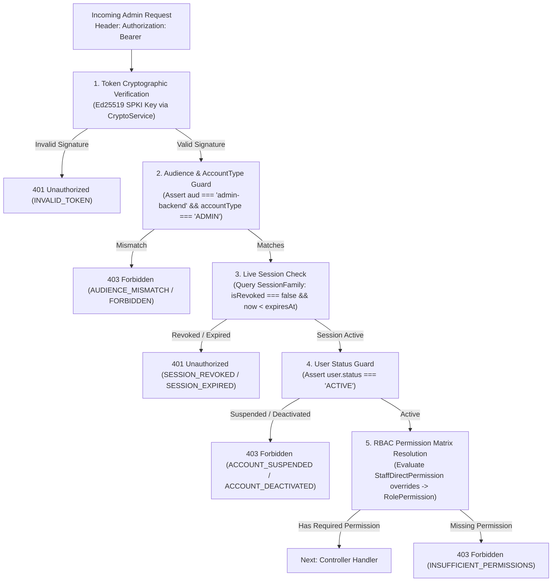

# Super Admin Backend & Admin Dashboard — Comprehensive Technical Audit (V3)

**Audit Date:** November 23, 2026  
**Audited Target:** `apps/backend/src/modules/admin/`, `apps/admin-dashboard/src/`, `packages/*`, `apps/backend/prisma/`  
**Active Working Branch:** `feat/admin-dashboard`  
**Auditor:** Principal Enterprise Architect & Full-Stack Systems Engineer  
**Document Location:** `docs/ADMIN_BACKEND_AUDIT_V3.md`  

---

## Executive Summary & System Context

This technical audit provides an exhaustive evaluation of:
1. **The Super Admin Backend Module** (`apps/backend/src/modules/admin/`), designed exclusively to power the Super Admin operations portal.
2. **The Admin Dashboard Frontend Application** (`apps/admin-dashboard/src/`), cataloging all 12 operational pages, data shapes, state mutators, and integration contracts.

### System Architectural Boundaries
* **Scope of `apps/backend/src/modules/admin`:** Reserved exclusively for Super Admin governance, staff RBAC, platform policies, moderation, dispute resolution, and operational overrides.
* **External Client Domains:** Vendor, Rider, and Customer mobile apps and websites will interface with their own independent business backends (`vendor-backend`, `rider-backend`, `customer-backend`) or domain services.
* **Central Auth Baseline:** Central Auth (`apps/backend/src/modules/auth/`), Ed25519 asymmetric JWKS, SessionFamily rotation, and baseline RBAC PostgreSQL models are already implemented in `apps/backend/`.

---

# PART A: Backend Admin Folder (`apps/backend/src/modules/admin`)

## A.1 Exact Directory Tree & File Inventory

The admin module directory structure inside `apps/backend/src/modules/admin` follows the modular monolith pattern. A complete file system scan confirms:

```text
apps/backend/src/modules/admin/
├── controllers/
│   └── .gitkeep              # Empty placeholder (0 KB) — Controller classes pending
├── dto/
│   └── .gitkeep              # Empty placeholder (0 KB) — Request/Response DTOs pending
├── interfaces/
│   └── .gitkeep              # Empty placeholder (0 KB) — Internal TypeScript contracts pending
├── models/
│   └── .gitkeep              # Empty placeholder (0 KB) — Domain models/Prisma extensions pending
├── repositories/
│   └── .gitkeep              # Empty placeholder (0 KB) — Database query repositories pending
├── routes/
│   └── .gitkeep              # Empty placeholder (0 KB) — Express route definitions pending
├── services/
│   └── .gitkeep              # Empty placeholder (0 KB) — Admin business services pending
├── tests/
│   └── .gitkeep              # Empty placeholder (0 KB) — Admin unit/integration test suites pending
└── validators/
    └── .gitkeep              # Empty placeholder (0 KB) — Zod runtime validation schemas pending
```

### Component Status Classification:
* **Implemented:** **0 files.**
* **Stubs / Skeletons:** **0 files.**
* **Empty Placeholders:** **9 subdirectories** containing only `.gitkeep` markers.
* **Total Executable Code in Admin Module Today:** **0 lines of TypeScript.**

---

## A.2 Routes Mounted Under `/api/v1/admin`

Verification of the root application factory file [`apps/backend/src/app.ts`](file:///c:/Vortex/AppKart-main%20(1)/apps/backend/src/app.ts#L78-L117):

```typescript
// apps/backend/src/app.ts lines 89-108
const v1Router = Router();
v1Router.use("/health/ready", readyRouter);
v1Router.use("/health", healthRouter);

// Mount Public Central Auth module under /api/v1/auth
const authRouter = createAuthRouter(authController);
v1Router.use("/auth", authRouter);

// Canonical S2S Internal Live Verification Endpoint:
const internalAuthRouter = Router();
internalAuthRouter.post("/verify-session", validateRequest({ body: verifySessionRequestSchema }), authController.verifySession);
v1Router.use("/internal/auth", internalAuthRouter);

app.use("/api/v1", v1Router);
```

### Audit Finding:
* **Mounted Routes under `/api/v1/admin`:** **0 routes mounted.**
* **Router Registration:** `apps/backend/src/app.ts` does **not** import, instantiate, or mount any router under `/api/v1/admin`.
* Any HTTP request sent to `http://127.0.0.1:4000/api/v1/admin/*` currently falls through to `notFoundHandler` in [`apps/backend/src/middleware/not-found.ts`](file:///c:/Vortex/AppKart-main%20(1)/apps/backend/src/middleware/not-found.ts) returning `404 Not Found`.

---

## A.3 Status of High-Priority Admin Endpoints

| Target Admin Endpoint | Backend Status | Exact Code Location | How It Works Today | Test Suite Status |
| :--- | :---: | :--- | :--- | :---: |
| **`POST /verify-settings-access`** | 🔴 **Missing** | Backend: None.<br>Frontend: [`apps/admin-dashboard/src/services/settingsAccess.ts`](file:///c:/Vortex/AppKart-main%20(1)/apps/admin-dashboard/src/services/settingsAccess.ts#L60-L105) | Frontend mocks password verification in browser memory using a local session token stored in `sessionStorage` with a 15-minute sliding expiry window (`verifySettingsPassword`). No backend call. | ❌ No tests |
| **`GET /roles`** | 🔴 **Missing** | Backend: None.<br>Frontend: [`apps/admin-dashboard/src/services/rolesService.ts`](file:///c:/Vortex/AppKart-main%20(1)/apps/admin-dashboard/src/services/rolesService.ts#L8-L25) | Frontend loads hardcoded mock roles (`Super Admin`, `Operations Admin`, `Finance Admin`, `Support Admin`, `Marketing Admin`) from [`apps/admin-dashboard/src/data/staffData.ts`](file:///c:/Vortex/AppKart-main%20(1)/apps/admin-dashboard/src/data/staffData.ts#L1-L60). | ❌ No tests |
| **`GET /staff`** | 🔴 **Missing** | Backend: None.<br>Frontend: [`apps/admin-dashboard/src/services/usersService.ts`](file:///c:/Vortex/AppKart-main%20(1)/apps/admin-dashboard/src/services/usersService.ts#L22-L35) | Returns in-memory array `initialStaffMembers` with 300ms simulated network latency (`mockDelay`). | ❌ No tests |
| **`POST /staff/invite`** | 🔴 **Missing** | Backend: None.<br>Frontend: [`apps/admin-dashboard/src/pages/StaffPage.tsx`](file:///c:/Vortex/AppKart-main%20(1)/apps/admin-dashboard/src/pages/StaffPage.tsx#L85-L120) | Frontend handles form submission in state only (`setStaffList([newStaff, ...staffList])`). No network exchange. | ❌ No tests |
| **`PATCH /staff/:id/status`** | 🔴 **Missing** | Backend: None.<br>Frontend: [`apps/admin-dashboard/src/pages/StaffPage.tsx`](file:///c:/Vortex/AppKart-main%20(1)/apps/admin-dashboard/src/pages/StaffPage.tsx#L122-L140) | Toggles `isActive: !member.isActive` directly inside React component state. | ❌ No tests |

---

## A.4 Authentication & Authorization Architecture for Super Admin

### Existing Backend Infrastructure
Central Auth provides token issuing and live verification in:
* [`apps/backend/src/modules/auth/services/crypto.service.ts`](file:///c:/Vortex/AppKart-main%20(1)/apps/backend/src/modules/auth/services/crypto.service.ts): Signs and verifies asymmetric **Ed25519 (EdDSA)** JWTs.
* [`apps/backend/src/modules/auth/services/live-verification.service.ts`](file:///c:/Vortex/AppKart-main%20(1)/apps/backend/src/modules/auth/services/live-verification.service.ts#L60-L168): Validates live session status and evaluates permissions.

### Admin Request Authorization Pipeline Requirements
When an incoming request hits `/api/v1/admin/*`, the following 5-stage pipeline must execute:



### Authoritative RBAC Evaluation Precedence (LiveVerificationService Line 130-149)
1. **Tier 1 (Direct Staff Overrides):** Checks `StaffDirectPermission`.
   - If `effect === "DENY"` matches `${action}:${resource}`, access is **immediately denied** (explicit `DENY` takes precedence over all role grants).
   - If `effect === "ALLOW"` matches, the permission is explicitly added.
2. **Tier 2 (Administrative Profile Assignments):** Gathers permissions from active `AdminProfileAssignment` records linked to `ProfilePermission`.
3. **Tier 3 (Canonical Role):** Resolves base permissions mapped via `RolePermission` for the user's `roleId`.

### Gap Identified:
* **Missing Middleware:** [`apps/backend/src/middleware/`](file:///c:/Vortex/AppKart-main%20(1)/apps/backend/src/middleware/) has no generic `authenticateAdmin` or `requirePermission` middleware. An `adminAuthGuard` must be created.

---

## A.5 Prisma Models, Database Role & Privilege Boundaries

### Database Connection Role
* The running backend connects via `DATABASE_URL` using the **`fillcart_app_user`** role ([`FILLCART_DEVELOPER_ONBOARDING_GUIDE.md` Line 181](file:///c:/Vortex/AppKart-main%20(1)/FILLCART_DEVELOPER_ONBOARDING_GUIDE.md#L181)).
* The privileged schema owner (`fillcart_user`) via `MIGRATION_DATABASE_URL` is **never** provided to the running Express app.

### Database Privilege Lockdown (Enforced by Applied Migrations)
1. **Zero Runtime DELETE Policy:**
   * Enforced by migration [`20261118120000_revoke_runtime_delete/migration.sql`](file:///c:/Vortex/AppKart-main%20(1)/apps/backend/prisma/migrations/20261118120000_revoke_runtime_delete/migration.sql#L7-L22).
   * `fillcart_app_user` has **ZERO `DELETE` privileges** across all operational tables (`User`, `Role`, `Permission`, `StaffDirectPermission`, `AdminInvitation`, etc.).
   * *Impact on Admin Code:* Admin endpoints **cannot execute hard SQL deletes**. Any deletion must be implemented as a soft delete (`status = DEACTIVATED`, `revokedAt = now()`, `isRevoked = true`).
2. **Restricted Admin Profile Configuration Writes:**
   * Enforced by migration [`20261118063408_restrict_admin_config_writes/migration.sql`](file:///c:/Vortex/AppKart-main%20(1)/apps/backend/prisma/migrations/20261118063408_restrict_admin_config_writes/migration.sql#L3-L9).
   * PostgreSQL `INSERT` and `UPDATE` on tables `PermissionProfile`, `ProfilePermission`, and `AdminBootstrapMarker` are **explicitly revoked** from `fillcart_app_user`.
   * *Impact on Admin Code:* The Super Admin backend cannot insert new system permission profiles dynamically at runtime; system profiles can only be seeded or modified via migration scripts using `MIGRATION_DATABASE_URL`.

### Admin Prisma Models Matrix: Permitted Read/Write Operations Today

| Prisma Model | Can Read? | Can Insert? | Can Update? | Can Delete? | Permitted Admin Actions |
| :--- | :---: | :---: | :---: | :---: | :--- |
| **`User`** | ✅ Yes | ✅ Yes | ✅ Yes | ❌ **No (Revoked)** | Read admin/staff profiles; update `status`, `suspensionReason`, `fullName`, `roleId`. |
| **`Credential`** | ✅ Yes | ✅ Yes | ✅ Yes | ❌ **No (Revoked)** | Reset staff passwords, increment `failedAttempts`, set `lockedUntil`. |
| **`Role`** | ✅ Yes | ⚠️ Partial | ⚠️ Partial | ❌ **No (Revoked)** | Read all roles; assign roles to users. Cannot delete roles. |
| **`Permission`** | ✅ Yes | ❌ Restrict | ❌ Restrict | ❌ **No (Revoked)** | Read all system permissions to display RBAC matrix. |
| **`RolePermission`** | ✅ Yes | ⚠️ Restricted | ⚠️ Restricted | ❌ **No (Revoked)** | Read role-to-permission mappings. |
| **`PermissionProfile`** | ✅ Yes | ❌ **Revoked** | ❌ **Revoked** | ❌ **No (Revoked)** | Read permission profile bundles (e.g. `Operations_Lead`). |
| **`ProfilePermission`** | ✅ Yes | ❌ **Revoked** | ❌ **Revoked** | ❌ **No (Revoked)** | Read profile-to-permission mappings. |
| **`AdminProfileAssignment`**| ✅ Yes | ✅ Yes | ✅ Yes | ❌ **No (Revoked)** | Assign profiles to staff (`INSERT`), revoke assignments (`UPDATE revokedAt = now()`). |
| **`StaffDirectPermission`** | ✅ Yes | ✅ Yes | ✅ Yes | ❌ **No (Revoked)** | Grant custom staff overrides (`INSERT`), revoke overrides (`UPDATE revokedAt = now()`). |
| **`AdminInvitation`** | ✅ Yes | ✅ Yes | ✅ Yes | ❌ **No (Revoked)** | Issue new staff invitations (`INSERT`), revoke invitations (`UPDATE isRevoked = true`). |
| **`AuthAuditLog`** | ✅ Yes | ✅ Yes | ❌ Restrict | ❌ **No (Revoked)** | Append immutable audit logs (`INSERT`); read logs for audit page. |
| **`AdminBootstrapMarker`** | ✅ Yes | ❌ **Revoked** | ❌ **Revoked** | ❌ **No (Revoked)** | Read bootstrap status. Cannot re-bootstrap via runtime role. |

---

## A.6 Contract & DTO State (`packages/api-contracts` & `packages/validations`)

### OpenAPI Contract State ([`packages/api-contracts/openapi/v1/openapi.yaml`](file:///c:/Vortex/AppKart-main%20(1)/packages/api-contracts/openapi/v1/openapi.yaml))
* **Paths Defined:** Exactly 8 paths (`/.well-known/jwks.json`, `/health`, `/health/ready`, `/api/v1/auth/register`, `/api/v1/auth/login`, `/api/v1/auth/refresh`, `/api/v1/auth/logout`, `/api/v1/auth/otp/send`, `/api/v1/auth/otp/verify`, `/api/v1/internal/auth/verify-session`).
* **Admin Routes in Contract:** **0 admin routes.** None of the `/api/v1/admin/*` endpoints exist in the OpenAPI contract.

### Shared Validations State ([`packages/validations/src/auth.ts`](file:///c:/Vortex/AppKart-main%20(1)/packages/validations/src/auth.ts))
* **Included:** `accountTypeSchema` includes `"ADMIN"`; `audienceSchema` includes `"admin-backend"`.
* **Missing:** Zero admin management validation schemas exist. The following must be authored:
  - `verifySettingsAccessSchema`
  - `adminInviteStaffSchema`
  - `updateStaffRoleSchema`
  - `updateStaffStatusSchema`
  - `vendorStatusUpdateSchema`
  - `riderStatusUpdateSchema`
  - `documentVerificationActionSchema`
  - `orderDispatchOverrideSchema`
  - `settlementReleaseBatchSchema`
  - `couponCreateSchema`
  - `systemSettingsUpdateSchema`

---

## A.7 Build, Typecheck & Test Audit for Backend

* **Backend Typecheck Test:** Executed `npm --workspace=@fillcart/backend run type-check`.
  * *Result:* Script failed with `'tsc' is not recognized` because workspace root dependencies (`typescript`, `@types/node`, `@fillcart/config`) require a clean `npm install` at root to create binary symlinks in `node_modules/.bin`.
* **Admin Tests:** `apps/backend/src/modules/admin/tests/` contains only `.gitkeep`. **Zero tests exist for admin.**

---

# PART B: Frontend Data Needs (Admin Dashboard)

Below is the complete, granular audit of all 12 operational views in `apps/admin-dashboard/src/pages/` and layout components.

---

### B.1 Dashboard (`HomePage.tsx`)
* **Component Path:** [`apps/admin-dashboard/src/pages/HomePage.tsx`](file:///c:/Vortex/AppKart-main%20(1)/apps/admin-dashboard/src/pages/HomePage.tsx)
* **Sub-Components:** `PlatformActivityCard`, `PendingVerificationsCard`, `StaffAndAuditCards`, `VendorsCard`, `BasicReportsDarkCard`, `RidersTallCard`, `TopOrdersCard`, `ProductsDonutCard`, `PaymentsCreditsCard`, `OrdersActivityCard`.

#### 1. Data Shown & TypeScript Types
```typescript
interface DashboardSummary {
  customers: number;             // Total active customers
  vendors: number;               // Total registered vendors
  riders: number;                // Total registered delivery fleet
  ordersToday: number;           // Orders placed today
  revenueToday: number;          // Gross revenue today in INR
  activeDeliveries: number;      // Current live in-transit deliveries
  commissionToday: number;       // Platform commission earned today in INR
  refundToday: number;           // Total refunds processed today
  activeUsers: number;           // Concurrently active users
}

interface PendingVerificationsSummary {
  pendingVendorsCount: number;
  pendingRidersCount: number;
  criticalPendingCount: number;
}
```

#### 2. User Actions & State Mutations
* Clicking "Review" on Pending Verifications card $\to$ Navigates to `/verification`.
* Quick date filter toggling (Today, Yesterday, Last 7 Days, Month).

#### 3. API Needed
* **Method & Path:** `GET /api/v1/admin/dashboard/summary`
* **Query Parameters:** `?period=today|7d|30d`
* **Response Shape:** `{ success: true, data: DashboardSummary }`

#### 4. Current Mock / Store Source
* Handled in [`apps/admin-dashboard/src/services/dashboardService.ts`](file:///c:/Vortex/AppKart-main%20(1)/apps/admin-dashboard/src/services/dashboardService.ts) returning `initialDashboardData` from [`apps/admin-dashboard/src/data/mockDashboardData.ts`](file:///c:/Vortex/AppKart-main%20(1)/apps/admin-dashboard/src/data/mockDashboardData.ts).

#### 5. Data Ownership Classification
* **(b) READ-ONLY aggregation** from other teams' domain tables (`orders`, `vendors`, `riders`, `customers`, `payments`).

---

### B.2 Document Verification (`DocumentVerificationPage.tsx`)
* **Component Path:** [`apps/admin-dashboard/src/pages/DocumentVerificationPage.tsx`](file:///c:/Vortex/AppKart-main%20(1)/apps/admin-dashboard/src/pages/DocumentVerificationPage.tsx)
* **Drawer / Card:** `DocumentCard.tsx`, `ReviewDrawer.tsx`, `VerificationToolbar.tsx`.

#### 1. Data Shown & TypeScript Types
Defined in [`apps/admin-dashboard/src/types/index.ts`](file:///c:/Vortex/AppKart-main%20(1)/apps/admin-dashboard/src/types/index.ts#L1-L51):
```typescript
type ApplicantType = 'Rider' | 'Vendor';
type VerificationStatus = 'Pending' | 'Approved' | 'Rejected' | 'Under Review';
type DocumentStatus = 'Pending' | 'Approved' | 'Rejected';

interface VerificationDocument {
  id: string;
  name: string;
  type: string;                  // "Aadhaar Front", "PAN Card", "FSSAI License", "Vehicle RC"
  documentNumber?: string;
  status: DocumentStatus;
  uploadedAt: string;            // ISO timestamp
  previewUrl: string;            // Secure S3/CDN view URL
  rejectReason?: string;
  rejectRemarks?: string;
}

interface Applicant {
  id: string;
  name: string;
  avatar: string;
  type: ApplicantType;
  email: string;
  phone: string;
  city: string;
  state: string;
  submittedAt: string;
  documentsCount: number;
  status: VerificationStatus;
  documents: VerificationDocument[];
  timeline: VerificationTimelineItem[];
  vehicleDetails?: { model: string; plateNumber: string; type: string };
  businessDetails?: { storeName: string; category: string; address: string };
}
```

#### 2. User Actions & State Mutations
* **Approve Single Document:** Updates specific document status to `'Approved'`.
* **Reject Single Document:** Opens Reject Modal; requires `reason` selection + optional `remarks`; sets document status to `'Rejected'`.
* **Finalize Applicant Decision:** If all mandatory documents are Approved $\to$ Applicant becomes `'Approved'`. If any rejected $\to$ Applicant becomes `'Rejected'`.
* **Filter by Type:** Tab switch between `All`, `Vendors`, `Riders`, and status (`Pending`, `Under Review`, `Approved`, `Rejected`).

#### 3. API Needed
* `GET /api/v1/admin/verification/applicants?type=Vendor|Rider&status=Pending&page=1&limit=20`
* `GET /api/v1/admin/verification/applicants/:id`
* `PATCH /api/v1/admin/verification/documents/:documentId/review`  
  `Body: { status: "Approved" | "Rejected", reason?: string, remarks?: string }`
* `POST /api/v1/admin/verification/applicants/:applicantId/decision`  
  `Body: { decision: "Approved" | "Rejected", notes?: string }`

#### 4. Current Mock / Store Source
* [`apps/admin-dashboard/src/data/verification.ts`](file:///c:/Vortex/AppKart-main%20(1)/apps/admin-dashboard/src/data/verification.ts) and component state in `DocumentVerificationPage.tsx`.

#### 5. Data Ownership Classification
* **(c) ADMIN ACTIONS ON OTHER TEAMS' DATA:**
  * Applicant profile and document file uploads are created by **Vendor / Rider apps**.
  * Admin writes **review decisions**: `document.status`, `document.rejectReason`, `document.rejectRemarks`, `applicant.verificationStatus`, `applicant.reviewedByAdminId`, `applicant.reviewedAt`.

---

### B.3 Vendors & Vendor Details (`VendorsPage.tsx` & `VendorDetailPage.tsx`)
* **Component Paths:** [`apps/admin-dashboard/src/pages/VendorsPage.tsx`](file:///c:/Vortex/AppKart-main%20(1)/apps/admin-dashboard/src/pages/VendorsPage.tsx) and [`apps/admin-dashboard/src/pages/VendorDetailPage.tsx`](file:///c:/Vortex/AppKart-main%20(1)/apps/admin-dashboard/src/pages/VendorDetailPage.tsx).

#### 1. Data Shown & TypeScript Types
Defined in [`apps/admin-dashboard/src/data/vendors.ts`](file:///c:/Vortex/AppKart-main%20(1)/apps/admin-dashboard/src/data/vendors.ts#L1-L35) and [`apps/admin-dashboard/src/data/mockManagementData.ts`](file:///c:/Vortex/AppKart-main%20(1)/apps/admin-dashboard/src/data/mockManagementData.ts#L18-L55):
```typescript
interface VendorProduct {
  id: string;
  name: string;
  category: string;
  price: string;
  status: 'Active' | 'Inactive';
}

interface Vendor {
  id: string;
  storeName: string;
  ownerName: string;
  initials: string;
  businessCategory: string;
  city: string;
  phone: string;
  email: string;
  shopAddress: string;
  gstin?: string;
  licenceNumber?: string;
  commissionPct: number;
  joinedDate: string;
  productsCount: number;
  ordersCount: number;
  verificationStatus: 'Verified' | 'Pending' | 'Rejected';
  status: 'Active' | 'Suspended' | 'Inactive';
  statusReason?: string;
  statusRemarks?: string;
  statusDate?: string;
  statusAdmin?: string;
  bankDetails: { accountMasked: string; ifsc: string; bankName: string };
  lastPayout: string;
  pendingPayout: string;
  commissionSummary: { totalEarned: string; platformFee: string; netPayout: string };
  products: VendorProduct[];
  salesLast7Days: number[];
}
```

#### 2. User Actions & State Mutations
* **Suspend Vendor:** Opens `ConfirmActionModal`; requires `reason` selection + `remarks`; sets `status = 'Suspended'`, records `statusReason`, `statusDate`, `statusAdmin`.
* **Reactivate Vendor:** Sets `status = 'Active'`, clears suspension flags.
* **Update Commission Rate:** Modifies `commissionPct` for the vendor.
* **Search & Filter:** Search by store name, owner, phone, city; filter by Status and Category.

#### 3. API Needed
* `GET /api/v1/admin/vendors?page=1&limit=20&search=...&status=Active|Suspended|Inactive&category=...`
* `GET /api/v1/admin/vendors/:id`
* `PATCH /api/v1/admin/vendors/:id/status`  
  `Body: { status: "Active" | "Suspended" | "Inactive", reason?: string, remarks?: string }`
* `PATCH /api/v1/admin/vendors/:id/commission`  
  `Body: { commissionPct: number, reason: string }`

#### 4. Current Mock / Store Source
* [`apps/admin-dashboard/src/services/vendorsService.ts`](file:///c:/Vortex/AppKart-main%20(1)/apps/admin-dashboard/src/services/vendorsService.ts) and [`apps/admin-dashboard/src/data/vendors.ts`](file:///c:/Vortex/AppKart-main%20(1)/apps/admin-dashboard/src/data/vendors.ts).

#### 5. Data Ownership Classification
* **(c) ADMIN ACTIONS ON OTHER TEAMS' DATA:**
  * Store details, bank accounts, and products belong to **Vendor Backend**.
  * Admin writes: `vendor.status`, `vendor.statusReason`, `vendor.statusRemarks`, `vendor.commissionPct`, `vendor.verificationStatus`.

---

### B.4 Riders & Rider Details (`RidersPage.tsx` & `RiderDetailPage.tsx`)
* **Component Paths:** [`apps/admin-dashboard/src/pages/RidersPage.tsx`](file:///c:/Vortex/AppKart-main%20(1)/apps/admin-dashboard/src/pages/RidersPage.tsx) and [`apps/admin-dashboard/src/pages/RiderDetailPage.tsx`](file:///c:/Vortex/AppKart-main%20(1)/apps/admin-dashboard/src/pages/RiderDetailPage.tsx).

#### 1. Data Shown & TypeScript Types
Defined in [`apps/admin-dashboard/src/data/riders.ts`](file:///c:/Vortex/AppKart-main%20(1)/apps/admin-dashboard/src/data/riders.ts#L1-L45):
```typescript
interface RiderDelivery {
  id: string;
  orderNumber: string;
  storeName: string;
  customerName: string;
  deliveryAddress: string;
  date: string;
  time: string;
  amount: string;
  tip: string;
  status: 'Completed' | 'Cancelled' | 'In transit';
}

interface Rider {
  id: string;
  name: string;
  initials: string;
  phone: string;
  email: string;
  city: string;
  address: string;
  vehicleType: 'Motorcycle' | 'Scooter' | 'Electric' | 'Bicycle' | 'On foot';
  vehicleNumber: string;
  emergencyContact: { name: string; relation: string; phone: string };
  joinedDate: string;
  availability: 'Online' | 'Offline' | 'On delivery';
  deliveriesCompleted: number;
  rating: number;
  verificationStatus: 'Verified' | 'Pending' | 'Rejected';
  status: 'Active' | 'Suspended' | 'Inactive';
  statusReason?: string;
  statusRemarks?: string;
  bankDetails: { accountMasked: string; bankName: string };
  lastPayout: string;
  pendingPayout: string;
  weeklyEarnings: number[];      // Mon-Sun array (7 integers)
  deliveriesSummary: { totalDeliveries: number; onTimePct: number; avgRating: number };
  recentDeliveries: RiderDelivery[];
}
```

#### 2. User Actions & State Mutations
* **Suspend Rider:** Sets `status = 'Suspended'`, captures mandatory reason.
* **Reactivate Rider:** Sets `status = 'Active'`.
* **Override Availability:** Force rider status to `'Offline'` during operational disputes.

#### 3. API Needed
* `GET /api/v1/admin/riders?page=1&limit=20&search=...&status=Active|Suspended&availability=Online|Offline`
* `GET /api/v1/admin/riders/:id`
* `PATCH /api/v1/admin/riders/:id/status`  
  `Body: { status: "Active" | "Suspended" | "Inactive", reason?: string, remarks?: string }`
* `PATCH /api/v1/admin/riders/:id/availability`  
  `Body: { availability: "Offline", reason: string }`

#### 4. Current Mock / Store Source
* [`apps/admin-dashboard/src/services/ridersService.ts`](file:///c:/Vortex/AppKart-main%20(1)/apps/admin-dashboard/src/services/ridersService.ts) and [`apps/admin-dashboard/src/data/riders.ts`](file:///c:/Vortex/AppKart-main%20(1)/apps/admin-dashboard/src/data/riders.ts).

#### 5. Data Ownership Classification
* **(c) ADMIN ACTIONS ON OTHER TEAMS' DATA:**
  * Fleet registration, live GPS location, and shifts belong to **Rider Backend**.
  * Admin writes: `rider.status`, `rider.statusReason`, `rider.verificationStatus`, `rider.availability` (override).

---

### B.5 Orders & Dispatch (`OrdersPage.tsx`)
* **Component Path:** [`apps/admin-dashboard/src/pages/OrdersPage.tsx`](file:///c:/Vortex/AppKart-main%20(1)/apps/admin-dashboard/src/pages/OrdersPage.tsx)
* **Modals:** `OrderDetailsModal.tsx`, `OrderCancelModal.tsx`.

#### 1. Data Shown & TypeScript Types
Defined in [`apps/admin-dashboard/src/data/ordersData.ts`](file:///c:/Vortex/AppKart-main%20(1)/apps/admin-dashboard/src/data/ordersData.ts#L1-L40):
```typescript
type OrderStatus = 'Placed' | 'Preparing' | 'Out for delivery' | 'Delivered' | 'Cancelled';
type PaymentMethod = 'UPI' | 'Card' | 'Bank' | 'COD';

interface OrderItem {
  id: string;
  name: string;
  qty: number;
  price: number;
  unit: string;
}

interface Order {
  id: string;
  orderNumber: string;
  date: string;
  time: string;
  paymentMethod: PaymentMethod;
  customer: { name: string; phone: string; email: string; address: string };
  vendor: { name: string; phone: string; address: string };
  rider: { id: string; name: string; phone: string; vehicleType: string } | null;
  items: OrderItem[];
  itemTotal: number;
  deliveryFee: number;
  tax: number;
  totalAmount: number;
  status: OrderStatus;
  timeline: {
    placedAt: string;
    acceptedAt?: string;
    preparingAt?: string;
    outForDeliveryAt?: string;
    deliveredAt?: string;
    cancelledAt?: string;
  };
  cancelReason?: string;
  cancelRemarks?: string;
  isRefunded?: boolean;
}
```

#### 2. User Actions & State Mutations
* **Cancel Order (Admin Override):** Opens `OrderCancelModal`; requires reason from preset list (`Customer requested cancellation`, `Item out of stock`, `No rider available`, etc.) + remarks; updates status to `'Cancelled'`, sets `isRefunded = true`.
* **Re-Dispatch / Re-Assign Rider:** Admin assigns or changes `rider.id`.
* **Filter Orders:** Filter by `status` (Placed, Preparing, Out for delivery, Delivered, Cancelled) and payment method.

#### 3. API Needed
* `GET /api/v1/admin/orders?page=1&limit=20&status=...&paymentMethod=...&search=...`
* `GET /api/v1/admin/orders/:id`
* `POST /api/v1/admin/orders/:id/cancel`  
  `Body: { reason: string, remarks?: string, triggerRefund: boolean }`
* `PATCH /api/v1/admin/orders/:id/dispatch`  
  `Body: { riderId: string, notes?: string }`

#### 4. Current Mock / Store Source
* [`apps/admin-dashboard/src/services/ordersService.ts`](file:///c:/Vortex/AppKart-main%20(1)/apps/admin-dashboard/src/services/ordersService.ts) and [`apps/admin-dashboard/src/data/ordersData.ts`](file:///c:/Vortex/AppKart-main%20(1)/apps/admin-dashboard/src/data/ordersData.ts).

#### 5. Data Ownership Classification
* **(c) ADMIN ACTIONS ON OTHER TEAMS' DATA:**
  * Order creation, cart, and transactions belong to **Customer/Order Backend**.
  * Admin writes: `order.status = 'Cancelled'`, `order.cancelReason`, `order.cancelRemarks`, `order.riderId` (dispatch override).

---

### B.6 Products & Categories (`ProductsPage.tsx`)
* **Component Path:** [`apps/admin-dashboard/src/pages/ProductsPage.tsx`](file:///c:/Vortex/AppKart-main%20(1)/apps/admin-dashboard/src/pages/ProductsPage.tsx)
* **Components:** `ProductTable.tsx`, `CategoryGrid.tsx`, `ProductModal.tsx`.

#### 1. Data Shown & TypeScript Types
Defined in [`apps/admin-dashboard/src/data/products.ts`](file:///c:/Vortex/AppKart-main%20(1)/apps/admin-dashboard/src/data/products.ts#L1-L35):
```typescript
interface Product {
  id: string;
  name: string;
  category: string;
  vendor: string;
  mrp: number;
  salePrice: number;
  discountPct: number;
  itemsSold: number;
  status: 'Active' | 'Pending approval' | 'Inactive' | 'Rejected';
  sku: string;
  brand: string;
  unit: string;
  description?: string;
  isActive: boolean;
  rejectReason?: string;
}

interface Category {
  id: string;
  name: string;
  iconName: string;
  productCount: number;
  isActive: boolean;
  parentCategory?: string;
}
```

#### 2. User Actions & State Mutations
* **Moderate Product:** Approve or Reject vendor-submitted product.
* **Toggle Product Active/Inactive:** Deactivate infringing product.
* **Category CRUD:** Create new Category (name, icon, parent category); Toggle category `isActive`.

#### 3. API Needed
* `GET /api/v1/admin/catalog/products?page=1&status=...&category=...`
* `PATCH /api/v1/admin/catalog/products/:id/status`  
  `Body: { status: "Active" | "Rejected", rejectReason?: string }`
* `GET /api/v1/admin/catalog/categories`
* `POST /api/v1/admin/catalog/categories`  
  `Body: { name: string, iconName: string, parentCategory?: string }`
* `PATCH /api/v1/admin/catalog/categories/:id`  
  `Body: { name?: string, iconName?: string, isActive?: boolean }`

#### 4. Current Mock / Store Source
* [`apps/admin-dashboard/src/services/productsService.ts`](file:///c:/Vortex/AppKart-main%20(1)/apps/admin-dashboard/src/services/productsService.ts) and [`apps/admin-dashboard/src/data/products.ts`](file:///c:/Vortex/AppKart-main%20(1)/apps/admin-dashboard/src/data/products.ts).

#### 5. Data Ownership Classification
* **Products:** **(c) ADMIN ACTION ON VENDOR DATA** (Vendor creates product; Admin approves/rejects/suspends).
* **Categories:** **(a) ADMIN-OWNED DATA** (Master taxonomy belongs to Super Admin).

---

### B.7 Finance Hub (7 Sub-Views)
* **Parent Layout:** [`apps/admin-dashboard/src/pages/FinancePage.tsx`](file:///c:/Vortex/AppKart-main%20(1)/apps/admin-dashboard/src/pages/FinancePage.tsx)
* **Sub-Pages:**
  1. `FinanceOverviewPage.tsx` (Executive GMV, Platform Fees, Net Flow)
  2. `PaymentsPage.tsx` (Gateway transaction ledger & statement generation)
  3. `SettlementsPage.tsx` (Vendor & Rider disbursement batches)
  4. `CommissionPage.tsx` (Category rates & vendor commission overrides)
  5. `WalletPage.tsx` (Customer credit balance, manual adjustments)
  6. `CouponsPage.tsx` (Promotional discount codes, usage limits)
  7. `TaxesPage.tsx` (GST slabs, HSN category codes, monthly returns)

#### 1. Data Shown & TypeScript Types
```typescript
// Payments & Ledger
interface PaymentTransaction {
  id: string;
  txNumber: string;
  date: string;
  time: string;
  party: string;
  partyType: 'Customer' | 'Vendor' | 'Rider';
  type: 'Collection' | 'Vendor Payout' | 'Rider Payout' | 'Refund';
  method: 'UPI' | 'Card' | 'Bank' | 'COD';
  amount: number;
  status: 'Paid' | 'Pending' | 'Failed' | 'Refunded';
  orderId?: string;
  reference: string;
}

// Settlements
interface SettlementBatch {
  id: string;
  batchNumber: string;
  recipientType: 'Vendor' | 'Rider';
  recipientName: string;
  totalOrders: number;
  grossAmount: number;
  deductions: number;
  netPayout: number;
  bankDetails: { bankName: string; accountMasked: string; ifsc: string };
  status: 'Pending' | 'Processing' | 'Disbursed' | 'Failed';
  scheduledDate: string;
}

// Commission Rules (Admin-Owned)
interface CategoryRate {
  id: string;
  categoryName: string;
  defaultPct: number;
  updatedAt: string;
  updatedBy: string;
}
interface VendorOverride {
  id: string;
  vendorId: string;
  vendorName: string;
  overridePct: number;
  validUntil: string;
  reason: string;
}

// Platform Coupons (Admin-Owned)
interface Coupon {
  id: string;
  code: string;
  type: 'Percentage' | 'Flat';
  value: number;
  minOrder: number;
  maxDiscount?: number;
  usageCount: number;
  usageLimit: number;
  perUserLimit: number;
  applicableFor: 'All Customers' | 'New Customers Only' | 'VIP Customers';
  validFrom: string;
  validTo: string;
  status: 'Active' | 'Expired' | 'Disabled';
}

// Customer Wallets
interface CustomerWallet {
  id: string;
  customerId: string;
  customerName: string;
  customerPhone: string;
  balance: number;
  totalCredited: number;
  totalDebited: number;
  status: 'Active' | 'Frozen';
}

// Tax Slabs
interface CategoryTaxMapping {
  id: string;
  categoryName: string;
  hsnCode: string;
  gstRatePct: number;
  cessPct: number;
}
```

#### 2. User Actions & State Mutations
* **Disburse Settlement:** Admin clicks "Release Payout" / "Batch Disburse" $\to$ triggers payout batch via banking API.
* **Create Coupon:** Opens Coupon Modal $\to$ creates new promo code with expiry and budget cap.
* **Update Commission Slab:** Modifies default category percentage or assigns vendor discount override.
* **Adjust Wallet:** Super Admin manually credits/debits customer wallet with reason/audit remarks.
* **Generate Statement:** Exports monthly GST and reconciliation PDF/CSV.

#### 3. API Needed
* `GET /api/v1/admin/finance/overview`
* `GET /api/v1/admin/finance/payments?type=...&status=...&page=1`
* `GET /api/v1/admin/finance/settlements?status=Pending|Disbursed`
* `POST /api/v1/admin/finance/settlements/:id/disburse`
* `GET /api/v1/admin/finance/commission`
* `PUT /api/v1/admin/finance/commission/categories/:id`
* `POST /api/v1/admin/finance/commission/overrides`
* `GET /api/v1/admin/finance/coupons`
* `POST /api/v1/admin/finance/coupons`
* `PATCH /api/v1/admin/finance/coupons/:id/status`
* `GET /api/v1/admin/finance/wallets`
* `POST /api/v1/admin/finance/wallets/:id/adjust`  
  `Body: { type: "Credit" | "Debit", amount: number, reason: string }`
* `GET /api/v1/admin/finance/taxes`

#### 4. Current Mock / Store Source
* [`apps/admin-dashboard/src/data/paymentsData.ts`](file:///c:/Vortex/AppKart-main%20(1)/apps/admin-dashboard/src/data/paymentsData.ts), [`apps/admin-dashboard/src/services/settlementsService.ts`](file:///c:/Vortex/AppKart-main%20(1)/apps/admin-dashboard/src/services/settlementsService.ts), and respective page state.

#### 5. Data Ownership Classification
* **(a) ADMIN-OWNED DATA:** Commission rates, Vendor overrides, Platform coupons, Tax HSN mappings, Wallet manual adjustment records.
* **(b) READ-ONLY:** Payment gateway collections (from Payment gateway webhook / Order backend).
* **(c) ADMIN ACTIONS:** Release settlement batch, Freeze customer wallet.

---

### B.8 Reports & Analytics (`ReportsPage.tsx`)
* **Component Path:** [`apps/admin-dashboard/src/pages/ReportsPage.tsx`](file:///c:/Vortex/AppKart-main%20(1)/apps/admin-dashboard/src/pages/ReportsPage.tsx)

#### 1. Data Shown & TypeScript Types
* Time-series GMV, Order volume curves, Average Order Value (AOV), Delivery SLA compliance percentage, Merchant retention cohorts, Heatmap of orders by city/zone.

#### 2. User Actions & State Mutations
* Date range selector (Last 7 Days, Month, Quarter, Year, Custom Range).
* Export report to CSV/Excel.

#### 3. API Needed
* `GET /api/v1/admin/reports/analytics?period=month&metrics=gmv,orders,sla`
* `GET /api/v1/admin/reports/export?format=csv&type=orders|revenue`

#### 4. Current Mock / Store Source
* [`apps/admin-dashboard/src/services/reportsService.ts`](file:///c:/Vortex/AppKart-main%20(1)/apps/admin-dashboard/src/services/reportsService.ts).

#### 5. Data Ownership Classification
* **(b) READ-ONLY aggregation** from analytical database views / materialized views.

---

### B.9 Staff Management (`StaffPage.tsx`)
* **Component Path:** [`apps/admin-dashboard/src/pages/StaffPage.tsx`](file:///c:/Vortex/AppKart-main%20(1)/apps/admin-dashboard/src/pages/StaffPage.tsx)
* **Modals:** `AddStaffModal.tsx`, `EditStaffModal.tsx`.

#### 1. Data Shown & TypeScript Types
Defined in [`apps/admin-dashboard/src/data/staffData.ts`](file:///c:/Vortex/AppKart-main%20(1)/apps/admin-dashboard/src/data/staffData.ts#L65-L98):
```typescript
type InternalStaffRole =
  | 'Super Admin'
  | 'Operations Admin'
  | 'Finance Admin'
  | 'Support Admin'
  | 'Marketing Admin';

interface StaffMember {
  id: string;
  name: string;
  email: string;
  phone: string;
  role: StaffRole;
  lastLogin: string;
  isActive: boolean;
  avatar?: string;
  initials: string;
  createdDate: string;
}

type ModuleName = 'Dashboard' | 'Users' | 'Products' | 'Orders' | 'Payments' | 'Reports' | 'Marketing' | 'Audit Logs' | 'Settings';
type ActionName = 'View' | 'Create' | 'Edit' | 'Delete' | 'Approve';
type ModulePermissions = Record<ActionName, boolean>;
type RolePermissions = Record<ModuleName, ModulePermissions>;
```

#### 2. User Actions & State Mutations
* **Invite New Staff:** Submits `AddStaffModal` with `name`, `email`, `phone`, `role` $\to$ issues invitation.
* **Edit Staff Role:** Updates assigned role for staff member.
* **Toggle Active Status:** Suspends or reactivates staff member.
* **RBAC Matrix Customization:** Toggles specific permissions for custom roles.

#### 3. API Needed
* `GET /api/v1/admin/staff`
* `POST /api/v1/admin/staff/invite`  
  `Body: { fullName: string, email: string, phone?: string, roleId: string }`
* `PATCH /api/v1/admin/staff/:id/role`  
  `Body: { roleId: string }`
* `PATCH /api/v1/admin/staff/:id/status`  
  `Body: { isActive: boolean, reason?: string }`
* `GET /api/v1/admin/roles`
* `PATCH /api/v1/admin/roles/:id/permissions`  
  `Body: { permissions: { action: string, resource: string, allow: boolean }[] }`

#### 4. Current Mock / Store Source
* [`apps/admin-dashboard/src/services/usersService.ts`](file:///c:/Vortex/AppKart-main%20(1)/apps/admin-dashboard/src/services/usersService.ts) and [`apps/admin-dashboard/src/services/rolesService.ts`](file:///c:/Vortex/AppKart-main%20(1)/apps/admin-dashboard/src/services/rolesService.ts).

#### 5. Data Ownership Classification
* **(a) ADMIN-OWNED DATA (100%):** Staff records, roles, permission matrices, and invitations are owned completely by Super Admin.

---

### B.10 Audit Logs (`AuditLogsPage.tsx`)
* **Component Path:** [`apps/admin-dashboard/src/pages/AuditLogsPage.tsx`](file:///c:/Vortex/AppKart-main%20(1)/apps/admin-dashboard/src/pages/AuditLogsPage.tsx)

#### 1. Data Shown & TypeScript Types
Defined in [`apps/admin-dashboard/src/data/auditData.ts`](file:///c:/Vortex/AppKart-main%20(1)/apps/admin-dashboard/src/data/auditData.ts#L1-L40):
```typescript
interface AuditDiff {
  field: string;
  before: string;
  after: string;
}

interface AuditLogEntry {
  id: string;
  timestamp: string;
  admin: { name: string; role: string; email: string };
  action: 'Create' | 'Update' | 'Delete' | 'Approve' | 'Suspend' | 'Login';
  module: string;
  target: string;
  details: string;
  ip: string;
  browser: string;
  diff?: AuditDiff[];
}

interface ApiLogEntry {
  id: string;
  timestamp: string;
  method: 'GET' | 'POST' | 'PATCH' | 'PUT' | 'DELETE';
  endpoint: string;
  statusCode: number;
  latencyMs: number;
  userOrAdmin: string;
  ip: string;
  requestId: string;
  errorCode?: string;
  errorMessage?: string;
  browser: string;
}
```

#### 2. User Actions & State Mutations
* Filter by Admin Actor, Module, Action Type, Date range.
* Toggle between "Administrative Actions" and "API & Security Access Logs".
* Export audit logs to CSV (`export.csv`).

#### 3. API Needed
* `GET /api/v1/admin/audit-logs?page=1&limit=25&module=...&action=...&actorId=...`
* `GET /api/v1/admin/audit-logs/api-requests?statusCode=...&page=1`
* `GET /api/v1/admin/audit-logs/export?format=csv`

#### 4. Current Mock / Store Source
* [`apps/admin-dashboard/src/data/auditData.ts`](file:///c:/Vortex/AppKart-main%20(1)/apps/admin-dashboard/src/data/auditData.ts) and [`apps/admin-dashboard/src/services/auditService.ts`](file:///c:/Vortex/AppKart-main%20(1)/apps/admin-dashboard/src/services/auditService.ts).

#### 5. Data Ownership Classification
* **(a) ADMIN-OWNED DATA:** Administrative audit log records are written exclusively by the admin backend.

---

### B.11 Settings (`SettingsPage.tsx`)
* **Component Path:** [`apps/admin-dashboard/src/pages/SettingsPage.tsx`](file:///c:/Vortex/AppKart-main%20(1)/apps/admin-dashboard/src/pages/SettingsPage.tsx)
* **Tabs:** `GeneralTab.tsx`, `OrdersDispatchTab.tsx`, `OnboardingTab.tsx`, `FinanceSettingsTab.tsx`, `NotificationsTab.tsx`, `SecurityLogsTab.tsx`.
* **Guard:** [`apps/admin-dashboard/src/components/settings/SettingsGuard.tsx`](file:///c:/Vortex/AppKart-main%20(1)/apps/admin-dashboard/src/components/settings/SettingsGuard.tsx).

#### 1. Data Shown & TypeScript Types
Defined in [`apps/admin-dashboard/src/types/settings.ts`](file:///c:/Vortex/AppKart-main%20(1)/apps/admin-dashboard/src/types/settings.ts#L1-L100):
```typescript
interface SystemSettings {
  general: GeneralSettings;        // platformName, supportEmail, currency, maintenanceMode
  orders: OrdersDispatchSettings;  // assignmentMode (Auto/Manual), autoAssignRadiusKm, cancelWindow
  onboarding: OnboardingSettings;  // allowPharmacy, gstOptional, docExpiryReminderDays
  finance: FinanceSettings;        // defaultCommissionPct, settlementCycle, refundWindowDays
  notifications: NotificationsSettings; // SMS, WhatsApp, Email, Push channel API keys
  security: SecurityLogsSettings;  // adminLoginOtp, sessionTimeoutMin, logRetention
}
```

#### 2. User Actions & State Mutations
* **Password Verification:** Unlock settings page by entering admin password.
* **Update Configuration:** Save changes on any of the 6 tabs.
* **Toggle Maintenance Mode:** Enables platform-wide maintenance banner and locks customer order placement.

#### 3. API Needed
* `POST /api/v1/admin/auth/verify-settings-access`  
  `Body: { password: string }` $\to$ Returns `{ verified: true, sessionToken: string, expiresIn: 900 }`
* `GET /api/v1/admin/settings`
* `PATCH /api/v1/admin/settings`  
  `Body: Partial<SystemSettings>`

#### 4. Current Mock / Store Source
* [`apps/admin-dashboard/src/services/settingsService.ts`](file:///c:/Vortex/AppKart-main%20(1)/apps/admin-dashboard/src/services/settingsService.ts), [`apps/admin-dashboard/src/services/settingsAccess.ts`](file:///c:/Vortex/AppKart-main%20(1)/apps/admin-dashboard/src/services/settingsAccess.ts).

#### 5. Data Ownership Classification
* **(a) ADMIN-OWNED DATA (100%):** All platform configuration settings belong entirely to Super Admin.

---

### B.12 Header & Profile Menu (`Header.tsx` & `AdminProfileMenu.tsx`)
* **Component Paths:** [`apps/admin-dashboard/src/components/layout/Header.tsx`](file:///c:/Vortex/AppKart-main%20(1)/apps/admin-dashboard/src/components/layout/Header.tsx) and [`apps/admin-dashboard/src/components/layout/AdminProfileMenu.tsx`](file:///c:/Vortex/AppKart-main%20(1)/apps/admin-dashboard/src/components/layout/AdminProfileMenu.tsx).

#### 1. Data Shown & User Actions
* **Admin Profile Info:** `adminUser.name`, `adminUser.email`, `adminUser.avatar`, Role badge (`Super Admin`), Active Session indicator.
* **Actions:**
  - "Lock Settings Access" $\to$ Clears settings session token in `sessionStorage`.
  - "Logout" $\to$ Calls `/api/v1/auth/logout`, clears memory tokens, redirects to `/login`.

---

## B.13 Frontend Enums & Statuses Catalog

| Enum Name | Allowed Values | Source File Location |
| :--- | :--- | :--- |
| **`VerificationStatus`** | `'Pending'`, `'Approved'`, `'Rejected'`, `'Under Review'` | `src/types/index.ts:3` |
| **`DocumentStatus`** | `'Pending'`, `'Approved'`, `'Rejected'` | `src/types/index.ts:5` |
| **`VendorStatus`** | `'Active'`, `'Suspended'`, `'Inactive'` | `src/data/vendors.ts:25` |
| **`RiderStatus`** | `'Active'`, `'Suspended'`, `'Inactive'` | `src/data/riders.ts:27` |
| **`RiderAvailability`** | `'Online'`, `'Offline'`, `'On delivery'` | `src/data/riders.ts:22` |
| **`OrderStatus`** | `'Placed'`, `'Preparing'`, `'Out for delivery'`, `'Delivered'`, `'Cancelled'` | `src/data/ordersData.ts:10` |
| **`PaymentStatus`** | `'Paid'`, `'Pending'`, `'Failed'`, `'Refunded'` | `src/data/paymentsData.ts:2` |
| **`PaymentMethod`** | `'UPI'`, `'Card'`, `'Bank'`, `'COD'` | `src/data/paymentsData.ts:3` |
| **`TransactionType`** | `'Collection'`, `'Vendor Payout'`, `'Rider Payout'`, `'Refund'` | `src/data/paymentsData.ts:1` |
| **`InternalStaffRole`** | `'Super Admin'`, `'Operations Admin'`, `'Finance Admin'`, `'Support Admin'`, `'Marketing Admin'` | `src/data/staffData.ts:1-6` |

---

## B.14 Business Rules in Frontend That MUST Move to Backend

1. **Document Verification Finalization Rule ([`DocumentVerificationPage.tsx`](file:///c:/Vortex/AppKart-main%20(1)/apps/admin-dashboard/src/pages/DocumentVerificationPage.tsx)):**
   * *Frontend logic:* If any single document has `status === 'Rejected'`, the entire applicant status is flagged `Rejected`. An applicant can only be `Approved` if every mandatory document has `status === 'Approved'`.
   * *Backend mandate:* Must be enforced atomically in the backend service layer within a database transaction.
2. **Order Cancellation Safety Constraint ([`OrderCancelModal.tsx`](file:///c:/Vortex/AppKart-main%20(1)/apps/admin-dashboard/src/components/orders/OrderCancelModal.tsx)):**
   * *Frontend logic:* Orders with `status === 'Delivered'` cannot be cancelled. Cancellation requires selecting a valid `cancelReason`.
   * *Backend mandate:* Enforce state-machine transitions in backend; reject cancellation of already delivered orders with HTTP 400.
3. **Vendor Suspension Audit Record ([`VendorDetailPage.tsx`](file:///c:/Vortex/AppKart-main%20(1)/apps/admin-dashboard/src/pages/VendorDetailPage.tsx)):**
   * *Frontend logic:* When a vendor is suspended, the admin's name, timestamp, reason, and remarks are appended to an in-memory activity timeline.
   * *Backend mandate:* Write immutable audit entry to `AuthAuditLog` / `AdminAuditLog` table on status transition.
4. **Settings Access Guard 15-Minute Expiry ([`settingsAccess.ts`](file:///c:/Vortex/AppKart-main%20(1)/apps/admin-dashboard/src/services/settingsAccess.ts)):**
   * *Frontend logic:* Checks `Date.now() > session.expiresAt` in `sessionStorage`.
   * *Backend mandate:* Issue a signed, short-lived JWT grant (`stepUpGrant`, 15-min expiry) on password verification; require this grant in `Authorization` header for any `PATCH /api/v1/admin/settings` or sensitive write.

---

# PART C: Gap & Dependency Summary

## C.1 Comprehensive Admin Feature Matrix

| Feature / Domain | Frontend Readiness | Backend Status | Data Owner | Blocked By External Teams? |
| :--- | :---: | :---: | :--- | :--- |
| **1. Admin Router & S2S Auth** | ✅ Complete | 🔴 Missing | Super Admin | **None** (Can build immediately) |
| **2. Settings Password Verification** | ✅ Complete | 🔴 Missing | Super Admin | **None** (Uses existing `Credential` table) |
| **3. Staff Listing & Invitation** | ✅ Complete | 🔴 Missing | Super Admin | **None** (Uses existing `User`, `Role`, `AdminInvitation` tables) |
| **4. Staff Role & Permission Matrix** | ✅ Complete | 🔴 Missing | Super Admin | **None** (Uses existing `Role`, `Permission`, `StaffDirectPermission` tables) |
| **5. System Settings (6 Tabs)** | ✅ Complete | 🔴 Missing | Super Admin | **None** (Requires new `SystemSetting` key-value model) |
| **6. KYC Document Decision Engine** | ✅ Complete | 🔴 Missing | Super Admin | **None** (Admin creates `ApplicantDocument` & `VerificationAudit` models) |
| **7. Platform Commission Policies** | ✅ Complete | 🔴 Missing | Super Admin | **None** (Admin creates `CommissionRate` & `VendorOverride` models) |
| **8. Promotional Platform Coupons** | ✅ Complete | 🔴 Missing | Super Admin | **None** (Admin creates `Coupon` model) |
| **9. Admin Audit Logs & Export** | ✅ Complete | 🟡 Partial | Super Admin | **None** (Extends existing `AuthAuditLog` model) |
| **10. Vendor Management & Details** | ✅ Complete | 🔴 Missing | **Vendor Team** | ⚠️ **Blocked** (Waiting for Vendor Team's `Vendor` & `Store` schema) |
| **11. Rider Fleet & Details** | ✅ Complete | 🔴 Missing | **Rider Team** | ⚠️ **Blocked** (Waiting for Rider Team's `Rider` & `Vehicle` schema) |
| **12. Orders Pipeline & Dispatch** | ✅ Complete | 🔴 Missing | **Customer/Order Team** | ⚠️ **Blocked** (Waiting for Order Team's `Order` & `OrderItem` schema) |
| **13. Catalogue Moderation** | ✅ Complete | 🔴 Missing | **Vendor Team** | ⚠️ **Blocked** (Waiting for Vendor Team's `Product` schema) |
| **14. Finance Settlements Release** | ✅ Complete | 🔴 Missing | **Banking / Finance** | ⚠️ **Blocked** (Waiting for Nodal Escrow / Banking integration contract) |
| **15. Dashboard Analytics Aggregates**| ✅ Complete | 🔴 Missing | **Cross-Team** | ⚠️ **Blocked** (Requires Orders, Vendors, and Riders tables to aggregate) |

---

## C.2 Questions Other Teams Must Answer

Before the Super Admin backend can integrate with external business domains, the respective teams must define the following contracts:

### 1. Vendor Backend Team:
1. **Schema Definition:** What is the authoritative table name, primary key type, and schema for `Vendor`, `Store`, and `StoreOperatingHours`?
2. **Status Lifecycle:** What are the exact database status enums for vendors (e.g. `PENDING_APPROVAL`, `ACTIVE`, `SUSPENDED`, `INACTIVE`)?
3. **Notification on Suspension:** When Super Admin suspends a vendor via `PATCH /api/v1/admin/vendors/:id/status`, how should the Vendor Backend be notified (Webhook, direct PostgreSQL status update, or Redis Pub/Sub)? Does the vendor app receive a WebSocket push to log out immediately?

### 2. Rider Backend Team:
1. **Fleet Schema:** What are the table names and fields for `Rider`, `Vehicle`, and emergency contacts?
2. **Availability States:** Does the rider backend track availability as `ONLINE` / `OFFLINE` / `ON_DELIVERY`?
3. **Dispatch Override:** When Super Admin manually overrides or reassigns an order to another rider, what endpoint or event must be triggered to alert the rider's mobile app via Firebase Cloud Messaging (FCM)?

### 3. Customer & Orders Backend Team:
1. **Order Schema:** What are the exact foreign keys connecting `Order` to `User` (Customer), `Store` (Vendor), and `Rider`?
2. **Order State Machine:** What are the valid status transitions? Can an order in `Preparing` state be cancelled without vendor confirmation?
3. **Refund Webhook:** When an order is cancelled by Super Admin with `triggerRefund: true`, what payment gateway service processes the refund reversal?

---

## C.3 Recommended Engineering Build Order (Zero-Blocker First)

To maintain continuous delivery without waiting for external team schemas, development in `apps/backend/src/modules/admin/` must follow this sequence:

### Phase 1: Zero-Blocker Admin Foundation (Start Immediately)
1. **Admin Router & Auth Middleware:**
   - Create `apps/backend/src/modules/admin/routes/admin.routes.ts`.
   - Mount router at `/api/v1/admin` in [`apps/backend/src/app.ts`](file:///c:/Vortex/AppKart-main%20(1)/apps/backend/src/app.ts).
   - Create `adminAuthMiddleware` verifying Ed25519 token, `aud === "admin-backend"`, and `accountType === "ADMIN"`.
2. **Settings Access Guard Verification Endpoint:**
   - Implement `POST /api/v1/admin/auth/verify-settings-access`.
   - Compares input password against admin's Argon2id `Credential.secretHash`.
   - Issues short-lived 15-minute settings access token.
3. **Staff & RBAC Endpoints (Uses Existing Tables):**
   - Implement `GET /api/v1/admin/roles` (queries existing `Role` and `Permission` tables).
   - Implement `GET /api/v1/admin/staff` (queries `User` where `accountType = ADMIN`).
   - Implement `POST /api/v1/admin/staff/invite` (creates `AdminInvitation`).
   - Implement `PATCH /api/v1/admin/staff/:id/role` and `PATCH /api/v1/admin/staff/:id/status`.

### Phase 2: Super Admin Dedicated Models & KYC Workflow
4. **System Settings Table & APIs:**
   - Add `SystemSetting` key-value model to Prisma schema (`apps/backend/prisma/schema.prisma`).
   - Implement `GET /api/v1/admin/settings` and `PATCH /api/v1/admin/settings`.
5. **KYC Document Verification Engine:**
   - Add `ApplicantDocument` and `DocumentVerificationAudit` models to Prisma schema.
   - Implement `GET /api/v1/admin/verification/applicants`.
   - Implement `PATCH /api/v1/admin/verification/documents/:id/review` (Approve/Reject).
   - Implement `POST /api/v1/admin/verification/applicants/:id/decision`.

### Phase 3: Platform Rules & Financial Policies
6. **Platform Commission & Coupons Engine:**
   - Add `CommissionRateRule`, `VendorCommissionOverride`, and `PlatformCoupon` models.
   - Implement Commission and Coupon CRUD endpoints.
7. **Comprehensive Admin Audit Logging:**
   - Implement `GET /api/v1/admin/audit-logs` and CSV export endpoint.

### Phase 4: Cross-Team Integration (As External Schemas Land)
8. Connect Vendor, Rider, and Order endpoints as the respective teams publish their database models and OpenAPI contracts.
