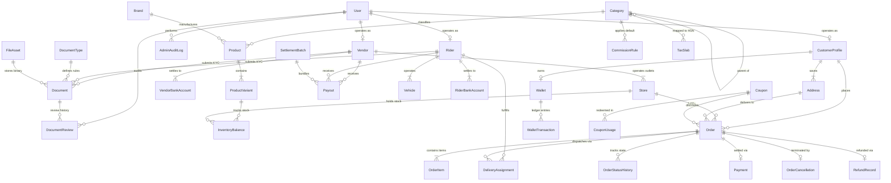
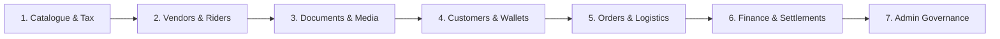

# Fillcart Core Platform Database Schema Proposal (V1)

**Document Type:** Architecture Design & Core Database Schema Proposal  
**Document Location:** `docs/CORE_SCHEMA_PROPOSAL.md`  
**Date:** November 23, 2026  
**Status:** Ready for Architectural Review & RFC  
**Target Audience:** Technical Lead (Akshay), Project Lead, Backend Engineers (Central Auth, Admin, Vendor, Rider, Customer), and Frontend Platform Leads  

---

## Executive Summary & System Scope

Fillcart operates as a unified, high-throughput on-demand delivery platform. Currently, the database contains **19 Central Auth and Identity models** (`User`, `Credential`, `Role`, `Permission`, `SessionFamily`, `ServiceClient`, etc.) managed in PostgreSQL 16 under the least-privilege runtime role `fillcart_app_user`.

This proposal provides the authoritative design for the **Core Platform Database Schema**. It satisfies two critical operational requirements:
1. **Super Admin Governance:** Directly maps to all 12 operational pages, types, mock data, and settings stores in `apps/admin-dashboard`.
2. **Unified Domain Foundation:** Serves as the single source of truth for the upcoming domain backends (**Vendor Backend**, **Rider Backend**, and **Customer Backend**) so that all services share standard models rather than duplicate data or create split-brain inconsistencies.

### Core Architectural Invariants
* **Zero Runtime Hard Deletes:** `fillcart_app_user` possesses only `SELECT`, `INSERT`, and `UPDATE` permissions (`can_delete = false`). Every operational model incorporates soft-delete tracking (`isDeleted: Boolean @default(false)` and `deletedAt: DateTime?`).
* **Financial Integrity:** All currency values are stored as **64-bit integer Paisa (`BigInt` / `Int`)** to eliminate IEEE 754 floating-point inaccuracies. Display formatting (`₹48,200.00`) is handled at the presentation/mapper layer.
* **Geospatial & Address Precision:** Coordinates are captured as `Float` (`latitude`, `longitude` with precision indexes) ready for PostgreSQL PostGIS indexing.
* **Temporal Auditing:** Every model includes canonical `createdAt DateTime @default(now())` and `updatedAt DateTime @updatedAt`. State transitions record historical ledger snapshots (`OrderStatusHistory`, `DocumentReview`, `TimelineEvent`).
* **Cross-Model Auth Integration:** Domain profiles link directly to the existing central `User.id` via strict foreign key relationships (`Vendor.userId`, `Rider.userId`, `CustomerProfile.userId`).

---

## 1. Complete Enum Catalog

| Enum Name | Allowed Values | Domain Meaning & State Invariants |
| :--- | :--- | :--- |
| **`ProductStatus`** | `ACTIVE`, `INACTIVE`, `DRAFT`, `ARCHIVED` | Lifecycle visibility of a product in the catalog. |
| **`ProductModerationStatus`** | `PENDING_APPROVAL`, `APPROVED`, `REJECTED`, `CHANGES_REQUESTED` | Administrative moderation gate for vendor-submitted products. |
| **`UnitType`** | `GRAM`, `KG`, `MILLILITER`, `LITER`, `PIECE`, `PACK`, `METER` | Physical unit of measure for variants. |
| **`VendorStatus`** | `ACTIVE`, `INACTIVE`, `SUSPENDED`, `PENDING_ONBOARDING` | Operational status of the merchant on the platform. |
| **`VerificationStatus`** | `PENDING`, `UNDER_REVIEW`, `APPROVED`, `REJECTED`, `REUPLOAD_REQUESTED` | KYC and onboarding verification state for vendors and riders. |
| **`BankVerificationStatus`** | `PENDING`, `PENNY_DROP_VERIFIED`, `REJECTED` | Verification state of merchant/rider bank accounts. |
| **`RiderStatus`** | `ACTIVE`, `INACTIVE`, `SUSPENDED`, `PENDING_ONBOARDING` | Administrative employment/contract state of delivery rider. |
| **`RiderAvailability`** | `ONLINE`, `OFFLINE`, `ON_DELIVERY` | Real-time shift and dispatch availability state. |
| **`VehicleType`** | `MOTORCYCLE`, `SCOOTER`, `ELECTRIC_VEHICLE`, `BICYCLE`, `ON_FOOT` | Mode of transport used by rider for dispatch calculations. |
| **`ApplicantType`** | `VENDOR`, `RIDER` | Class of business entity submitting onboarding documents. |
| **`RequirementType`** | `REQUIRED`, `OPTIONAL`, `CONDITIONAL` | Rule governing whether a document must be supplied during KYC. |
| **`DocumentStatus`** | `PENDING`, `APPROVED`, `REJECTED`, `REUPLOAD_REQUESTED` | Review state of an individual compliance document. |
| **`DocumentReviewAction`** | `APPROVED`, `REJECTED`, `REUPLOAD_REQUESTED` | Action captured in the append-only KYC audit trail. |
| **`AddressType`** | `HOME`, `WORK`, `OTHER` | Category of customer shipping/delivery address. |
| **`OrderStatus`** | `PLACED`, `ACCEPTED`, `PREPARING`, `READY_FOR_PICKUP`, `OUT_FOR_DELIVERY`, `DELIVERED`, `CANCELLED` | Canonical linear state progression for customer orders. |
| **`PaymentStatus`** | `PENDING`, `AUTHORIZED`, `CAPTURED`, `FAILED`, `REFUNDED`, `PARTIALLY_REFUNDED` | Financial settlement state of customer order transactions. |
| **`PaymentMethod`** | `UPI`, `CARD`, `NET_BANKING`, `COD`, `WALLET` | Mode of payment selected during checkout. |
| **`DeliveryAssignmentStatus`** | `PENDING_ACCEPTANCE`, `ACCEPTED`, `REJECTED`, `TIMED_OUT`, `ARRIVED_AT_STORE`, `PICKED_UP`, `DELIVERED`, `CANCELLED` | Real-time dispatch lifecycle between order and rider. |
| **`AssignmentMode`** | `MANUAL`, `AUTO_DISPATCH` | Whether an order was dispatched algorithmically or by Super Admin override. |
| **`CancellationReasonCode`** | `CUSTOMER_REQUESTED`, `ITEM_OUT_OF_STOCK`, `NO_RIDER_AVAILABLE`, `OUTSIDE_SERVICEABLE_ZONE`, `SUSPECTED_FRAUD`, `OPERATIONAL_DELAY`, `ADMIN_OVERRIDE` | Controlled taxonomy of order cancellations. |
| **`RefundStatus`** | `INITIATED`, `PROCESSING`, `SUCCESS`, `FAILED` | State of return/dispute fund transfers back to customer. |
| **`RefundReason`** | `ORDER_CANCELLED`, `ITEM_MISSING_DAMAGED`, `QUALITY_ISSUE`, `DELIVERY_DELAY`, `ADMIN_DISCRETIONARY` | Business cause justifying customer refund. |
| **`SettlementBatchStatus`** | `DRAFT`, `GENERATED`, `PROCESSING`, `COMPLETED`, `FAILED` | Lifecycle of periodic payout settlement bundles. |
| **`PayoutStatus`** | `PENDING`, `APPROVED`, `PROCESSING`, `PAID`, `FAILED`, `ON_HOLD` | Financial release state for vendor/rider payouts. |
| **`WalletStatus`** | `ACTIVE`, `FROZEN` | Operational status of a customer stored-value wallet. |
| **`WalletTxType`** | `CREDIT`, `DEBIT`, `REFUND`, `CASHBACK` | Transaction ledger classification for wallet balances. |
| **`CouponType`** | `PERCENTAGE`, `FLAT` | Math logic applied to calculate cart discounts. |
| **`CouponAudience`** | `ALL_CUSTOMERS`, `NEW_CUSTOMERS_ONLY`, `VIP_CUSTOMERS_ONLY` | Target eligibility segment for promotion rules. |
| **`CouponStatus`** | `ACTIVE`, `EXPIRED`, `DISABLED` | Availability status for promotional discount vouchers. |
| **`SettingsTabId`** | `GENERAL`, `ORDERS`, `ONBOARDING`, `FINANCE`, `NOTIFICATIONS`, `SECURITY` | Strict partition matching Admin Portal settings tabs. |
| **`AuditTargetType`** | `STAFF`, `VENDOR`, `RIDER`, `ORDER`, `CATALOG`, `SETTING`, `FINANCE`, `DOCUMENT` | High-level taxonomy for admin-performed operational actions. |
| **`AdminAuditAction`** | `CREATE`, `UPDATE`, `DELETE_SOFT`, `APPROVE`, `REJECT`, `SUSPEND`, `REINSTATE`, `OVERRIDE`, `CONFIG_CHANGE` | Standardized audit verbs logged in the management console. |

---

## 2. Core Models Specification (Field-by-Field)

### 2.1 Catalogue & Inventory Subsystem

#### Model: `Category`
Represents the hierarchical taxonomy of products (e.g. "Grocery & Staples" -> "Flours & Grains").
* `id`: `String` `@id @default(uuid())`
* `name`: `String`
* `slug`: `String @unique` (URL/lookup identifier)
* `description`: `String?`
* `iconName`: `String` (Lucide icon identifier, e.g. `ShoppingBag`, `Milk`, `Pill`)
* `parentCategoryId`: `String?` (Self-relation foreign key)
* `displayOrder`: `Int @default(0)`
* `isActive`: `Boolean @default(true)`
* `isDeleted`: `Boolean @default(false)`
* `deletedAt`: `DateTime?`
* `createdAt`: `DateTime @default(now())`
* `updatedAt`: `DateTime @updatedAt`
* **Relations:**
  * `parentCategory`: `Category? @relation("CategoryHierarchy", fields: [parentCategoryId], references: [id], onDelete: Restrict)`
  * `subCategories`: `Category[] @relation("CategoryHierarchy")`
  * `products`: `Product[]`
  * `commissionRules`: `CommissionRule[]`
  * `taxMappings`: `TaxSlab[]`
* **Indexes & Constraints:**
  * `@@index([parentCategoryId])`
  * `@@index([isActive, isDeleted])`

#### Model: `Brand`
Represents verified manufacturers and product lines (e.g. "Aashirvaad", "Amul", "Tata").
* `id`: `String` `@id @default(uuid())`
* `name`: `String @unique`
* `slug`: `String @unique`
* `logoUrl`: `String?`
* `isActive`: `Boolean @default(true)`
* `isDeleted`: `Boolean @default(false)`
* `deletedAt`: `DateTime?`
* `createdAt`: `DateTime @default(now())`
* `updatedAt`: `DateTime @updatedAt`
* **Relations:**
  * `products`: `Product[]`
* **Indexes & Constraints:**
  * `@@index([isActive, isDeleted])`

#### Model: `Product`
Master product definition independent of vendor-specific pricing or stock.
* `id`: `String` `@id @default(uuid())`
* `name`: `String`
* `slug`: `String @unique`
* `description`: `String?`
* `categoryId`: `String`
* `brandId`: `String?`
* `hsnCode`: `String?` (Harmonized System of Nomenclature code for GST)
* `status`: `ProductStatus @default(DRAFT)`
* `moderationStatus`: `ProductModerationStatus @default(PENDING_APPROVAL)`
* `rejectReason`: `String?`
* `moderatedByUserId`: `String?` (Foreign key to Admin `User.id`)
* `moderatedAt`: `DateTime?`
* `isActive`: `Boolean @default(true)`
* `isDeleted`: `Boolean @default(false)`
* `deletedAt`: `DateTime?`
* `createdAt`: `DateTime @default(now())`
* `updatedAt`: `DateTime @updatedAt`
* **Relations:**
  * `category`: `Category @relation(fields: [categoryId], references: [id], onDelete: Restrict)`
  * `brand`: `Brand? @relation(fields: [brandId], references: [id], onDelete: Restrict)`
  * `moderatedBy`: `User? @relation("ProductModerator", fields: [moderatedByUserId], references: [id], onDelete: Restrict)`
  * `variants`: `ProductVariant[]`
* **Indexes & Constraints:**
  * `@@index([categoryId])`
  * `@@index([brandId])`
  * `@@index([status, moderationStatus])`
  * `@@index([isActive, isDeleted])`

#### Model: `ProductVariant`
The concrete sellable SKU (e.g. "500g pouch", "5kg bag") holding price benchmarks and units.
* `id`: `String` `@id @default(uuid())`
* `productId`: `String`
* `sku`: `String @unique` (e.g. `AAS-ATT-5KG`)
* `barcode`: `String? @unique`
* `variantName`: `String` (e.g. "5 kg", "500 g Carton", "1 L Pouch")
* `unitQuantity`: `Decimal @db.Decimal(10, 3)` (e.g. 5.000, 0.500)
* `unitType`: `UnitType`
* `mrpPaisa`: `Int` (Maximum Retail Price in Paisa, e.g. 32500 for ₹325)
* `salePricePaisa`: `Int` (Default benchmark selling price in Paisa)
* `discountPct`: `Int @default(0)`
* `isDefault`: `Boolean @default(false)`
* `isActive`: `Boolean @default(true)`
* `isDeleted`: `Boolean @default(false)`
* `deletedAt`: `DateTime?`
* `createdAt`: `DateTime @default(now())`
* `updatedAt`: `DateTime @updatedAt`
* **Relations:**
  * `product`: `Product @relation(fields: [productId], references: [id], onDelete: Cascade)`
  * `inventoryBalances`: `InventoryBalance[]`
  * `orderItems`: `OrderItem[]`
* **Indexes & Constraints:**
  * `@@index([productId])`
  * `@@index([sku])`
  * `@@index([isActive, isDeleted])`

#### Model: `InventoryBalance`
Real-time per-store stock tracking linking store outlets with catalog variants.
* `id`: `String` `@id @default(uuid())`
* `storeId`: `String`
* `variantId`: `String`
* `quantityOnHand`: `Int @default(0)`
* `reservedQuantity`: `Int @default(0)` (Held by unfulfilled placed orders)
* `reorderThreshold`: `Int @default(5)`
* `lastRestockedAt`: `DateTime?`
* `createdAt`: `DateTime @default(now())`
* `updatedAt`: `DateTime @updatedAt`
* **Relations:**
  * `store`: `Store @relation(fields: [storeId], references: [id], onDelete: Cascade)`
  * `variant`: `ProductVariant @relation(fields: [variantId], references: [id], onDelete: Restrict)`
* **Indexes & Constraints:**
  * `@@unique([storeId, variantId])`
  * `@@index([variantId])`
  * `@@index([quantityOnHand])`

---

### 2.2 Vendors & Stores Subsystem

#### Model: `Vendor`
Merchant legal entity profile linked 1-to-1 with a central `User` identity.
* `id`: `String` `@id @default(uuid())`
* `userId`: `String @unique` (Links to Central `User.id`)
* `businessName`: `String` (Store legal trade name, e.g. "Fresh Mart Hub")
* `ownerName`: `String` (Contact person, e.g. "Rajesh Gupta")
* `businessCategory`: `String` (e.g. "Grocery", "Dairy", "Pharmacy")
* `city`: `String`
* `shopAddress`: `String`
* `gstin`: `String?` (GST Identification Number, e.g. `07AAAAA0000A1Z5`)
* `licenceNumber`: `String?` (FSSAI or trade license)
* `commissionPct`: `Decimal @default(8.00) @db.Decimal(5, 2)` (Default merchant commission cut)
* `status`: `VendorStatus @default(PENDING_ONBOARDING)`
* `verificationStatus`: `VerificationStatus @default(PENDING)`
* `statusReason`: `String?`
* `statusRemarks`: `String?`
* `statusChangedAt`: `DateTime?`
* `statusChangedByUserId`: `String?` (Foreign key to Admin `User.id`)
* `joinedDate`: `DateTime @default(now())`
* `isDeleted`: `Boolean @default(false)`
* `deletedAt`: `DateTime?`
* `createdAt`: `DateTime @default(now())`
* `updatedAt`: `DateTime @updatedAt`
* **Relations:**
  * `user`: `User @relation("VendorUser", fields: [userId], references: [id], onDelete: Restrict)`
  * `statusChangedBy`: `User? @relation("VendorStatusAdmin", fields: [statusChangedByUserId], references: [id], onDelete: Restrict)`
  * `stores`: `Store[]`
  * `bankAccounts`: `VendorBankAccount[]`
  * `documents`: `Document[]`
  * `payouts`: `Payout[]`
  * `commissionOverrides`: `CommissionRule[]`
* **Indexes & Constraints:**
  * `@@index([status, verificationStatus])`
  * `@@index([city])`
  * `@@index([gstin])`
  * `@@index([isDeleted])`

#### Model: `Store`
Physical or dark-store fulfillment location operated by a vendor.
* `id`: `String` `@id @default(uuid())`
* `vendorId`: `String`
* `storeName`: `String`
* `storeCode`: `String @unique` (e.g. `STR-DEL-001`)
* `phone`: `String`
* `email`: `String?`
* `addressLine1`: `String`
* `addressLine2`: `String?`
* `city`: `String`
* `state`: `String`
* `postalCode`: `String`
* `latitude`: `Float`
* `longitude`: `Float`
* `serviceRadiusKm`: `Decimal @default(5.0) @db.Decimal(4, 1)`
* `isOpen`: `Boolean @default(true)`
* `openingTime`: `String @default("07:00")` (HH:MM format)
* `closingTime`: `String @default("23:00")`
* `isActive`: `Boolean @default(true)`
* `isDeleted`: `Boolean @default(false)`
* `deletedAt`: `DateTime?`
* `createdAt`: `DateTime @default(now())`
* `updatedAt`: `DateTime @updatedAt`
* **Relations:**
  * `vendor`: `Vendor @relation(fields: [vendorId], references: [id], onDelete: Cascade)`
  * `inventoryBalances`: `InventoryBalance[]`
  * `orders`: `Order[]`
* **Indexes & Constraints:**
  * `@@index([vendorId])`
  * `@@index([city, state])`
  * `@@index([latitude, longitude])`
  * `@@index([isOpen, isActive, isDeleted])`

#### Model: `VendorBankAccount`
Disbursement account details for merchant settlement processing.
* `id`: `String` `@id @default(uuid())`
* `vendorId`: `String`
* `accountHolderName`: `String`
* `bankName`: `String` (e.g. "HDFC Bank")
* `accountNumberEncrypted`: `String` (AES-256-GCM cipher text)
* `accountNumberMasked`: `String` (e.g. "HDFC Bank •••• 4892")
* `ifscCode`: `String` (e.g. `HDFC0001234`)
* `isPrimary`: `Boolean @default(true)`
* `verificationStatus`: `BankVerificationStatus @default(PENDING)`
* `isDeleted`: `Boolean @default(false)`
* `deletedAt`: `DateTime?`
* `createdAt`: `DateTime @default(now())`
* `updatedAt`: `DateTime @updatedAt`
* **Relations:**
  * `vendor`: `Vendor @relation(fields: [vendorId], references: [id], onDelete: Cascade)`
  * `payouts`: `Payout[]`
* **Indexes & Constraints:**
  * `@@index([vendorId])`
  * `@@index([isPrimary])`

---

### 2.3 Riders & Fleets Subsystem

#### Model: `Rider`
Delivery fleet personnel profile linked 1-to-1 with a central `User` identity.
* `id`: `String` `@id @default(uuid())`
* `userId`: `String @unique` (Links to Central `User.id`)
* `fullName`: `String`
* `phone`: `String`
* `email`: `String?`
* `city`: `String`
* `address`: `String`
* `emergencyContactName`: `String`
* `emergencyContactRelation`: `String`
* `emergencyContactPhone`: `String`
* `availability`: `RiderAvailability @default(OFFLINE)`
* `currentLatitude`: `Float?`
* `currentLongitude`: `Float?`
* `lastLocationUpdatedAt`: `DateTime?`
* `verificationStatus`: `VerificationStatus @default(PENDING)`
* `status`: `RiderStatus @default(PENDING_ONBOARDING)`
* `statusReason`: `String?`
* `statusRemarks`: `String?`
* `statusChangedAt`: `DateTime?`
* `statusChangedByUserId`: `String?` (Foreign key to Admin `User.id`)
* `ratingAverage`: `Decimal @default(5.00) @db.Decimal(3, 2)`
* `deliveriesCompleted`: `Int @default(0)`
* `onTimePct`: `Decimal @default(100.0) @db.Decimal(5, 2)`
* `joinedDate`: `DateTime @default(now())`
* `isDeleted`: `Boolean @default(false)`
* `deletedAt`: `DateTime?`
* `createdAt`: `DateTime @default(now())`
* `updatedAt`: `DateTime @updatedAt`
* **Relations:**
  * `user`: `User @relation("RiderUser", fields: [userId], references: [id], onDelete: Restrict)`
  * `statusChangedBy`: `User? @relation("RiderStatusAdmin", fields: [statusChangedByUserId], references: [id], onDelete: Restrict)`
  * `vehicles`: `Vehicle[]`
  * `bankAccounts`: `RiderBankAccount[]`
  * `deliveryAssignments`: `DeliveryAssignment[]`
  * `documents`: `Document[]`
  * `payouts`: `Payout[]`
* **Indexes & Constraints:**
  * `@@index([status, verificationStatus])`
  * `@@index([availability])`
  * `@@index([city])`
  * `@@index([currentLatitude, currentLongitude])`
  * `@@index([isDeleted])`

#### Model: `Vehicle`
Transportation vehicle registered to a delivery rider.
* `id`: `String` `@id @default(uuid())`
* `riderId`: `String`
* `vehicleType`: `VehicleType` (e.g. `MOTORCYCLE`, `SCOOTER`, `BICYCLE`)
* `model`: `String?` (e.g. "Hero Splendor", "Activa 6G")
* `registrationNumber`: `String?` (e.g. `MP09 AB 1234`; nullable for bicycle/on-foot)
* `isPrimary`: `Boolean @default(true)`
* `isActive`: `Boolean @default(true)`
* `isDeleted`: `Boolean @default(false)`
* `deletedAt`: `DateTime?`
* `createdAt`: `DateTime @default(now())`
* `updatedAt`: `DateTime @updatedAt`
* **Relations:**
  * `rider`: `Rider @relation(fields: [riderId], references: [id], onDelete: Cascade)`
* **Indexes & Constraints:**
  * `@@index([riderId])`
  * `@@index([registrationNumber])`

#### Model: `RiderBankAccount`
Disbursement account details for rider trip earning settlements.
* `id`: `String` `@id @default(uuid())`
* `riderId`: `String`
* `accountHolderName`: `String`
* `bankName`: `String`
* `accountNumberEncrypted`: `String` (AES-256-GCM cipher text)
* `accountNumberMasked`: `String` (e.g. "SBI •••• 8841")
* `ifscCode`: `String`
* `isPrimary`: `Boolean @default(true)`
* `verificationStatus`: `BankVerificationStatus @default(PENDING)`
* `isDeleted`: `Boolean @default(false)`
* `deletedAt`: `DateTime?`
* `createdAt`: `DateTime @default(now())`
* `updatedAt`: `DateTime @updatedAt`
* **Relations:**
  * `rider`: `Rider @relation(fields: [riderId], references: [id], onDelete: Cascade)`
  * `payouts`: `Payout[]`
* **Indexes & Constraints:**
  * `@@index([riderId])`
  * `@@index([isPrimary])`

---

### 2.4 Document Verification & Media Subsystem

#### Model: `FileAsset`
Central registry of immutable binary assets stored in S3/MinIO cloud object storage.
* `id`: `String` `@id @default(uuid())`
* `storageKey`: `String @unique` (S3 object key)
* `bucketName`: `String`
* `fileUrl`: `String` (Signed CDN or gateway URL)
* `mimeType`: `String` (e.g. `image/jpeg`, `application/pdf`)
* `fileSizeBytes`: `Int`
* `checksumSha256`: `String`
* `uploadedByUserId`: `String` (Foreign key to Central `User.id`)
* `createdAt`: `DateTime @default(now())`
* **Relations:**
  * `uploadedBy`: `User @relation("AssetUploader", fields: [uploadedByUserId], references: [id], onDelete: Restrict)`
  * `documents`: `Document[]`
* **Indexes & Constraints:**
  * `@@index([uploadedByUserId])`

#### Model: `DocumentType`
Configurable rules engine for required onboarding credentials.
* `id`: `String` `@id @default(uuid())`
* `code`: `String @unique` (e.g. `PAN_CARD`, `AADHAAR_FRONT`, `DRIVING_LICENSE`, `FSSAI_REGISTRATION`, `DRUG_LICENSE`)
* `name`: `String` (e.g. "Owner's PAN Card", "Commercial Vehicle RC")
* `purpose`: `String` (e.g. "Identity & tax verification", "Food safety compliance")
* `appliesTo`: `ApplicantType` (e.g. `VENDOR` or `RIDER`)
* `requirementLevel`: `RequirementType @default(REQUIRED)`
* `isCategorySpecific`: `Boolean @default(false)`
* `applicableCategory`: `String?` (e.g. "Pharmacy", "Dairy")
* `isVehicleRequired`: `Boolean @default(false)` (Conditional on motorized vehicle)
* `displayOrder`: `Int @default(0)`
* `isActive`: `Boolean @default(true)`
* `createdAt`: `DateTime @default(now())`
* `updatedAt`: `DateTime @updatedAt`
* **Relations:**
  * `documents`: `Document[]`
* **Indexes & Constraints:**
  * `@@index([appliesTo, isActive])`

#### Model: `Document`
Concrete compliance document instance uploaded by an applicant.
* `id`: `String` `@id @default(uuid())`
* `entityType`: `ApplicantType`
* `vendorId`: `String?`
* `riderId`: `String?`
* `documentTypeId`: `String`
* `fileAssetId`: `String?`
* `documentNumber`: `String?` (Masked/encrypted identifier, e.g. `ABCDE1234F`)
* `status`: `DocumentStatus @default(PENDING)`
* `rejectReason`: `String?` (Standardized reject taxonomy from admin UI)
* `rejectRemarks`: `String?` (Custom instructions for applicant resubmission)
* `reviewedByUserId`: `String?` (Foreign key to Admin `User.id`)
* `reviewedAt`: `DateTime?`
* `isDeleted`: `Boolean @default(false)`
* `deletedAt`: `DateTime?`
* `createdAt`: `DateTime @default(now())`
* `updatedAt`: `DateTime @updatedAt`
* **Relations:**
  * `vendor`: `Vendor? @relation(fields: [vendorId], references: [id], onDelete: Cascade)`
  * `rider`: `Rider? @relation(fields: [riderId], references: [id], onDelete: Cascade)`
  * `documentType`: `DocumentType @relation(fields: [documentTypeId], references: [id], onDelete: Restrict)`
  * `fileAsset`: `FileAsset? @relation(fields: [fileAssetId], references: [id], onDelete: SetNull)`
  * `reviewedBy`: `User? @relation("DocumentReviewer", fields: [reviewedByUserId], references: [id], onDelete: Restrict)`
  * `reviews`: `DocumentReview[]`
* **Indexes & Constraints:**
  * `@@index([vendorId])`
  * `@@index([riderId])`
  * `@@index([status])`
  * `@@index([documentTypeId])`

#### Model: `DocumentReview`
Append-only historical audit trail of document review decisions.
* `id`: `String` `@id @default(uuid())`
* `documentId`: `String`
* `reviewedByUserId`: `String` (Admin user)
* `action`: `DocumentReviewAction`
* `reason`: `String?`
* `remarks`: `String?`
* `createdAt`: `DateTime @default(now())`
* **Relations:**
  * `document`: `Document @relation(fields: [documentId], references: [id], onDelete: Cascade)`
  * `reviewedBy`: `User @relation("ReviewHistoryUser", fields: [reviewedByUserId], references: [id], onDelete: Restrict)`
* **Indexes & Constraints:**
  * `@@index([documentId])`
  * `@@index([reviewedByUserId])`
  * `@@index([createdAt])`

---

### 2.5 Customers & Addresses Subsystem

#### Model: `CustomerProfile`
Customer consumer profile linked 1-to-1 with a central `User` identity.
* `id`: `String` `@id @default(uuid())`
* `userId`: `String @unique` (Links to Central `User.id`)
* `dateOfBirth`: `DateTime?`
* `alternatePhone`: `String?`
* `isVip`: `Boolean @default(false)`
* `totalOrdersPlaced`: `Int @default(0)`
* `isDeleted`: `Boolean @default(false)`
* `deletedAt`: `DateTime?`
* `createdAt`: `DateTime @default(now())`
* `updatedAt`: `DateTime @updatedAt`
* **Relations:**
  * `user`: `User @relation("CustomerUser", fields: [userId], references: [id], onDelete: Restrict)`
  * `addresses`: `Address[]`
  * `orders`: `Order[]`
  * `wallet`: `Wallet?`
  * `couponUsages`: `CouponUsage[]`
* **Indexes & Constraints:**
  * `@@index([isVip])`
  * `@@index([isDeleted])`

#### Model: `Address`
Saved delivery addresses for customer checkout.
* `id`: `String` `@id @default(uuid())`
* `customerProfileId`: `String`
* `addressType`: `AddressType @default(HOME)`
* `recipientName`: `String`
* `recipientPhone`: `String`
* `flatHouseNumber`: `String` (e.g. "Flat 402, Lotus Greens")
* `streetAddress`: `String` (e.g. "Indirapuram")
* `landmark`: `String?`
* `city`: `String`
* `state`: `String`
* `postalCode`: `String`
* `latitude`: `Float`
* `longitude`: `Float`
* `isDefault`: `Boolean @default(false)`
* `isDeleted`: `Boolean @default(false)`
* `deletedAt`: `DateTime?`
* `createdAt`: `DateTime @default(now())`
* `updatedAt`: `DateTime @updatedAt`
* **Relations:**
  * `customerProfile`: `CustomerProfile @relation(fields: [customerProfileId], references: [id], onDelete: Cascade)`
  * `orders`: `Order[]`
* **Indexes & Constraints:**
  * `@@index([customerProfileId])`
  * `@@index([latitude, longitude])`

---

### 2.6 Orders & Logistics Subsystem

#### Model: `Order`
Central transactional lifecycle model capturing order composition, pricing, and fulfillment.
* `id`: `String` `@id @default(uuid())`
* `orderNumber`: `String @unique` (Human-readable format, e.g. `#FK-8921`)
* `customerProfileId`: `String`
* `storeId`: `String`
* `deliveryAddressId`: `String`
* `status`: `OrderStatus @default(PLACED)`
* `paymentStatus`: `PaymentStatus @default(PENDING)`
* `paymentMethod`: `PaymentMethod`
* `itemTotalPaisa`: `Int` (Sum of line items)
* `deliveryFeePaisa`: `Int @default(0)`
* `taxPaisa`: `Int @default(0)` (GST aggregated)
* `discountPaisa`: `Int @default(0)` (Coupon/promotion deductions)
* `tipPaisa`: `Int @default(0)`
* `totalAmountPaisa`: `Int` (Net bill payable by customer)
* `couponId`: `String?`
* `specialInstructions`: `String?`
* `placedAt`: `DateTime @default(now())`
* `acceptedAt`: `DateTime?`
* `preparingAt`: `DateTime?`
* `readyForPickupAt`: `DateTime?`
* `outForDeliveryAt`: `DateTime?`
* `deliveredAt`: `DateTime?`
* `cancelledAt`: `DateTime?`
* `cancelReason`: `String?`
* `cancelRemarks`: `String?`
* `isRefunded`: `Boolean @default(false)`
* `isDeleted`: `Boolean @default(false)`
* `deletedAt`: `DateTime?`
* `createdAt`: `DateTime @default(now())`
* `updatedAt`: `DateTime @updatedAt`
* **Relations:**
  * `customerProfile`: `CustomerProfile @relation(fields: [customerProfileId], references: [id], onDelete: Restrict)`
  * `store`: `Store @relation(fields: [storeId], references: [id], onDelete: Restrict)`
  * `deliveryAddress`: `Address @relation(fields: [deliveryAddressId], references: [id], onDelete: Restrict)`
  * `coupon`: `Coupon? @relation(fields: [couponId], references: [id], onDelete: SetNull)`
  * `items`: `OrderItem[]`
  * `statusHistory`: `OrderStatusHistory[]`
  * `deliveryAssignments`: `DeliveryAssignment[]`
  * `payment`: `Payment?`
  * `cancellationRecord`: `OrderCancellation?`
  * `refundRecord`: `RefundRecord?`
* **Indexes & Constraints:**
  * `@@index([orderNumber])`
  * `@@index([customerProfileId])`
  * `@@index([storeId])`
  * `@@index([status])`
  * `@@index([paymentStatus])`
  * `@@index([placedAt])`

#### Model: `OrderItem`
Immutable line-item snapshot of products purchased inside an order.
* `id`: `String` `@id @default(uuid())`
* `orderId`: `String`
* `variantId`: `String`
* `productName`: `String` (Historical text snapshot)
* `variantName`: `String` (e.g. "5 kg")
* `unitPricePaisa`: `Int`
* `quantity`: `Int`
* `subtotalPaisa`: `Int`
* `taxPaisa`: `Int @default(0)`
* `totalPaisa`: `Int`
* `specialNotes`: `String?`
* `createdAt`: `DateTime @default(now())`
* **Relations:**
  * `order`: `Order @relation(fields: [orderId], references: [id], onDelete: Cascade)`
  * `variant`: `ProductVariant @relation(fields: [variantId], references: [id], onDelete: Restrict)`
* **Indexes & Constraints:**
  * `@@index([orderId])`
  * `@@index([variantId])`

#### Model: `OrderStatusHistory`
Append-only state machine ledger recording every stage transition of an order.
* `id`: `String` `@id @default(uuid())`
* `orderId`: `String`
* `fromStatus`: `OrderStatus?`
* `toStatus`: `OrderStatus`
* `triggeredByActorType`: `AuditActorType` (e.g. `USER`, `SERVICE_CLIENT`)
* `triggeredByUserId`: `String?`
* `reason`: `String?`
* `metadata`: `Json?`
* `createdAt`: `DateTime @default(now())`
* **Relations:**
  * `order`: `Order @relation(fields: [orderId], references: [id], onDelete: Cascade)`
  * `triggeredByUser`: `User? @relation("OrderStatusActor", fields: [triggeredByUserId], references: [id], onDelete: Restrict)`
* **Indexes & Constraints:**
  * `@@index([orderId])`
  * `@@index([toStatus])`
  * `@@index([createdAt])`

#### Model: `DeliveryAssignment`
Real-time dispatch task dispatching orders to riders.
* `id`: `String` `@id @default(uuid())`
* `orderId`: `String`
* `riderId`: `String`
* `status`: `DeliveryAssignmentStatus @default(PENDING_ACCEPTANCE)`
* `assignedByMode`: `AssignmentMode @default(AUTO_DISPATCH)`
* `assignedByUserId`: `String?` (Populated if manually dispatched by Super Admin)
* `assignedAt`: `DateTime @default(now())`
* `acceptedAt`: `DateTime?`
* `arrivedAtStoreAt`: `DateTime?`
* `pickedUpAt`: `DateTime?`
* `arrivedAtCustomerAt`: `DateTime?`
* `completedAt`: `DateTime?`
* `cancelledAt`: `DateTime?`
* `cancelReason`: `String?`
* `distanceMeters`: `Int?`
* `riderEarningsPaisa`: `Int @default(0)` (Trip payout credited to rider)
* `createdAt`: `DateTime @default(now())`
* `updatedAt`: `DateTime @updatedAt`
* **Relations:**
  * `order`: `Order @relation(fields: [orderId], references: [id], onDelete: Cascade)`
  * `rider`: `Rider @relation(fields: [riderId], references: [id], onDelete: Restrict)`
  * `assignedByUser`: `User? @relation("DispatchAdminUser", fields: [assignedByUserId], references: [id], onDelete: Restrict)`
* **Indexes & Constraints:**
  * `@@index([orderId])`
  * `@@index([riderId])`
  * `@@index([status])`

#### Model: `OrderCancellation`
Strict audit record capturing cause and actor for order terminations.
* `id`: `String` `@id @default(uuid())`
* `orderId`: `String @unique`
* `cancelledByActorType`: `AuditActorType`
* `cancelledByUserId`: `String?`
* `reasonCode`: `CancellationReasonCode`
* `customReason`: `String?`
* `isAutoCancelled`: `Boolean @default(false)`
* `feeAppliedPaisa`: `Int @default(0)`
* `createdAt`: `DateTime @default(now())`
* **Relations:**
  * `order`: `Order @relation(fields: [orderId], references: [id], onDelete: Cascade)`
  * `cancelledByUser`: `User? @relation("OrderCancelUser", fields: [cancelledByUserId], references: [id], onDelete: Restrict)`

#### Model: `RefundRecord`
Dispute and return settlement ledger linking customer orders to monetary reimbursements.
* `id`: `String` `@id @default(uuid())`
* `orderId`: `String @unique`
* `paymentId`: `String?`
* `customerProfileId`: `String`
* `amountPaisa`: `Int`
* `status`: `RefundStatus @default(INITIATED)`
* `reason`: `RefundReason`
* `processedByUserId`: `String?` (Admin user authorizing refund)
* `gatewayRefundId`: `String?`
* `processedAt`: `DateTime?`
* `createdAt`: `DateTime @default(now())`
* `updatedAt`: `DateTime @updatedAt`
* **Relations:**
  * `order`: `Order @relation(fields: [orderId], references: [id], onDelete: Cascade)`
  * `payment`: `Payment? @relation(fields: [paymentId], references: [id], onDelete: SetNull)`
  * `customerProfile`: `CustomerProfile @relation(fields: [customerProfileId], references: [id], onDelete: Restrict)`
  * `processedByUser`: `User? @relation("RefundAdminUser", fields: [processedByUserId], references: [id], onDelete: Restrict)`
* **Indexes & Constraints:**
  * `@@index([status])`
  * `@@index([customerProfileId])`

---

### 2.7 Finance, Settlements & Promotions Subsystem

#### Model: `Payment`
Payment gateway gateway interaction ledger.
* `id`: `String` `@id @default(uuid())`
* `orderId`: `String @unique`
* `customerProfileId`: `String`
* `gatewayTransactionId`: `String? @unique`
* `gatewayName`: `String` (e.g. "Razorpay", "Cashfree", "MockGateway")
* `method`: `PaymentMethod`
* `amountPaisa`: `Int`
* `currency`: `String @default("INR")`
* `status`: `PaymentStatus @default(PENDING)`
* `failureReason`: `String?`
* `gatewayResponse`: `Json?`
* `createdAt`: `DateTime @default(now())`
* `updatedAt`: `DateTime @updatedAt`
* **Relations:**
  * `order`: `Order @relation(fields: [orderId], references: [id], onDelete: Cascade)`
  * `refunds`: `RefundRecord[]`
* **Indexes & Constraints:**
  * `@@index([status])`
  * `@@index([gatewayTransactionId])`

#### Model: `SettlementBatch`
Periodic batch settlement grouping payouts for bulk release.
* `id`: `String` `@id @default(uuid())`
* `batchNumber`: `String @unique` (e.g. `SET-202611-001`)
* `entityType`: `ApplicantType` (`VENDOR` or `RIDER`)
* `periodStart`: `DateTime`
* `periodEnd`: `DateTime`
* `totalGrossAmountPaisa`: `BigInt`
* `totalCommissionPaisa`: `BigInt`
* `totalGstPaisa`: `BigInt`
* `totalNetPayoutPaisa`: `BigInt`
* `totalCount`: `Int`
* `status`: `SettlementBatchStatus @default(DRAFT)`
* `createdByUserId`: `String`
* `processedAt`: `DateTime?`
* `createdAt`: `DateTime @default(now())`
* `updatedAt`: `DateTime @updatedAt`
* **Relations:**
  * `createdByUser`: `User @relation("SettlementBatchCreator", fields: [createdByUserId], references: [id], onDelete: Restrict)`
  * `payouts`: `Payout[]`
* **Indexes & Constraints:**
  * `@@index([status])`
  * `@@index([periodStart, periodEnd])`

#### Model: `Payout`
Individual line item disbursement for a merchant or delivery partner.
* `id`: `String` `@id @default(uuid())`
* `settlementBatchId`: `String?`
* `entityType`: `ApplicantType`
* `vendorId`: `String?`
* `riderId`: `String?`
* `periodLabel`: `String` (e.g. "10 Nov - 16 Nov 2026")
* `grossAmountPaisa`: `Int`
* `commissionPct`: `Decimal @db.Decimal(5, 2)`
* `commissionAmountPaisa`: `Int`
* `gstOnCommissionPaisa`: `Int` (18% GST on platform fee)
* `deductionsPaisa`: `Int @default(0)`
* `netPayoutPaisa`: `Int`
* `status`: `PayoutStatus @default(PENDING)`
* `vendorBankAccountId`: `String?`
* `riderBankAccountId`: `String?`
* `utrNumber`: `String?` (Unique Transaction Reference from bank transfer)
* `failureReason`: `String?`
* `initiatedByUserId`: `String?`
* `processedAt`: `DateTime?`
* `createdAt`: `DateTime @default(now())`
* `updatedAt`: `DateTime @updatedAt`
* **Relations:**
  * `settlementBatch`: `SettlementBatch? @relation(fields: [settlementBatchId], references: [id], onDelete: SetNull)`
  * `vendor`: `Vendor? @relation(fields: [vendorId], references: [id], onDelete: Cascade)`
  * `rider`: `Rider? @relation(fields: [riderId], references: [id], onDelete: Cascade)`
  * `vendorBankAccount`: `VendorBankAccount? @relation(fields: [vendorBankAccountId], references: [id], onDelete: SetNull)`
  * `riderBankAccount`: `RiderBankAccount? @relation(fields: [riderBankAccountId], references: [id], onDelete: SetNull)`
  * `initiatedByUser`: `User? @relation("PayoutInitiator", fields: [initiatedByUserId], references: [id], onDelete: Restrict)`
* **Indexes & Constraints:**
  * `@@index([vendorId])`
  * `@@index([riderId])`
  * `@@index([status])`
  * `@@index([settlementBatchId])`

#### Model: `CommissionRule`
Dynamic commission rate policies per category or specific vendor negotiated overrides.
* `id`: `String` `@id @default(uuid())`
* `name`: `String`
* `categoryId`: `String?`
* `vendorId`: `String?`
* `ratePct`: `Decimal @db.Decimal(5, 2)`
* `effectiveFrom`: `DateTime`
* `effectiveTo`: `DateTime?`
* `reason`: `String?`
* `createdByUserId`: `String`
* `isActive`: `Boolean @default(true)`
* `isDeleted`: `Boolean @default(false)`
* `deletedAt`: `DateTime?`
* `createdAt`: `DateTime @default(now())`
* `updatedAt`: `DateTime @updatedAt`
* **Relations:**
  * `category`: `Category? @relation(fields: [categoryId], references: [id], onDelete: Cascade)`
  * `vendor`: `Vendor? @relation(fields: [vendorId], references: [id], onDelete: Cascade)`
  * `createdByUser`: `User @relation("CommissionRuleAdmin", fields: [createdByUserId], references: [id], onDelete: Restrict)`
* **Indexes & Constraints:**
  * `@@index([categoryId])`
  * `@@index([vendorId])`
  * `@@index([isActive, isDeleted])`

#### Model: `Wallet`
Stored-value digital wallet assigned to customers.
* `id`: `String` `@id @default(uuid())`
* `customerProfileId`: `String @unique`
* `balancePaisa`: `Int @default(0)`
* `totalSpentPaisa`: `Int @default(0)`
* `currency`: `String @default("INR")`
* `status`: `WalletStatus @default(ACTIVE)`
* `isDeleted`: `Boolean @default(false)`
* `deletedAt`: `DateTime?`
* `createdAt`: `DateTime @default(now())`
* `updatedAt`: `DateTime @updatedAt`
* **Relations:**
  * `customerProfile`: `CustomerProfile @relation(fields: [customerProfileId], references: [id], onDelete: Cascade)`
  * `transactions`: `WalletTransaction[]`
* **Indexes & Constraints:**
  * `@@index([status])`

#### Model: `WalletTransaction`
Double-entry ledger entry for customer wallet balances.
* `id`: `String` `@id @default(uuid())`
* `walletId`: `String`
* `type`: `WalletTxType`
* `amountPaisa`: `Int`
* `balanceAfterPaisa`: `Int`
* `referenceOrderId`: `String?`
* `reason`: `String`
* `performedByUserId`: `String?` (Populated if credited/adjusted by Super Admin)
* `createdAt`: `DateTime @default(now())`
* **Relations:**
  * `wallet`: `Wallet @relation(fields: [walletId], references: [id], onDelete: Cascade)`
  * `performedByUser`: `User? @relation("WalletAdminAdjuster", fields: [performedByUserId], references: [id], onDelete: Restrict)`
* **Indexes & Constraints:**
  * `@@index([walletId])`
  * `@@index([type])`
  * `@@index([createdAt])`

#### Model: `Coupon`
Promotional discount voucher rules engine.
* `id`: `String` `@id @default(uuid())`
* `code`: `String @unique` (e.g. `WELCOME50`, `FRESH20`)
* `type`: `CouponType` (`FLAT` or `PERCENTAGE`)
* `valuePaisaOrPct`: `Int` (e.g. 5000 for ₹50, or 20 for 20%)
* `minOrderValuePaisa`: `Int @default(0)`
* `maxDiscountPaisa`: `Int?` (Ceiling limit for percentage discounts)
* `totalUsageLimit`: `Int @default(1000)`
* `currentUsageCount`: `Int @default(0)`
* `perUserLimit`: `Int @default(1)`
* `applicableAudience`: `CouponAudience @default(ALL_CUSTOMERS)`
* `validFrom`: `DateTime`
* `validTo`: `DateTime`
* `status`: `CouponStatus @default(ACTIVE)`
* `isDeleted`: `Boolean @default(false)`
* `deletedAt`: `DateTime?`
* `createdAt`: `DateTime @default(now())`
* `updatedAt`: `DateTime @updatedAt`
* **Relations:**
  * `orders`: `Order[]`
  * `usages`: `CouponUsage[]`
* **Indexes & Constraints:**
  * `@@index([code])`
  * `@@index([status])`
  * `@@index([validFrom, validTo])`

#### Model: `CouponUsage`
Tracking individual redemption of coupons per customer.
* `id`: `String` `@id @default(uuid())`
* `couponId`: `String`
* `customerProfileId`: `String`
* `orderId`: `String`
* `discountAppliedPaisa`: `Int`
* `usedAt`: `DateTime @default(now())`
* **Relations:**
  * `coupon`: `Coupon @relation(fields: [couponId], references: [id], onDelete: Restrict)`
  * `customerProfile`: `CustomerProfile @relation(fields: [customerProfileId], references: [id], onDelete: Restrict)`
* **Indexes & Constraints:**
  * `@@index([couponId, customerProfileId])`
  * `@@index([orderId])`

#### Model: `TaxSlab`
Statutory GST and HSN classification tables.
* `id`: `String` `@id @default(uuid())`
* `name`: `String` (e.g. "Dairy & Milk Products", "Packaged Snacks")
* `categoryId`: `String?`
* `hsnCode`: `String` (e.g. `0401`, `0709`)
* `slabPercentage`: `Int` (0, 5, 12, 18, 28)
* `cessPercentage`: `Decimal @default(0.00) @db.Decimal(5, 2)`
* `effectiveFrom`: `DateTime @default(now())`
* `isActive`: `Boolean @default(true)`
* `createdAt`: `DateTime @default(now())`
* `updatedAt`: `DateTime @updatedAt`
* **Relations:**
  * `category`: `Category? @relation(fields: [categoryId], references: [id], onDelete: SetNull)`
* **Indexes & Constraints:**
  * `@@index([hsnCode])`
  * `@@index([isActive])`

---

### 2.8 Admin-Owned Governance & System Settings Subsystem

#### Model: `AdminAuditLog`
Dedicated high-visibility operational audit log for all portal actions.
* `id`: `String` `@id @default(uuid())`
* `adminUserId`: `String`
* `targetType`: `AuditTargetType`
* `targetId`: `String`
* `action`: `AdminAuditAction`
* `changesSummary`: `Json?` (Old vs new diff)
* `ipAddress`: `String?`
* `userAgent`: `String?`
* `createdAt`: `DateTime @default(now())`
* **Relations:**
  * `adminUser`: `User @relation("AdminAuditUser", fields: [adminUserId], references: [id], onDelete: Restrict)`
* **Indexes & Constraints:**
  * `@@index([adminUserId])`
  * `@@index([targetType, targetId])`
  * `@@index([action])`
  * `@@index([createdAt])`

#### Model: `SystemSetting`
Partitioned key-value configuration store matching the 6 settings tabs in the Admin Portal.
* `id`: `String` `@id @default(uuid())`
* `tabId`: `SettingsTabId` (Enum: `GENERAL`, `ORDERS`, `ONBOARDING`, `FINANCE`, `NOTIFICATIONS`, `SECURITY`)
* `key`: `String @unique` (e.g. `orders.assignmentMode`, `finance.defaultCommissionPct`, `security.loginAttemptLimit`)
* `value`: `Json` (Structured configuration payload matching TypeScript interfaces in `apps/admin-dashboard/src/types/settings.ts`)
* `isEncrypted`: `Boolean @default(false)`
* `updatedByUserId`: `String`
* `updatedAt`: `DateTime @updatedAt`
* **Relations:**
  * `updatedByUser`: `User @relation("SystemSettingAdmin", fields: [updatedByUserId], references: [id], onDelete: Restrict)`
* **Indexes & Constraints:**
  * `@@index([tabId])`

#### Model: `OpsPolicy`
Operational policy parameters (e.g. SLA thresholds, auto-assignment radii, cancellation penalty rules).
* `id`: `String` `@id @default(uuid())`
* `policyKey`: `String @unique` (e.g. `DISPATCH_SLA_POLICY`)
* `policyName`: `String`
* `config`: `Json`
* `effectiveFrom`: `DateTime @default(now())`
* `effectiveTo`: `DateTime?`
* `updatedByUserId`: `String`
* `updatedAt`: `DateTime @updatedAt`
* **Relations:**
  * `updatedByUser`: `User @relation("OpsPolicyAdmin", fields: [updatedByUserId], references: [id], onDelete: Restrict)`

---

## 3. Visual Entity-Relationship Diagram (Mermaid)



---

## 4. Service & RACI Field Ownership Matrix

To prevent split-brain updates across backend domains, write operations are strictly partitioned by service and role:

| Table / Entity | Writing Service / Domain | Read-Only Services | Super Admin Controlled Fields (Admin Portal Writes) |
| :--- | :--- | :--- | :--- |
| **`Category`** | Admin Backend | Customer, Vendor | Admin owns all fields (`name`, `iconName`, `isActive`, `displayOrder`, `isDeleted`). |
| **`Brand`** | Admin Backend | Customer, Vendor | Admin owns all fields. |
| **`Product`** | Vendor Backend / Admin | Customer | Admin writes: `moderationStatus`, `status`, `rejectReason`, `moderatedByUserId`, `moderatedAt`. |
| **`ProductVariant`** | Vendor Backend / Admin | Customer | Vendor writes `sku`, `unitQuantity`, `mrpPaisa`, `salePricePaisa`. Admin can override or deactivate. |
| **`InventoryBalance`** | Vendor Backend (Store staff) | Customer (Search), Admin | Vendor writes `quantityOnHand`. System decrements `reservedQuantity` on order placement. |
| **`Vendor`** | Vendor Backend (Signup) | Admin, Customer | Admin writes: `status`, `verificationStatus`, `commissionPct`, `statusReason`, `statusRemarks`. |
| **`Store`** | Vendor Backend | Customer, Rider, Admin | Vendor writes store hours, address. Admin can toggle `isActive` or suspend. |
| **`VendorBankAccount`** | Vendor Backend | Admin, Finance | Admin writes: `verificationStatus` (Penny-drop verification). |
| **`Rider`** | Rider Backend (App) | Admin, Customer | Admin writes: `status`, `verificationStatus`, `statusReason`, `statusRemarks`. |
| **`Vehicle`** | Rider Backend | Admin | Rider submits vehicle info; Admin reviews and validates RC. |
| **`Document`** | Vendor/Rider Backends | Admin | Applicant uploads file; Admin writes: `status`, `rejectReason`, `rejectRemarks`, `reviewedByUserId`. |
| **`DocumentReview`**| Admin Backend | Vendor, Rider (Read-only) | Admin creates review history records. |
| **`CustomerProfile`** | Customer Backend | Admin | Customer updates profile; Admin toggles `isVip`. |
| **`Address`** | Customer Backend | Order, Rider, Admin | Customer creates and manages addresses. |
| **`Order`** | Customer Backend / Systems | Vendor, Rider, Admin | System writes transitions; Admin writes: manual `status` overrides, `cancelReason`, `cancelRemarks`. |
| **`OrderStatusHistory`**| Domain Services / Admin | Customer, Vendor, Rider | Append-only ledger recording all actor transitions. |
| **`DeliveryAssignment`**| Rider Dispatch Engine | Customer, Vendor | Engine assigns; Admin writes manual `riderId` override (`assignedByMode = MANUAL`). |
| **`Payment`** | Payment Gateway Webhook | Customer, Admin | Gateway confirms capture/failure. |
| **`SettlementBatch`**| Admin Finance Service | Vendor, Rider | Admin writes: `status`, `processedAt`. |
| **`Payout`** | Admin Finance Service | Vendor, Rider | Admin writes: `status`, `utrNumber`, `failureReason`, `processedAt`. |
| **`CommissionRule`**| Admin Backend | Vendor, Finance | Admin owns all fields (`ratePct`, `vendorId`, `effectiveFrom`). |
| **`Wallet`** | Customer / Admin | Vendor, Rider | System manages balances; Admin toggles `status = FROZEN`. |
| **`WalletTransaction`**| Customer / Admin | Customer | Admin writes discretionary credits/debits (`performedByUserId`). |
| **`Coupon`** | Admin Backend | Customer (Redemption) | Admin owns all fields (`code`, `valuePaisaOrPct`, `status`, `validTo`). |
| **`SystemSetting`** | Admin Backend | All Services (Cache) | Admin owns all settings across the 6 tabs. |

---

## 5. Database Privileges & Security Architecture

### 5.1 Principle of Least Privilege (DML Enforcement)
In strict alignment with migration `20261118120000_revoke_runtime_delete`:
* The runtime database connection **`fillcart_app_user`** possesses **`SELECT`, `INSERT`, and `UPDATE`** privileges.
* **`DELETE` is explicitly REVOKED.**
* Every operational model implements soft deletion:
  ```sql
  -- Soft Delete Standard
  UPDATE "Product" SET "isDeleted" = true, "deletedAt" = NOW() WHERE "id" = :id;
  ```
* Standard application queries automatically enforce `WHERE "isDeleted" = false`.

### 5.2 Do We Need a Separate DB User for Super Admin?
**Architectural Recommendation: NO separate DB user is required for runtime application servers.**
* **Reasoning:**
  1. The Super Admin backend is an internal governance service connecting over the internal secure virtual network.
  2. Granting `DELETE` to an Admin DB user creates an unnecessary security liability (SQL injection or credential compromise could result in irreversible data loss).
  3. Super Admin operations themselves require non-repudiable audit logs. Deletions in e-commerce (e.g. deleting a product or staff member) must always retain relational integrity with past orders, settlements, and tax filings.
  4. The existing `fillcart_user` role (migration schema owner) is reserved strictly for CLI migrations and offline maintenance scripts (`cleanup.ts`).

### 5.3 Sensitive Data Protection & Field-Level Encryption

The platform processes sensitive identity and banking data governed by RBI and Indian data privacy standards.

| Table | Sensitive Fields | Storage Format | Masking & Display Strategy |
| :--- | :--- | :--- | :--- |
| **`VendorBankAccount`** | `accountNumberEncrypted` | AES-256-GCM encrypted string (IV + Ciphertext + Auth Tag) | `accountNumberMasked` (`•••• 4892`) stored for rapid UI display without decrypting. |
| **`RiderBankAccount`** | `accountNumberEncrypted` | AES-256-GCM encrypted string | `accountNumberMasked` (`•••• 8841`) for display. |
| **`Document`** | `documentNumber` | Deterministic HMAC-SHA256 for deduplication lookup; AES-256-GCM for storage | Masked in UI (e.g. `••••••1234F`). |
| **`SystemSetting`** | Secrets in `value` (e.g. MSG91 API key, Razorpay webhook secret) | Field-level AES-256-GCM when `isEncrypted = true` | Masked in admin UI as `••••••••••••`. |

---

## 6. Phased Migration Plan

To minimize risk and permit independent PR reviews, the core schema is divided into **7 ordered, incremental migrations**:



### Phase 1: Migration `20261124010000_core_catalogue`
* **Models:** `Category`, `Brand`, `Product`, `ProductVariant`, `TaxSlab`.
* **Prisma Enums:** `ProductStatus`, `ProductModerationStatus`, `UnitType`.
* **Unlocked Admin Endpoints:**
  * `GET /api/v1/admin/categories`, `POST /api/v1/admin/categories`, `PATCH /api/v1/admin/categories/:id`
  * `GET /api/v1/admin/products`, `PATCH /api/v1/admin/products/:id/status`, `POST /api/v1/admin/products/:id/moderate`
  * `GET /api/v1/admin/taxes`, `POST /api/v1/admin/taxes/mapping`

### Phase 2: Migration `20261124020000_core_vendors_riders`
* **Models:** `Vendor`, `Store`, `VendorBankAccount`, `Rider`, `Vehicle`, `RiderBankAccount`.
* **Prisma Enums:** `VendorStatus`, `RiderStatus`, `RiderAvailability`, `VehicleType`, `BankVerificationStatus`.
* **Unlocked Admin Endpoints:**
  * `GET /api/v1/admin/vendors`, `GET /api/v1/admin/vendors/:id`, `PATCH /api/v1/admin/vendors/:id/status`
  * `GET /api/v1/admin/riders`, `GET /api/v1/admin/riders/:id`, `PATCH /api/v1/admin/riders/:id/status`

### Phase 3: Migration `20261124030000_core_documents`
* **Models:** `FileAsset`, `DocumentType`, `Document`, `DocumentReview`.
* **Prisma Enums:** `ApplicantType`, `RequirementType`, `DocumentStatus`, `DocumentReviewAction`.
* **Unlocked Admin Endpoints:**
  * `GET /api/v1/admin/verification/applicants`
  * `GET /api/v1/admin/verification/applicants/:id/documents`
  * `POST /api/v1/admin/verification/documents/:id/review` (Approve / Reject / Request Reupload)

### Phase 4: Migration `20261124040000_core_customers_wallets`
* **Models:** `CustomerProfile`, `Address`, `Wallet`, `WalletTransaction`.
* **Prisma Enums:** `AddressType`, `WalletStatus`, `WalletTxType`.
* **Unlocked Admin Endpoints:**
  * `GET /api/v1/admin/customers`, `GET /api/v1/admin/customers/:id`
  * `GET /api/v1/admin/wallets`, `POST /api/v1/admin/wallets/:id/adjust` (Credit/Debit/Freeze)

### Phase 5: Migration `20261124050000_core_orders_logistics`
* **Models:** `Order`, `OrderItem`, `OrderStatusHistory`, `DeliveryAssignment`, `OrderCancellation`, `RefundRecord`, `InventoryBalance`.
* **Prisma Enums:** `OrderStatus`, `PaymentStatus`, `PaymentMethod`, `DeliveryAssignmentStatus`, `AssignmentMode`, `CancellationReasonCode`, `RefundStatus`, `RefundReason`.
* **Unlocked Admin Endpoints:**
  * `GET /api/v1/admin/orders`, `GET /api/v1/admin/orders/:id`
  * `PATCH /api/v1/admin/orders/:id/status`, `POST /api/v1/admin/orders/:id/cancel`
  * `POST /api/v1/admin/orders/:id/assign-rider`, `POST /api/v1/admin/orders/:id/refund`

### Phase 6: Migration `20261124060000_core_finance_promotions`
* **Models:** `Payment`, `SettlementBatch`, `Payout`, `CommissionRule`, `Coupon`, `CouponUsage`.
* **Prisma Enums:** `SettlementBatchStatus`, `PayoutStatus`, `CouponType`, `CouponAudience`, `CouponStatus`.
* **Unlocked Admin Endpoints:**
  * `GET /api/v1/admin/finance/settlements`, `POST /api/v1/admin/finance/settlements/generate`
  * `POST /api/v1/admin/finance/payouts/:id/release`, `PATCH /api/v1/admin/finance/payouts/:id/utr`
  * `GET /api/v1/admin/commission/rules`, `POST /api/v1/admin/commission/rules`
  * `GET /api/v1/admin/coupons`, `POST /api/v1/admin/coupons`, `PATCH /api/v1/admin/coupons/:id/status`

### Phase 7: Migration `20261124070000_core_admin_governance`
* **Models:** `AdminAuditLog`, `SystemSetting`, `OpsPolicy`.
* **Prisma Enums:** `SettingsTabId`, `AuditTargetType`, `AdminAuditAction`.
* **Unlocked Admin Endpoints:**
  * `GET /api/v1/admin/settings/:tabId`, `PUT /api/v1/admin/settings/:tabId`
  * `GET /api/v1/admin/audit-logs`
  * `GET /api/v1/admin/ops-policies`, `PUT /api/v1/admin/ops-policies/:key`

---

## 7. Open Questions for Technical Lead (Akshay) & Engineering Teams

1. **Multi-Vendor Carts:**
   * *Question:* Does a single customer checkout order support items from multiple distinct vendor stores, or is an order strictly partitioned per store (1 checkout = 1 store)?
   * *Schema Impact:* If multi-store checkouts are supported, `Order` must act as a parent order with multiple sub-orders (`VendorSubOrder`). The proposal currently assumes 1 order = 1 store, which matches standard quick-commerce models (Blinkit / Zepto).
2. **Product Catalog Sharing vs Vendor-Owned SKUs:**
   * *Question:* Can multiple vendors link to the same master `ProductVariant` benchmark (centralized catalog), or does each vendor create their own isolated catalog items?
   * *Schema Impact:* The current proposal supports a master `Product` + `ProductVariant` catalog linked to stores via `InventoryBalance`. If vendors need custom descriptions/titles, a `StoreProductListing` join model can be added.
3. **Penny-Drop Banking Verification Provider:**
   * *Question:* Which service will execute automated bank account validation (RazorpayX, Cashfree Payouts, or manual admin statement checking)?
   * *Schema Impact:* `BankVerificationStatus` supports both automated webhook callback transitions and manual admin approval.
4. **GST & TCS Ledger Requirements:**
   * *Question:* Does the platform require an automated Tax Collected at Source (TCS 1%) ledger generated per vendor payout under Section 52 of the CGST Act?
   * *Schema Impact:* `Payout` currently records `commissionAmountPaisa` and `gstOnCommissionPaisa`. Additional fields for `tcsPaisa` and `tdsPaisa` can be added to `Payout` in Phase 6.
5. **Real-Time Rider Geolocation Storage:**
   * *Question:* Should high-frequency rider GPS pings (every 5-10s) write directly to PostgreSQL `Rider.currentLatitude`, or stream into Redis with PostgreSQL updated only on assignment milestones?
   * *Recommendation:* Stream high-frequency pings to Redis and update PostgreSQL `Rider.lastLocationUpdatedAt` only periodically or on trip status change.

---

## Conclusion & Next Steps

This proposal provides a comprehensive database blueprint adhering strictly to Fillcart's zero-delete architecture, least-privilege security model, and current Admin Dashboard state.

Upon review and sign-off by Technical Lead Akshay:
1. Migration 1 (`core_catalogue`) will be generated via Prisma without altering existing auth models.
2. The `apps/backend/src/modules/admin` controllers, DTOs, and services will be implemented incrementally per the unlocked endpoint roadmap.
