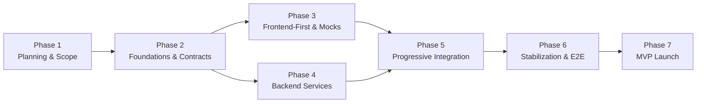
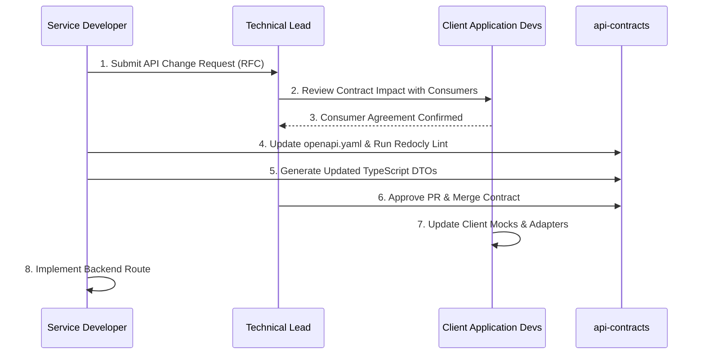

# FILLCART — PROJECT DEVELOPMENT & ENGINEERING PLAYBOOK

**Document Type:** Central Engineering Operating Manual & Project Playbook  
**Project:** Fillcart (Scalable Multi-Vendor On-Demand Delivery Platform)  
**Document Owner:** Principal Software Architect, Engineering Manager & Technical Program Lead  
**Target Audience:** Project Lead, Technical Lead / Integration Owner, Application Developers (Vendor, Customer, Rider, Website, Admin Dashboard), Backend Developers, Platform / Shared Package Owners, and all future engineering hires.  
**Version:** 1.0.0  
**Status:** Approved Engineering Baseline  
**Last Updated:** 2026-11-19

---

## Executive Summary & Document Governance

This playbook is the single authoritative engineering operating manual for the Fillcart project. It establishes the mandatory technical standards, cross-application coordination workflows, contract-first integration practices, security boundaries, testing disciplines, and release criteria required to take the Fillcart monorepo from its current foundational state through a production-ready Minimum Viable Product (MVP) launch.

### Relationship to Existing Repository Documentation

This document is a governance and operational manual designed to work in synergy with the existing foundational documents:

1. [**`FILLCART_DEVELOPER_ONBOARDING_GUIDE.md`**](../FILLCART_DEVELOPER_ONBOARDING_GUIDE.md): The practical local setup manual covering independent Docker PostgreSQL setup, environment configuration, database migrations, and application run commands.
2. [**`FILLCART_REPOSITORY_VERIFICATION_REPORT.md`**](../FILLCART_REPOSITORY_VERIFICATION_REPORT.md): The architectural audit recording verified baseline evidence, gate evaluations, and open project-owner decisions.
3. [**`packages/api-contracts/openapi/v1/openapi.yaml`**](../packages/api-contracts/openapi/v1/openapi.yaml): The authoritative schema contract for all client-facing REST APIs.

### Review and Update Policy

- **Living Document:** This playbook must be updated whenever architectural patterns evolve, new business backends are provisioned, or project-owner decisions are recorded.
- **Change Control:** Any change to this playbook requires a Pull Request reviewed and approved by both the **Technical Lead** and the **Project Lead**.
- **Mandatory Compliance:** Every engineer contributing to Fillcart must read, understand, and adhere to the applicable sections of this playbook.

---

## Table of Contents

1. [Fillcart Project Ecosystem & Architecture Map](#1-fillcart-project-ecosystem--architecture-map)
2. [Team Structure, Roles & RACI Governance Matrix](#2-team-structure-roles--raci-governance-matrix)
3. [End-to-End Development Lifecycle & Progressive Phases](#3-end-to-end-development-lifecycle--progressive-phases)
4. [MVP Scope, Feature Inventory & Lifecycle Management](#4-mvp-scope-feature-inventory--lifecycle-management)
5. [Unified Engineering & Coding Standards](#5-unified-engineering--coding-standards)
6. [API Contract & Integration Governance](#6-api-contract--integration-governance)
7. [Authentication, Authorization & Security Governance](#7-authentication-authorization--security-governance)
8. [Database Architecture & Data Ownership Governance](#8-database-architecture--data-ownership-governance)
9. [Git Branching, Commit Conventions & PR Workflow](#9-git-branching-commit-conventions--pr-workflow)
10. [Code Review Standards & Quality Gates](#10-code-review-standards--quality-gates)
11. [Cross-Application Testing Strategy & Scenarios](#11-cross-application-testing-strategy--scenarios)
12. [Cross-Application Integration Management](#12-cross-application-integration-management)
13. [Vendor Mobile App Development & Alignment Playbook](#13-vendor-mobile-app-development--alignment-playbook)
14. [Task & Sprint Management Workflow](#14-task--sprint-management-workflow)
15. [Engineering Communication & Escalation Protocols](#15-engineering-communication--escalation-protocols)
16. [Architecture Decision Records (ADR) Process](#16-architecture-decision-records-adr-process)
17. [Risk, Issue & Blocker Management](#17-risk-issue--blocker-management)
18. [Environment Topology & Configuration Management](#18-environment-topology--configuration-management)
19. [Release Engineering & MVP Launch Management](#19-release-engineering--mvp-launch-management)
20. [Incident, Bug & Hotfix Management](#20-incident-bug--hotfix-management)
21. [Documentation & Knowledge Architecture](#21-documentation--knowledge-architecture)
22. [Definition of Ready (DoR) & Definition of Done (DoD)](#22-definition-of-ready-dor--definition-of-done-dod)
23. [Engineering Health Metrics & KPIs](#23-engineering-health-metrics--kpis)
24. [Reusable Engineering Templates](#24-reusable-engineering-templates)
25. [First-Week Execution & Onboarding Plan](#25-first-week-execution--onboarding-plan)
26. [Mandatory Engineering Governance Principles](#26-mandatory-engineering-governance-principles)

---

## 1. Fillcart Project Ecosystem & Architecture Map

Fillcart is architected as an **npm workspaces monorepo** managed with **Turborepo**. The ecosystem segregates user-facing client applications, shared platform libraries, and backend identity services into clean boundaries.

### 1.1 Component Breakdown & Implementation Status Matrix

| Component                         | Path                                                               | Purpose                                                                                     | Verified Technology Stack                                | Assigned Owner                  | Implementation Status                                                   | Integration Points                                                |
| --------------------------------- | ------------------------------------------------------------------ | ------------------------------------------------------------------------------------------- | -------------------------------------------------------- | ------------------------------- | ----------------------------------------------------------------------- | ----------------------------------------------------------------- |
| **Central Auth Backend**          | `apps/backend/`                                                    | Identity Provider, credentials, sessions, refresh tokens, OTP, S2S verification             | Node.js 26.13.1, Express 5.3, Prisma 7.10, PostgreSQL 16 | Backend / Platform Team         | **Implemented & Operational**                                           | REST API, Ed25519 JWT, JWKS, S2S internal verification            |
| **Shared Flutter Foundation**     | `packages/flutter_shared/`                                         | Reusable mobile networking client, interceptors, design tokens, theme, atomic UI widgets    | Flutter 3.44.4, Dart 3.12.2, Dio 5.7                     | Mobile Lead / Platform Team     | **Implemented & Operational**                                           | Consumed by Vendor App, Customer App, Rider App                   |
| **Vendor Mobile App**             | `apps/vendor-app/`                                                 | Merchant store management, catalog editing, incoming order processing, preparation workflow | Flutter 3.44.4, Dart 3.12.2, `flutter_bloc` 8.1.6        | Vendor App Lead                 | **Application Foundation / Skeleton**                                   | Connects to Central Auth and future Vendor Business Backend       |
| **Customer Mobile App**           | `apps/customer-app/`                                               | Product catalog browsing, cart, checkout, live order tracking, addresses                    | Flutter + Dart (Feature folders laid out)                | Customer App Lead               | **Directory Scaffold Only** _(No `pubspec.yaml`)_                       | Will connect to Central Auth and future Customer Business Backend |
| **Rider Mobile App**              | `apps/rider-app/`                                                  | Delivery shift management, dispatch acceptance, pickup/drop navigation, earnings            | Flutter + Dart (Feature folders laid out)                | Rider App Lead                  | **Directory Scaffold Only** _(No `pubspec.yaml`)_                       | Will connect to Central Auth and future Rider Business Backend    |
| **Admin Dashboard**               | `apps/admin-dashboard/`                                            | Operations portal, merchant KYC verification, catalog moderation, rider approvals, disputes | Next.js / React 19, TypeScript                           | Admin Web Lead                  | **Directory Scaffold Only** _(Build pending Phase 2.2.6)_               | Central Auth Admin APIs, future Admin Business Backend            |
| **Customer Website**              | `apps/website/`                                                    | Public web portal, SEO storefront, vendor/rider recruitment landing pages                   | Next.js / React 19, TypeScript                           | Website Lead                    | **Directory Scaffold Only** _(Build pending Phase 2.2.6)_               | Central Auth Public APIs, future Customer Business Backend        |
| **API Contracts**                 | `packages/api-contracts/`                                          | Canonical OpenAPI 3.1 specification and generated TypeScript DTOs                           | OpenAPI 3.1, Redocly CLI, TypeScript                     | Technical Lead / Contract Owner | **Implemented & Operational**                                           | Authoritative contract for all client/server exchanges            |
| **Shared Web UI**                 | `packages/ui-web/`                                                 | Reusable React components, Web Locks refresh coordinator (`coordinateWebLockRefresh`)       | TypeScript, Web Locks API                                | Web Platform Lead               | **Implemented & Operational**                                           | Consumed by Admin Dashboard and Website                           |
| **Shared Validations**            | `packages/validations/`                                            | Zod runtime input schemas for requests and payloads                                         | Zod 3.25, TypeScript                                     | Platform Team                   | **Implemented & Operational**                                           | Consumed by Web, Backend, and Contract layers                     |
| **Shared Types / Tokens / Utils** | `packages/shared-types/`, `design-tokens/`, `constants/`, `utils/` | Shared domain TypeScript interfaces, design tokens, cross-cutting utilities                 | TypeScript                                               | Platform Team                   | **Implemented & Operational**                                           | Consumed across all TypeScript workspaces                         |
| **Business Backends**             | External / Future Monorepo Workspaces                              | Domain logic for Orders, Catalog, Payments, Delivery, Inventory, Pricing                    | _Pending Architectural Decision_                         | Business Backend Leads          | **Not Implemented Yet** _(Do NOT build in `apps/backend/src/modules/`)_ | Internal S2S session verification via Central Auth                |

### 1.2 Ecosystem Architecture Diagram

```mermaid
flowchart TD
    subgraph ClientLayer ["Client Applications"]
        VendorApp["Vendor Mobile App\n(Flutter 3.44 - BLoC Foundation)"]
        CustomerApp["Customer Mobile App\n(Flutter Scaffold)"]
        RiderApp["Rider Mobile App\n(Flutter Scaffold)"]
        Website["Customer Website\n(Next.js Scaffold)"]
        AdminDash["Admin Dashboard\n(Next.js Scaffold)"]
    end

    subgraph SharedLibraries ["Shared Monorepo Libraries"]
        FlutterShared["packages/flutter_shared\n(FCNetworkClient, Interceptors, FCTheme)"]
        UIWeb["packages/ui-web\n(coordinateWebLockRefresh, UI)"]
        Contracts["packages/api-contracts\n(OpenAPI 3.1 YAML + TS DTOs)"]
        Validations["packages/validations\n(Zod Schemas)"]
    end

    subgraph SecurityBoundary ["Central Auth & Platform Identity (apps/backend)"]
        CentralAuth["Central Auth Service\n(Express 5, Port 4000)"]
        AuthDB[("Central Auth PostgreSQL 16\n(Identity, Sessions, Credentials, Keys)\nRole: fillcart_app_user (Zero DELETE)")]
        JWKS["GET /.well-known/jwks.json\n(Ed25519 Public Keys)"]
        S2SEndpoint["POST /api/v1/internal/auth/verify-session\n(Fail-Closed Session & Permission Check)"]
        CleanupCLI["Standalone CLI: cleanup.ts\nRole: fillcart_user (Pruning Only)"]
    end

    subgraph BusinessBackends ["Future Business Services (Pending Topology Decision)"]
        VendorBackend["vendor-backend\n(Catalog, Orders, Inventory)"]
        CustomerBackend["customer-backend\n(Cart, Checkout, Tracking)"]
        RiderBackend["rider-backend\n(Dispatch, Shift, Route)"]
        AdminBackend["admin-backend\n(Governance, Moderation)"]
    end

    %% Client dependencies on shared
    VendorApp --> FlutterShared
    CustomerApp -.-> FlutterShared
    RiderApp -.-> FlutterShared
    Website -.-> UIWeb
    AdminDash -.-> UIWeb
    Website -.-> Validations
    AdminDash -.-> Validations

    %% Direct Auth Flows
    ClientLayer -->|"Public Auth: /api/v1/auth/*\n(Login, Register, Refresh, OTP)"| CentralAuth
    CentralAuth --> AuthDB
    CleanupCLI -.->|"MIGRATION_DATABASE_URL\n(Hard Pruning)"| AuthDB

    %% Business API Flows
    VendorApp -->|"Bearer User Access Token"| VendorBackend
    CustomerApp -.->|"Bearer User Access Token"| CustomerBackend
    RiderApp -.->|"Bearer User Access Token"| RiderBackend
    Website -.->|"Bearer User Access Token"| CustomerBackend
    AdminDash -.->|"Bearer User Access Token"| AdminBackend

    %% S2S Live Verification
    VendorBackend -->|"S2S Auth: auth:verify_session"| S2SEndpoint
    CustomerBackend -.->|"S2S Auth: auth:verify_session"| S2SEndpoint
    RiderBackend -.->|"S2S Auth: auth:verify_session"| S2SEndpoint
    AdminBackend -.->|"S2S Auth: auth:verify_session"| S2SEndpoint

    %% JWKS local validation
    BusinessBackends -.->|"Cache Ed25519 Keys"| JWKS
```



---

## 2. Team Structure, Roles & RACI Governance Matrix

Clear ownership prevents bottlenecks, architectural drift, and duplicated effort. Every component and milestone must have exactly **one accountable owner**.

### 2.1 Project Roles & Boundaries

#### Project Lead (Delivery & Product Scope)

- **Primary Accountabilities:** MVP scope definition, feature prioritization, sprint cadence, cross-team milestone delivery, release scheduling, stakeholder reporting, and business escalation.
- **Boundaries:** The Project Lead does **not** unilaterally modify technical architecture or bypass engineering quality gates.

#### Technical Lead / Integration Owner (Architecture & Governance)

- **Primary Accountabilities:** Cross-application architecture consistency, API contract governance, shared package review, security enforcement, integration verification, PR quality gate enforcement, and release readiness sign-off.
- **Dual Role Balance:** When the Technical Lead also implements an application (e.g., Vendor App), they must delegate routine reviews to maintain integration focus and avoid becoming a delivery bottleneck.

#### Application Owners (Vendor, Customer, Rider, Website, Admin)

- **Primary Accountabilities:** Feature development within their assigned app, maintaining application test suites, adhering to shared API contracts, implementing error/loading states, and participating in integration testing.
- **Boundaries:** Application developers may not unilaterally alter shared packages (`packages/*`), Central Auth code (`apps/backend`), or API contracts without Tech Lead approval.

#### Backend & Platform Owners

- **Primary Accountabilities:** Central Auth operations, S2S verification endpoints, database migrations, CI tooling, shared package builds, and future business service implementation.

### 2.2 RACI Governance Matrix

- **R (Responsible):** The role that performs the work.
- **A (Accountable):** The single role with ultimate approval authority and ownership.
- **C (Consulted):** Roles providing essential input prior to execution.
- **I (Informed):** Roles notified of the decision or output.

| Activity / Domain                      | Project Lead | Technical Lead | App Owners | Backend Lead | Platform Lead |
| -------------------------------------- | ------------ | -------------- | ---------- | ------------ | ------------- |
| **MVP Scope & Priority Changes**       | **A**        | C              | C          | C            | I             |
| **System Architecture & ADRs**         | C            | **A**          | C          | C            | C             |
| **API Contract Modifications**         | I            | **A**          | C          | R            | I             |
| **Frontend UI/UX Implementation**      | I            | C              | **A / R**  | I            | C             |
| **Central Auth & Security Policy**     | I            | **A**          | I          | R            | C             |
| **Database Migrations & Schemas**      | I            | **A**          | I          | R            | C             |
| **Shared Packages (`packages/*`)**     | I            | **A**          | C          | C            | R             |
| **Pull Request Merging (App Scope)**   | I            | C              | **A**      | I            | I             |
| **Pull Request Merging (Core / S2S)**  | I            | **A**          | I          | R            | C             |
| **Cross-App Integration Verification** | C            | **A**          | R          | R            | I             |
| **MVP Release Sign-Off**               | **A**        | **A**          | C          | C            | I             |
| **Production Incident Resolution**     | C            | **A**          | R          | R            | R             |

---

## 3. End-to-End Development Lifecycle & Progressive Phases

Fillcart follows a **Contract-First, Progressive Integration Lifecycle**. Postponing integration until the end of development is strictly prohibited.



### Phase 1 — Project Alignment & Planning

- **Objectives:** Lock MVP user stories, feature inventory, technical ownership, and milestone schedules.
- **Inputs:** Product requirements, market constraints, business timelines.
- **Deliverables:** Approved Feature Inventory, RACI matrix, Sprint 1 backlog.
- **Exit Criteria:** Zero unassigned MVP user stories; project dependencies mapped.

### Phase 2 — Technical Foundations & Contract Agreement

- **Objectives:** Establish base configurations, design systems, state management skeletons, and canonical OpenAPI contracts.
- **Inputs:** UI design tokens, wireframes, authentication architecture.
- **Deliverables:** OpenAPI 3.1 YAML specifications, generated TypeScript DTOs, Dart base models, application scaffolds.
- **Exit Criteria:** `npm run lint:openapi` passes with 0 warnings; mock data generators established.

### Phase 3 — Frontend-First Feature Development

- **Objectives:** Application developers build complete user interfaces, BLoC state logic, and interaction flows using mock data matching approved API schemas.
- **Inputs:** Approved OpenAPI contracts, mock payloads, `packages/flutter_shared`, `packages/ui-web`.
- **Deliverables:** UI screens implementing loading, empty, success, and error states; widget and unit tests.
- **Rule:** Frontend developers must **never** invent proprietary API payload shapes. Mock responses must validate against `packages/validations`.

### Phase 4 — Backend Service Development

- **Objectives:** Implement backend routes, domain services, database persistence, and authorization rules matching the agreed OpenAPI contracts.
- **Inputs:** Approved OpenAPI contracts, Central Auth S2S verification interface.
- **Deliverables:** REST endpoints, Prisma models, database migrations, unit and integration test suites.
- **Exit Criteria:** 100% of contract endpoints implemented with strict schema validation; zero DML regressions.

### Phase 5 — Progressive Integration (Slice-by-Slice)

- **Objectives:** Connect frontend features to real backend endpoints incrementally as each slice is completed.
- **Activities:** Real network verification, Bearer token propagation, S2S live verification, error handling validation.
- **Deliverables:** Working end-to-end user flows tested on local Docker environments.
- **Exit Criteria:** User journey passes from client UI to database and back with valid logging correlation.

### Phase 6 — System Testing & Stabilization

- **Objectives:** Execute automated regression tests, security scans, performance benchmarks, and cross-device manual audits.
- **Activities:** Load testing, token replay attack tests, network failure simulations, mobile device testing.
- **Deliverables:** System test audit report, resolved high-severity defect log, Release Candidate (RC) tag.
- **Exit Criteria:** Zero P0/P1 defects; all automated test suites pass.

### Phase 7 — MVP Release & Deployment

- **Objectives:** Deploy production infrastructure, apply verified database migrations, submit mobile builds to app stores.
- **Deliverables:** Live production deployments, monitoring dashboards, operational runbooks.
- **Exit Criteria:** Formal sign-off by Project Lead and Technical Lead.

---

## 4. MVP Scope, Feature Inventory & Lifecycle Management

Scope creep is the single greatest risk to timeline adherence. Features must be ruthlessly categorized and managed through a disciplined lifecycle.

### 4.1 Feature Categorization (MoSCoW)

- **Must-Have (P0 — MVP Blocker):** Essential functionality required for legal compliance, core security, or the fundamental transaction loop (e.g., Central Auth, Vendor order acceptance, Customer checkout).
- **Should-Have (P1 — Core Experience):** Important features required for smooth operations that have manual fallbacks if strictly necessary (e.g., automated SMS notifications, rider dispatch optimization).
- **Could-Have (P2 — Post-MVP Phase 2):** Enhancements that improve experience but are not required for day-one launch (e.g., advanced analytics, loyalty coupons, promotional banners).
- **Won't-Have (P3 — Future Roadmap):** Out-of-scope for initial launch (e.g., multi-region clustering, AI-driven recommendation engines).

### 4.2 Feature Completion Definition (The 5 Tiers)

A feature is **not** complete simply because a screen renders correctly. Completion requires progressing through all 5 tiers:

```
[ Tier 1: UI Complete ] ──> [ Tier 2: Backend Ready ] ──> [ Tier 3: Integrated ] ──> [ Tier 4: Tested ] ──> [ Tier 5: Accepted ]
```

1. **Tier 1 (UI Complete):** Responsive screens, loading states, empty states, error banners, and BLoC/Web state logic complete using mock data.
2. **Tier 2 (Backend Ready):** Endpoints implemented, validated against Zod/Prisma, authorized via S2S, unit/integration tested.
3. **Tier 3 (Integrated):** Client app communicates with live backend over HTTP; real tokens propagated; responses parsed.
4. **Tier 4 (Tested):** Automated widget/integration tests pass; error paths (network down, 401, 403, 422) verified.
5. **Tier 5 (Accepted):** Product Lead signs off against acceptance criteria in the user story.

---

## 5. Unified Engineering & Coding Standards

All developers must maintain strict consistency across languages, frameworks, and workspace boundaries.

### 5.1 Common Monorepo Standards

- **Node & Package Management:** Enforce Node.js `>=26.13.1` (pinned via `.nvmrc`) and `npm >=11.20.0`. Never use `yarn` or `pnpm`.
- **Prettier & Formatting:** All TypeScript, JavaScript, JSON, Markdown, and YAML files must pass Prettier formatting (`npm run format:check`).
- **Identifier Format:** All database IDs, session IDs, user IDs, and correlation IDs must be canonical **36-character hyphenated UUID strings** (`crypto.randomUUID()`). Never invent pseudo-prefixes like `usr_...` or `ses_...`.
- **Correlation IDs:** All inbound and outbound HTTP requests must generate or propagate the `x-request-id` UUID header.
- **Zero Sensitive Data Logging:** Passwords, OTPs, raw tokens, cookie contents, and payment secrets must never appear in server logs, client consoles, or screenshots.

### 5.2 Flutter Mobile Standards (`packages/flutter_shared`, `apps/*-app`)

- **SDK Constraints:** Flutter `>=3.44.0`, Dart `>=3.12.0 <4.0.0` (as defined in `pubspec.yaml`).
- **State Management:** Use `flutter_bloc` (`^8.1.6`) and `equatable` (`^2.0.7`). Never introduce ad-hoc state management libraries (`Provider`, `GetX`, `Riverpod`).
- **Networking:** Wrap all HTTP calls in `FCNetworkClient` from `packages/flutter_shared`.
  - Configured timeouts: Connect = **10s**, Receive = **15s**, Send = **10s**.
  - Attach mandatory interceptors: `FillcartAuthInterceptor`, `FCCorrelationInterceptor`, `FCSafeLoggingInterceptor`.
- **Token Storage:** Store refresh tokens exclusively in platform secure storage (`flutter_secure_storage`). Plain `SharedPreferences` is strictly prohibited for tokens.
- **Design Tokens:** Use `FCTheme`, `FCColors`, `FCSpacing`, and `FCTypography`. Hardcoded hex color literals or raw pixel values are prohibited.
- **Tooling Execution:** Execute Dart tooling using the workspace script:
  ```bash
  node scripts/flutter-tooling.mjs format
  node scripts/flutter-tooling.mjs analyze
  node scripts/flutter-tooling.mjs test
  ```

### 5.3 Web Applications (`apps/admin-dashboard`, `apps/website`)

- **Framework:** Next.js with TypeScript and App Router.
- **Token Storage:** Hold access tokens strictly in memory. Never store access tokens in `localStorage` or `sessionStorage`.
- **Refresh Token Coordination:** Multi-tab token refresh must be coordinated using `coordinateWebLockRefresh` from `@fillcart/ui-web`.
- **Component Reusability:** Consume shared atomic components and design tokens from `@fillcart/ui-web` and `@fillcart/design-tokens`.
- **Form Validation:** Use Zod schemas from `@fillcart/validations` paired with `react-hook-form`.

### 5.4 Backend Services (`apps/backend` & Future Business Services)

- **Architecture:** Layered modular architecture: `routes/` $\to$ `controllers/` $\to$ `services/` $\to$ `repositories/` $\to$ `database/`.
- **Input Validation:** Every endpoint must validate input payloads using `validateRequest({ body, query, params })` backed by Zod schemas from `@fillcart/validations`.
- **Error Handling:** Throw standard `AppError` subclasses (`BadRequestError`, `UnauthorizedError`, `ForbiddenError`, `NotFoundError`, `ConflictError`). Never return generic unhandled 500 exceptions with stack traces.

---

## 6. API Contract & Integration Governance

API contracts are the single source of truth for cross-team coordination. Modifying an API contract without prior consumer agreement is an engineering violation.

### 6.1 OpenAPI 3.1 as the Source of Truth

- **Specification Path:** [`packages/api-contracts/openapi/v1/openapi.yaml`](../packages/api-contracts/openapi/v1/openapi.yaml).
- **Validation Command:**
  ```bash
  npm run lint:openapi
  ```
  _(Executes Redocly CLI against `redocly.yaml`. Must pass with 0 errors and 0 warnings)._
- **Codegen:** TypeScript DTOs are compiled into `packages/api-contracts/typescript/src/generated/`.

### 6.2 Endpoint Documentation Standards

Every endpoint documented in the contract must specify:

1. `operationId`: Unique camelCase identifier (e.g., `verifySession`).
2. `security`: Security requirements (`bearerAuth`, `cookieAuth`, or public).
3. `requestBody`: Comprehensive JSON schema with field descriptions and validation constraints.
4. `responses`: Explicit HTTP status codes (`200`, `201`, `400`, `401`, `403`, `404`, `409`, `422`, `500`).
5. `examples`: Realistic JSON payloads for success and error scenarios.

### 6.3 Breaking vs. Non-Breaking Changes

- **Non-Breaking Changes (Permitted with Notice):**
  - Adding an optional query parameter.
  - Adding a new field to a response body.
  - Adding a brand-new endpoint.
- **Breaking Changes (Requires Versioning & Tech Lead Approval):**
  - Renaming or deleting an existing field in a request or response.
  - Changing a field's data type (e.g., string to number).
  - Adding a mandatory field to an existing request body.
  - Modifying URL path parameters or HTTP verbs.
  - Changing authentication requirements.

### 6.4 API Change Governance Workflow



---

## 7. Authentication, Authorization & Security Governance

Fillcart enforces an asymmetric, fail-closed security architecture governed centrally by `apps/backend`.

### 7.1 Cryptographic Standards & Key Hierarchy

- **Algorithm:** Central Auth exclusively issues and verifies **Ed25519 (EdDSA)** signatures. RSA, ES256, and HMAC JWT fallbacks are strictly prohibited.
- **JWKS Endpoint:** Public keys are exposed at `GET /.well-known/jwks.json`. Clients cache active keys with a 1-hour target.
- **Password Hashing:** Passwords must be hashed using **Argon2id** with parameters:
  - Memory Cost: `65536 KiB` (64 MB)
  - Time Cost: `3` iterations
  - Parallelism: `1` lane ($m=65536, t=3, p=1$)
  - Hash string format: `$argon2id$v=19$m=65536,t=3,p=1$...`
  - Transparent in-flight migration from legacy PBKDF2 is automatic upon successful login.

### 7.2 Session & Refresh Token Lifecycle

- **Access Tokens:** Short-lived (15 minutes). Held in client memory; contains 11 standard claims including `sub`, `session_id`, `aud`, `iss`, `role`, and `permissions`.
- **Refresh Tokens:** Long-lived, single-use, opaque cryptographically random strings (stored as SHA-256 digests).
  - 7-day rolling expiry.
  - 30-day absolute session family ceiling.
- **Zero-Grace Replay Revocation:** Attempting to reuse an already-rotated refresh token immediately triggers atomic revocation of the **entire session family** and logs a security audit event.

### 7.3 Audience Derivation & Applicant Promotion Workflow

Central Auth strictly derives the JWT audience (`aud`) claim from the database state:

| `accountType`      | `status`           | Operational Role | Issued JWT Audience (`aud`) |
| ------------------ | ------------------ | ---------------- | --------------------------- |
| `CUSTOMER`         | `ACTIVE`           | Customer         | `customer-backend`          |
| `VENDOR_APPLICANT` | `PENDING_APPROVAL` | Applicant        | `vendor-onboarding`         |
| `VENDOR_APPLICANT` | `ACTIVE`           | Vendor           | `vendor-backend`            |
| `RIDER_APPLICANT`  | `PENDING_APPROVAL` | Applicant        | `rider-onboarding`          |
| `RIDER_APPLICANT`  | `ACTIVE`           | Rider            | `rider-backend`             |
| `ADMIN`            | `ACTIVE`           | Admin            | `admin-backend`             |

> [!IMPORTANT] > **Applicant Promotion Principle:**
> When an applicant is approved via `AccountLinkingService.promoteApplicant`, `User.accountType` **remains** `VENDOR_APPLICANT` or `RIDER_APPLICANT`. The account transitions to `status = ACTIVE`, the operational `Role` is assigned via `roleId`, and all existing applicant sessions are revoked to enforce re-authentication.

### 7.4 Service-to-Service (S2S) Fail-Closed Authorization

Business backends must verify incoming client requests by calling:

```http
POST /api/v1/internal/auth/verify-session
Host: 127.0.0.1:4000
Content-Type: application/json
Authorization: Bearer <S2S_SERVICE_TOKEN>

{
  "userAccessToken": "<USER_ACCESS_TOKEN>",
  "requiredPermission": "orders:create"
}
```

- The S2S token must be signed by the calling service's registered Ed25519 key and carry the `auth:verify_session` scope.
- **Fail-Closed Mandate:** If Central Auth is unreachable or times out, the business service must **reject the request immediately**. Falling back to stale cached JWT permissions is strictly prohibited.

---

## 8. Database Architecture & Data Ownership Governance

Data integrity and least-privilege access control are enforced at the database engine level.

### 8.1 Database Privilege Separation

The PostgreSQL 16 database enforces two strictly isolated user roles:

1. **Migration / Schema Owner (`fillcart_user`):**
   - Configured via `MIGRATION_DATABASE_URL`.
   - Owns the database schema. Used exclusively by `prisma migrate` to run DDL and by the standalone `cleanup.ts` maintenance CLI.
2. **Runtime Application Role (`fillcart_app_user`):**
   - Configured via `DATABASE_URL`.
   - Granted standard DML (`SELECT`, `INSERT`, `UPDATE`), but **zero `DELETE` privileges** across all operational tables (`can_delete = false`).
   - The running Express application strictly connects as `fillcart_app_user` and **never** receives `MIGRATION_DATABASE_URL`.

### 8.2 Maintenance Cleanup CLI

Because the runtime role cannot delete records, expired tokens and rate limits are pruned by a dedicated script:

```bash
node --env-file=apps/backend/.env --import tsx apps/backend/src/database/maintenance/cleanup.ts
```

- Prunes `ServiceTokenReplay` (>300s expired), `RateLimitRecord` (>24h old), and `OtpChallenge` (>24h old).
- Must be executed with `MIGRATION_DATABASE_URL`. Running under `fillcart_app_user` will fail with an SQL permission error.
- **Security Rule:** This CLI is **never** exposed over public HTTP routes.

### 8.3 Migration Governance Workflow

Every database schema change must follow this sequence:

1. Create schema change in `apps/backend/prisma/schema.prisma`.
2. Generate migration locally: `npx --prefix apps/backend prisma migrate dev --name <descriptive_name>`.
3. Verify that `fillcart_app_user` privileges remain restricted (`REVOKE DELETE`).
4. Validate against a disposable local Docker database.
5. Submit PR with migration SQL attached and reviewed by the Technical Lead.
6. Deploy using `npx --prefix apps/backend prisma migrate deploy --config apps/backend/prisma7.config.ts`.

---

## 9. Git Branching, Commit Conventions & PR Workflow

### 9.1 Branching Strategy (GitFlow Adaptation)

- **`main`:** Production-ready code only. Tagged at each milestone release. Direct pushes are disabled.
- **`setup` / `develop`:** Primary integration branch. All feature branches merge here via Pull Request.
- **`feature/<app-or-domain>-<short-description>`:** Feature branch created from `setup` (e.g., `feature/vendor-catalog-bloc`, `feature/auth-otp-hardening`).
- **`fix/<app-or-domain>-<short-description>`:** Bugfix branch.
- **`hotfix/<issue>`:** Emergency production fix branch created from `main`.

### 9.2 Commit Message Convention (Conventional Commits)

All commit messages must adhere to the Conventional Commits specification:

```text
<type>(<scope>): <short imperative description>

[optional body explaining motivation and architectural context]

[optional footer referencing issue/task ID]
```

- **Allowed Types:** `feat`, `fix`, `docs`, `style`, `refactor`, `perf`, `test`, `chore`, `revert`.
- **Allowed Scopes:** `backend`, `vendor-app`, `customer-app`, `rider-app`, `admin-dashboard`, `website`, `contracts`, `flutter-shared`, `ui-web`, `validations`, `tooling`, `infra`.
- **Example:**

  ```text
  feat(vendor-app): implement catalog bloc state and error boundary

  Connects catalog screen to FCNetworkClient and handles empty inventory state.
  Ref: #FC-104
  ```

---

## 10. Code Review Standards & Quality Gates

Code reviews are a vital quality gate, not a rubber-stamping formality. Reviewers must verify architectural alignment and security compliance.

### 10.1 Reviewer Checklist & Inspection Criteria

- [ ] **Correctness:** Does the code solve the requirement without regressions?
- [ ] **Architecture:** Are modular boundaries respected? Are business backends isolated from Central Auth?
- [ ] **Security:** Is input validated? Are tokens handled securely? Is authorization fail-closed?
- [ ] **Data Integrity:** Are database queries indexed? Are migrations non-destructive?
- [ ] **Error Handling:** Are loading, empty, and failure states implemented gracefully?
- [ ] **Tests:** Are unit or widget tests included with passing assertions?
- [ ] **Formatting & Build:** Does `npm run build` and `npm run test` pass cleanly?

### 10.2 Conditions for PR Rejection

A PR must be rejected or requested for changes if:

1. It introduces hardcoded secrets, API keys, or credentials.
2. It attempts to implement business domain logic inside `apps/backend/src/modules/`.
3. It modifies an API contract without consumer consultation.
4. It breaks Prettier formatting or TypeScript compilation.
5. It deletes or skips existing tests to make a build pass.

---

## 11. Cross-Application Testing Strategy & Scenarios

Quality is verified continuously across all layers of the monorepo.

### 11.1 Test Pyramid & Execution Matrix

```
        / \
       /   \     E2E Flows (Playwright & Flutter Driver - Phase 6)
      / ----\
     /   API \   Integration Tests (Supertest & Vitest - apps/backend/test/integration)
    / --------\
   / Component \ Widget & Component Tests (Flutter Test & React Testing Library)
  / ------------\
 /   Unit Tests  \ Pure Business Logic, Zod Validation, Crypto (Vitest - 57 tests passing)
------------------
```

| Layer                    | Tools               | Scope                                                     | Command                                           |
| ------------------------ | ------------------- | --------------------------------------------------------- | ------------------------------------------------- |
| **Shared Packages Unit** | Vitest              | Zod schemas, Web Locks coordinator                        | `npm --workspace=@fillcart/validations test`      |
| **Backend Unit**         | Vitest              | CryptoService, PasswordService (Argon2id), SessionService | `npm --workspace=@fillcart/backend run test:unit` |
| **Backend Integration**  | Vitest + PostgreSQL | Refresh rotation, S2S verification, OTP rate limits       | `npm --workspace=@fillcart/backend run test`      |
| **Flutter Mobile Unit**  | Flutter Test        | BLoC states, network serialization, interceptors          | `node scripts/flutter-tooling.mjs test`           |
| **Contract Validation**  | Redocly CLI         | OpenAPI 3.1 syntax and completeness                       | `npm run lint:openapi`                            |

### 11.2 Critical Integration Test Scenarios

1. **Applicant Promotion Flow:** `VENDOR_APPLICANT` registers $\to$ status is `PENDING_APPROVAL` $\to$ audience is `vendor-onboarding` $\to$ Admin promotes applicant $\to$ status is `ACTIVE` $\to$ audience changes to `vendor-backend` $\to$ previous sessions revoked.
2. **Refresh Token Replay Defense:** User obtains tokens $\to$ rotates refresh token $\to$ attacker attempts to use old refresh token $\to$ Central Auth rejects with 401 and revokes the active session family.
3. **Fail-Closed S2S Verification:** Business backend verifies session while Central Auth is offline $\to$ request is rejected with 503; request does **not** succeed.

---

## 12. Cross-Application Integration Management

Integration must occur continuously in feature slices.

### 12.1 Integration Dependency Register Template

| Dependency ID | Feature Name      | Source App       | Target Service   | Integration Type                       | Technical Contract      | Status      | Blockers         |
| ------------- | ----------------- | ---------------- | ---------------- | -------------------------------------- | ----------------------- | ----------- | ---------------- |
| `INT-001`     | Vendor Login      | `vendor-app`     | Central Auth     | REST (`/api/v1/auth/login`)            | OpenAPI `login` schema  | Complete    | None             |
| `INT-002`     | S2S Session Check | `vendor-backend` | Central Auth     | REST (`/internal/auth/verify-session`) | OpenAPI `verifySession` | In Progress | S2S Key Seed     |
| `INT-003`     | Catalog Sync      | `vendor-app`     | `vendor-backend` | REST (`/api/v1/vendor/catalog`)        | _Pending Contract_      | Proposed    | Backend Scaffold |

---

## 13. Vendor Mobile App Development & Alignment Playbook

Because the **Vendor Mobile App (`apps/vendor-app`)** is an active development focus, this section defines its specific feature framework.

### 13.1 Vendor App Architecture

- **Entry Point:** `apps/vendor-app/lib/main.dart` with zoned error handling (`runZonedGuarded`).
- **Dependencies:** Consumes `packages/flutter_shared` (`fillcart_shared`).
- **State Pattern:** BLoC pattern:
  ```text
  lib/features/<domain>/
  ├── bloc/           # Events, States, and BLoC logic
  ├── models/         # Feature data models
  ├── repositories/   # Data fetching via FCNetworkClient
  └── screens/        # Flutter UI widgets and layouts
  ```

### 13.2 Vendor Feature Milestone Framework _(Illustrative Planning Guide)_

| Milestone                   | Key Screens / Capabilities                                      | Shared Dependencies                                     | Target Tier |
| --------------------------- | --------------------------------------------------------------- | ------------------------------------------------------- | ----------- |
| **M1: Auth & Onboarding**   | Login screen, OTP challenge, registration form, approval status | `FCNetworkClient`, `FCTheme`, `FillcartAuthInterceptor` | Tier 4      |
| **M2: Store Profile**       | Store details, operating hours, active/pause toggle             | `FCButton`, `FCTextField`, `coordinateWebLockRefresh`   | Tier 3      |
| **M3: Catalog & Inventory** | Category list, product creation, stock level adjustment         | `FCNetworkClient`, `@fillcart/validations`              | Tier 2      |
| **M4: Order Management**    | Real-time incoming orders, accept/reject modal, prep timer      | WebSockets _(Proposed)_, BLoC stream                    | Tier 1      |

---

## 14. Task & Sprint Management Workflow

Fillcart uses a lightweight, high-velocity Kanban/Sprint model.

### 14.1 Task Lifecycle States

```
[ Backlog ] ──> [ Ready (DoR Met) ] ──> [ In Progress ] ──> [ In Review (PR) ] ──> [ Testing ] ──> [ Done (DoD Met) ]
      │
      └───> [ Blocked ]
```

- **Backlog:** Defined but awaiting prerequisites.
- **Ready:** Meets Definition of Ready; assigned to developer.
- **In Progress:** Actively being coded.
- **In Review:** Pull Request open; CI checks running.
- **Testing:** Deployed to local/test environment for integration validation.
- **Blocked:** Work stopped due to an external dependency or technical question.
- **Done:** Meets Definition of Done; merged into integration branch.

---

## 15. Engineering Communication & Escalation Protocols

### 15.1 Meeting Cadence & Communication Channels

- **Daily Standup (Async / 15-min Sync):** What did you finish yesterday? What are you shipping today? Any blockers?
- **Weekly Technical Architecture Sync (45 min):** Reviews open ADRs, contract updates, and integration dependencies.
- **Sprint Review & Demo (45 min):** Live demonstration of working software slices.

### 15.2 Escalation Hierarchy

1. **Technical Blocker:** Escalate to **Technical Lead** if an API contract mismatch or architectural ambiguity stops progress for >2 hours.
2. **Scope / Priority Conflict:** Escalate to **Project Lead** if requirements conflict or deadlines risk slipping.

---

## 16. Architecture Decision Records (ADR) Process

Every significant architectural change must be recorded in `docs/architecture/` as an ADR.

### 16.1 ADR States

- `PROPOSED`: Under team review.
- `ACCEPTED`: Approved by Technical Lead; binding on implementation.
- `REJECTED`: Declined with recorded rationale.
- `SUPERSEDED`: Replaced by a newer ADR.

---

## 17. Risk, Issue & Blocker Management

### 17.1 Active Architectural & Operational Risks Register

| Risk ID   | Description                                       | Severity | Probability | Owner         | Mitigation Strategy                                         | Status                |
| --------- | ------------------------------------------------- | -------- | ----------- | ------------- | ----------------------------------------------------------- | --------------------- |
| `RSK-001` | Business backends implemented inside Central Auth | Critical | High        | Tech Lead     | Enforce strict prohibition in playbook and PR quality gates | Mitigated             |
| `RSK-002` | MSG91 SMS gateway downtime causing OTP failure    | High     | Medium      | Tech Lead     | Propose secondary SMS gateway fallback (AWS SNS / Twilio)   | **Requires Decision** |
| `RSK-003` | Mobile token idle expiration undefined            | Medium   | High        | Tech Lead     | Propose 7-day idle timeout before biometric re-auth         | **Requires Decision** |
| `RSK-004` | Customer and Rider apps lacking `pubspec.yaml`    | Medium   | Low         | App Leads     | Documented 2-minute copy setup from Vendor App              | Addressed             |
| `RSK-005` | Manual S2S service client key provisioning        | Medium   | Medium      | Platform Lead | Propose automated registration CLI                          | **Requires Decision** |

---

## 18. Environment Topology & Configuration Management

### 18.1 Environment Tiers

1. **Local Development (Current Verified State):**
   - Independent Docker container (`postgres:16-alpine`) running locally.
   - Central Auth Express server on `127.0.0.1:4000`.
   - Client applications point to `http://127.0.0.1:4000`.
2. **Staging / Integration Environment (_Proposed_):**
   - Centralized cloud deployment running automated CI/CD builds.
3. **Production Environment (_Proposed_):**
   - High-availability cluster, automated backups, secrets managed via cloud KMS.

---

## 19. Release Engineering & MVP Launch Management

Releases are governed by explicit quality gates, not arbitrary dates.

### 19.1 MVP Release Gate Criteria

- [ ] **Gate 1 (Central Auth):** 100% test pass rate; zero-grace replay protection verified.
- [ ] **Gate 2 (Vendor App):** Core store, catalog, and order acceptance flows verified.
- [ ] **Gate 3 (Security & Compliance):** All database roles enforce least privilege; runtime role has zero DELETE privileges.
- [ ] **Gate 4 (API Stability):** Zero undocumented breaking contract changes.
- [ ] **Gate 5 (Monitoring):** Pino logging active; error rate reporting operational.

---

## 20. Incident, Bug & Hotfix Management

### 20.1 Defect Severity Classification

- **P0 (Critical Blocker):** Security vulnerability, data loss, authentication outage, app crash on launch. Work stops to fix immediately.
- **P1 (High Priority):** Major feature broken with no workaround. Must fix within 24 hours.
- **P2 (Medium Priority):** Non-critical bug with an existing workaround. Addressed in current sprint.
- **P3 (Low Priority):** Minor UI glitch or cosmetic defect. Scheduled in backlog.

---

## 21. Documentation & Knowledge Architecture

Documentation must remain synchronised with code:

- **`README.md`**: Project overview and repo map.
- **`docs/FILLCART_PROJECT_DEVELOPMENT_PLAYBOOK.md`**: This operating manual.
- **`FILLCART_DEVELOPER_ONBOARDING_GUIDE.md`**: Developer setup and command cheat sheet.
- **`FILLCART_REPOSITORY_VERIFICATION_REPORT.md`**: Audit findings and baseline evidence.
- **`packages/api-contracts/`**: REST API contracts.

---

## 22. Definition of Ready (DoR) & Definition of Done (DoD)

### Definition of Ready (DoR)

A task can be picked up into a sprint **only if**:

1. User story contains clear business context and acceptance criteria.
2. API contract dependency is documented and approved.
3. UI mockups or wireframes are attached (for frontend tasks).
4. Assigned developer confirms understanding of scope.

### Definition of Done (DoD)

A task is marked **Done only if**:

1. Code is implemented and adheres to this playbook.
2. Automated unit, widget, or integration tests pass.
3. PR is reviewed and approved by an authorized reviewer.
4. No Prettier or ESLint warnings are introduced.
5. Relevant documentation or OpenAPI specs are updated.
6. Acceptance criteria are demonstrated and accepted.

---

## 23. Engineering Health Metrics & KPIs

To maintain delivery velocity without compromising quality, the Technical Lead and Project Lead review:

1. **MVP Burnup:** Tier 5 completed features vs. total MVP scope.
2. **Defect Leakage:** Number of P0/P1 bugs found during progressive integration.
3. **PR Turnaround Time:** Target: <24 hours from PR submission to review feedback.
4. **Build Reliability:** Percentage of CI pipeline runs passing cleanly on `setup`.

---

## 24. Reusable Engineering Templates

### Template 1: Feature / User Story Card

```markdown
### [FC-XXX] <Feature Title>

**Application / Service:** <e.g. apps/vendor-app>  
**Owner:** @username  
**Priority:** P0 (Must) / P1 (Should) / P2 (Could)

#### 1. Business Context & User Story

As a <type of user>, I want to <perform action> so that <business benefit>.

#### 2. Acceptance Criteria

- [ ] Criterion 1 (e.g. Valid input dispatches request)
- [ ] Criterion 2 (e.g. Loading indicator displayed during network flight)
- [ ] Criterion 3 (e.g. 401 error triggers refresh coordinator)

#### 3. Technical & Contract Dependencies

- **API Endpoint:** `POST /api/v1/...` (OpenAPI operationId: `...`)
- **Shared Package:** `@fillcart/...`
```

### Template 2: Pull Request Description

```markdown
## Summary of Changes

<Brief explanation of changes introduced by this PR>

## Related Issue / Task

Fixes #FC-XXX

## Impacted Applications & Packages

- [ ] apps/backend
- [ ] apps/vendor-app
- [ ] packages/flutter_shared
- [ ] packages/api-contracts
- [ ] Other: <name>

## Verification & Test Evidence

- [ ] Unit tests added / updated and passing
- [ ] Formatted with Prettier (`npm run format:check`)
- [ ] TypeScript typecheck passes (`npm run type-check`)
- [ ] Local integration tested against Docker PostgreSQL

## Security & Architectural Checklist

- [ ] No secrets, credentials, or private keys committed
- [ ] No business domain logic added to apps/backend/src/modules/
- [ ] No unreviewed database deletions or migrations
```

### Template 3: Daily Standup Update

```markdown
**Yesterday:** Completed BLoC state for vendor catalog (#FC-102); opened PR #14.  
**Today:** Integrating catalog screen with local Central Auth; adding error view tests.  
**Blockers:** Need approval on OpenAPI contract PR #12 for category creation endpoint.
```

### Template 4: Architecture Decision Record (ADR)

```markdown
# ADR-00X: <Title>

## Status

PROPOSED | ACCEPTED | REJECTED | SUPERSEDED

## Context & Problem Statement

<What technical challenge or architectural ambiguity needs to be resolved?>

## Options Considered

1. Option A: <Description, Pros, Cons>
2. Option B: <Description, Pros, Cons>

## Decision

<Chosen option and justification>

## Consequences

- **Positive:** <What improves?>
- **Negative / Trade-offs:** <What complexity is introduced?>
- **Impacted Systems:** <List apps and services>
```

---

## 25. First-Week Execution & Onboarding Plan

When a new developer joins Fillcart, their first week follows this structured plan:

### Day 1: Machine Setup & Repository Tour

- Read [`FILLCART_DEVELOPER_ONBOARDING_GUIDE.md`](../FILLCART_DEVELOPER_ONBOARDING_GUIDE.md).
- Install Node.js `26.13.1`, Flutter `3.44.4`, and Docker Desktop.
- Start local PostgreSQL database (`npm run docker:db:up`).
- Run Central Auth backend (`npm --workspace=@fillcart/backend run dev`) and probe `/health/ready`.

### Day 2: Architecture & Playbook Immersion

- Read this complete Playbook (`docs/FILLCART_PROJECT_DEVELOPMENT_PLAYBOOK.md`).
- Inspect [`FILLCART_REPOSITORY_VERIFICATION_REPORT.md`](../FILLCART_REPOSITORY_VERIFICATION_REPORT.md).
- Inspect OpenAPI contract at `packages/api-contracts/openapi/v1/openapi.yaml`.

### Day 3: Application Orientation & Local Execution

- **Vendor App Devs:** Run `apps/vendor-app/` on emulator; execute `node scripts/flutter-tooling.mjs test`.
- **Customer / Rider Devs:** Create `pubspec.yaml` referencing `packages/flutter_shared`; run `flutter pub get`.
- **Web / Admin Devs:** Inspect `@fillcart/ui-web` tests and Web Locks coordinator.
- **Backend Devs:** Execute unit test suite (`npm --workspace=@fillcart/backend run test:unit`).

### Day 4: First Good First Issue

- Pick up an assigned onboarding issue (e.g. writing a widget test, adding a validation schema, or implementing a scaffolded screen).
- Open feature branch following branch naming conventions (`feature/...`).

### Day 5: PR Submission & Review

- Run quality checks: `npm run format:check`, `npm run type-check`, `npm run test`.
- Submit PR using the PR template.
- Review and address feedback with the Technical Lead.

---

## 26. Mandatory Engineering Governance Principles

Every Fillcart engineer must uphold these non-negotiable rules:

1. **One Accountable Owner:** Every task, PR, and service has exactly one accountable owner.
2. **Contract Before Code:** Never code client-backend integrations without an agreed OpenAPI schema.
3. **Central Auth is Solely an IdP:** Business domain logic is strictly prohibited from `apps/backend/src/modules/`.
4. **Zero Runtime Deletions:** Central Auth runtime database role operates with `can_delete = false`.
5. **Fail-Closed Authorization:** Live S2S verification must fail closed on timeouts or errors.
6. **No Secrets in Source Control:** Private keys, JWT secrets, and SMS keys must never be committed.
7. **No Direct Commits to Main:** All merges to `main` and `setup` require an approved Pull Request.
8. **No Silent Breaking Changes:** Contract modifications require explicit consumer consultation.
9. **Never Postpone Integration:** Integrate feature slices progressively into the codebase.
10. **Evidence-Based Done:** No feature is Done without passing tests and verifiable acceptance evidence.
