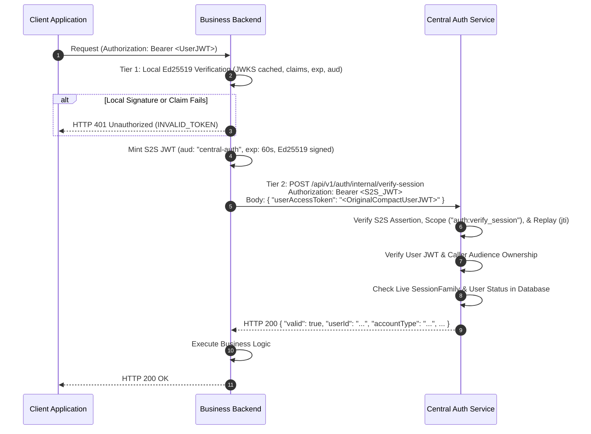

# Fillcart Central Authentication Platform — Developer Integration Manual

## 1. Architecture Overview

Fillcart utilizes a unified, central authentication and authorization platform (`CentralAuthService`) hosted within the modular Express backend at `apps/backend/src/modules/auth/`.

Central Auth exclusively owns:
- User identities, email normalization, credentials, and progressive lockout.
- Server-derived target audiences and operational roles.
- Ed25519 asymmetric cryptography and JWKS publication (`/.well-known/jwks.json`).
- Session family lifecycle and single-use rolling refresh rotation.
- Service-to-service (S2S) assertion authentication and durable replay protection.
- Live session verification over authenticated internal channels.
- OTP challenge generation, context-bound HMAC verification, and SMS delivery via MSG91.
- Step-up grant elevation and applicant promotion.

Business backends (`customer-backend`, `vendor-backend`, `rider-backend`, `admin-backend`) are independently developed and must **never connect directly to the Central Auth database**.

---

## 2. Hybrid Verification Model

Every incoming request to a protected business backend endpoint follows a mandatory two-tier hybrid verification topology:



### 2.1 Tier 1: Local Stateless Verification
1. Fetch and cache public keys from `GET /.well-known/jwks.json`.
2. Extract `kid` from the JWT header and match it against the cached JWKS.
3. Verify the Ed25519 signature over Curve25519.
4. Validate timing claims: `exp` (15 min lifetime), `iat`, `nbf` with $\pm 5\text{s}$ clock skew.
5. Validate mandatory claims: `sub`, `iss` (`https://auth.fillcart.internal`), `token_use` (`"access"`), `session_id`, `account_type`, `account_status`.
6. Assert `aud` matches your backend's authoritative audience.

### 2.2 Tier 2: Live Synchronous Central Verification
Submit the intact, unparsed compact user JWT over authenticated S2S connection:
- **Endpoint:** `POST /api/v1/auth/internal/verify-session`
- **Headers:** `Authorization: Bearer <S2S_JWT>`
- **Body:** `{ "userAccessToken": "<compact_jwt>" }`
- **Response Contract:**
  ```json
  {
    "valid": true,
    "userId": "123e4567-e89b-12d3-a456-426614174000",
    "sessionId": "456e7890-e89b-12d3-a456-426614174000",
    "accountType": "CUSTOMER",
    "status": "ACTIVE",
    "role": "CUSTOMER",
    "permissions": ["view:products", "create:orders"]
  }
  ```

---

## 3. Service-to-Service (S2S) Authentication Contract

Calling Central Auth requires a signed Ed25519 assertion token.

### 3.1 Token Specification
- `alg`: `"EdDSA"`
- `kid`: Registered key ID in `ServicePublicKey` table.
- `iss`: Registered `serviceIdentifier` of your service.
- `sub`: Must match `iss`.
- `aud`: Strictly `"central-auth"`.
- `exp`: Maximum 60 seconds from issuance.
- `jti`: Canonical RFC 4122 UUIDv4 token identifier.

### 3.2 S2S Scopes Matrix
- `customer-backend`: `auth:verify_session`
- `vendor-backend`: `auth:verify_session`
- `rider-backend`: `auth:verify_session`
- `admin-backend`: `auth:verify_session`

---

## 4. Client Integration Foundations

### 4.1 Flutter Mobile Clients
Use `FillcartAuthInterceptor` in `packages/flutter_shared`:
```dart
final dio = Dio();
dio.interceptors.add(
  FillcartAuthInterceptor(
    dio: dio,
    getAccessToken: () => secureStorage.read(key: 'access_token'),
    getRefreshToken: () => secureStorage.read(key: 'refresh_token'),
    saveTokens: (access, refresh) async {
      await secureStorage.write(key: 'access_token', value: access);
      await secureStorage.write(key: 'refresh_token', value: refresh);
    },
    clearAuthTokens: () async {
      // Isolate deletion to Fillcart auth keys; NEVER use deleteAll()
      await secureStorage.delete(key: 'access_token');
      await secureStorage.delete(key: 'refresh_token');
    },
  ),
);
```

### 4.2 Web Clients & BFFs
- Store access tokens strictly in memory.
- Store refresh tokens in HttpOnly cookies:
  ```http
  Set-Cookie: __Host-fillcart-rt=<token>; Path=/; Secure; HttpOnly; SameSite=Lax
  ```
- Use `coordinateWebLockRefresh` from `@fillcart/ui-web` to serialize token refresh across browser tabs using the W3C Web Locks API (`fillcart_auth_refresh_lock`).
