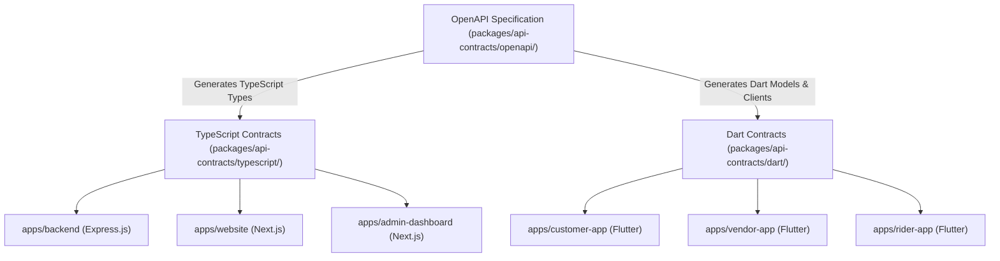

# Fillcart API Contracts (`packages/api-contracts/`)

This package houses the **language-neutral API contract architecture** for the Fillcart platform.

Because the Fillcart ecosystem encompasses multiple programming languages (Dart for Flutter mobile apps, TypeScript for Next.js web applications and the Express backend), language-specific interfaces alone cannot serve as the universal contract.

---

## 1. Architectural Architecture

```text
packages/api-contracts/
├── openapi/                        # Canonical, language-neutral API specifications
│   ├── README.md
│   └── v1/                         # Version 1 OpenAPI specifications
│       └── README.md
├── typescript/                     # TypeScript API contracts & generated types
│   └── src/
│       ├── auth/
│       ├── deliveries/
│       ├── orders/
│       ├── products/
│       ├── users/
│       └── vendors/
├── dart/                           # Dart API models & clients for Flutter apps
│   └── README.md
└── README.md                       # Contract architecture documentation
```

---

## 2. Triple-Tier Contract Model



1. **OpenAPI as Single Source of Truth**:
   The OpenAPI specification in `packages/api-contracts/openapi/` is the authoritative source for all REST APIs. No endpoint or DTO is created without first reflecting in this specification.

2. **TypeScript Generation & Alignment**:
   `packages/api-contracts/typescript/` houses TypeScript request/response contracts, DTO interfaces, and endpoint path constants derived from OpenAPI specifications. These are consumed directly by the Express backend and Next.js frontends.

3. **Dart Generation & Alignment**:
   `packages/api-contracts/dart/` reserves the location for Dart models and client stubs compiled from the OpenAPI specifications for consumption by all three Flutter mobile applications.

---

## 3. Relationship with `packages/shared-types/`

- **`packages/api-contracts/`**: Governs network boundaries, HTTP request/response payloads, query parameters, route contracts, and serialized data transfer objects across languages.
- **`packages/shared-types/`**: Contains shared pure TypeScript domain entity models, database-layer interfaces, and utility types shared internally between Node.js and Next.js applications that are not bound to HTTP transport contracts.
